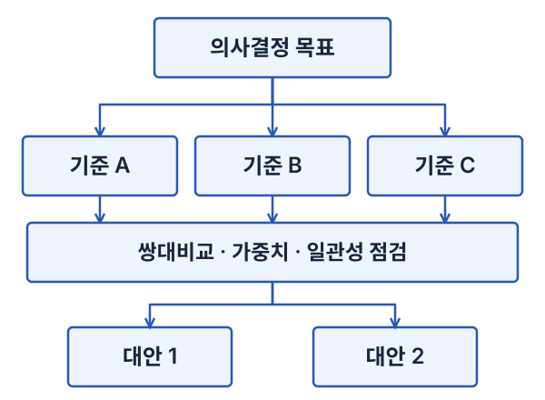

## 먼저 이해하기

클라우드 업체를 고를 때 가격만 볼 수 없다. 보안·성능·지원도 중요하지만 서로 단위가 다르다. AHP는 판단 기준을 나눈 뒤 “보안과 가격 중 어느 쪽이 얼마나 중요한가”처럼 두 개씩 비교하여 복잡한 판단을 작은 질문으로 바꾼다.

## 답안에 남길 핵심

**정의:** AHP(Analytic Hierarchy Process)는 의사결정 문제를 목표·평가기준·대안의 계층으로 구성하고, 쌍대비교로 상대적 중요도와 우선순위를 도출하며 판단의 일관성을 점검하는 다기준 의사결정 기법이다.

**회상 단서:** 계층화 · 쌍대비교 · 가중치 · 일관성 · 종합 우선순위 · 민감도

## 개념도

<figure class="concept-diagram">

<figcaption><strong>AHP의 목표·기준·대안과 평가</strong> 자료의 구조·설명을 바탕으로 직접 재구성한 학습용 SVG. <a href="/assets/subnotes/concepts/ahp.svg" target="_blank" rel="noopener">그림 크게 보기</a></figcaption>
</figure>

**읽는 법:** 목표·기준·대안의 계층을 평가 활동과 함께 요약했다. 비교는 같은 수준에서 수행하고 기준별 대안 평가를 가중 합산한다.

**손으로 그리기:** 맨 위 목표 → 기준 세 칸 → 쌍대비교·가중치·일관성 점검 → 아래 대안 두 칸.

개념도 참고: <a href="https://itpe.co.kr/main/portal/selectPortalContent.do?topicId=39">ITPE 지식관리 · AHP 계층구조</a> · <a href="https://www.inderscience.com/info/e_inarticle.php?artid=17590">Saaty · Decision making with the analytic hierarchy process</a>. 확인: 2026-11-22. 원문 구조·설명을 검토하여 핵심 관계만 직접 재구성한 학습용 도식. 원본 이미지는 전재하지 않음.

## 핵심 구조와 답안 포인트

| 활동 | 핵심 질문 | 산출·점검 |
| --- | --- | --- |
| 계층 구성 | 목표·기준·하위기준·대안은 무엇인가? | 같은 수준 항목의 의미·중복 점검 |
| 쌍대비교 | 두 항목 중 무엇이 얼마나 중요한가? | 비교행렬, 판단의 근거 |
| 가중치 도출 | 상대 중요도가 얼마나 되는가? | 기준·대안의 국지 우선순위 |
| 일관성 검토 | 판단끼리 모순이 크지 않은가? | CI·CR, 필요 시 재판단 |
| 종합·분석 | 기준 가중치를 합치면 어떤 대안이 앞서는가? | 종합 순위와 민감도 |

**계산의 뼈대:** 비교행렬에서 상대 우선순위를 구하고 상위 기준의 가중치를 대안의 국지 우선순위에 곱해 합산한다. 일관성 검토에는 CI=(λmax−n)/(n−1), CR=CI/RI를 사용한다. n은 비교 항목 수, RI는 같은 크기의 무작위 비교 기준값이다. 숫자만 쓰지 말고 각 기호의 역할을 설명한다.

## 가리고 설명하기

본문을 덮고 먼저 내 말로 답한다.

1. 단순 가중평가표와 구분되는 AHP의 핵심은?
2. CR이 낮으면 선택이 객관적으로 참이라고 할 수 있을까?

내 답과 비교할 기준

**1.** 문제를 계층화하고 같은 수준의 항목을 쌍대비교하여 상대 가중치를 도출하며 판단의 일관성을 확인하는 점이다.

**2.** 아니다. 비교 판단끼리 모순이 적다는 뜻이지 기준의 타당성이나 입력의 사실성을 보증하지는 않는다.

## 상황에 적용하기

전문가가 A는 B보다 중요하고, B는 C보다 중요하지만 C는 A보다 훨씬 중요하다고 판단했다. 계산 결과를 그대로 확정할까?

풀이와 판단 근거

판단의 일관성을 점검하고 비교 기준과 맥락을 다시 확인한다. 단순 입력 오류인지, 항목 정의가 겹쳤는지, 비교 시 다른 가정을 사용했는지 묻는다. 수정은 원하는 업체를 이기게 만드는 작업이 아니라 근거 있는 판단을 회복하는 과정이다. 기준 가중치가 조금 달라져도 순위가 유지되는지 민감도도 살핀다.

## 헷갈리지 않기

자주 쓰는 1~9 척도와 CR 0.1 수준은 널리 사용하는 관례이지만 모든 사업에 자동으로 적용되는 법정 합격선은 아니다. 조직·방법론의 기준을 먼저 확인한다. 표본이 많다는 이유만으로 편향·기준 누락·잘못된 계층구조가 사라지지 않는다.

## 셀프테스트 범위와 출처

- **기본 33번.** 확정 숙제 32개와 구분하여 추가한 셀프테스트 보완 노트다.
- [151기 셀프테스트 공지와 첨부 문제지](https://cafe.naver.com/81th/243521). 문제지의 출제 예상 표현은 강사의 의견이며 실제 출제를 확정하지 않는다.
- [ITPE 지식관리 · AHP](https://itpe.co.kr/main/portal/selectPortalContent.do?topicId=39)
- [ITPE 지식관리 · AHP 계층구조](https://itpe.co.kr/main/portal/selectPortalContent.do?topicId=39)
- [Saaty · Decision making with the analytic hierarchy process](https://www.inderscience.com/info/e_inarticle.php?artid=17590)
- 확인일: 2026-11-22. 아래 설명과 사례는 개인 학습용으로 재구성했으며 원문 도표를 전재하지 않았다.
