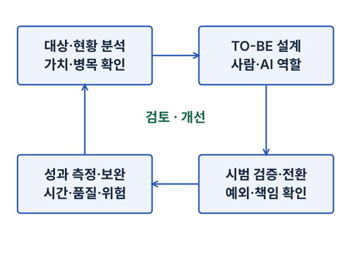

## 먼저 이해하기

반품 신청 하나에 상담원 입력, 부서 확인, 관리자 승인, 회계 재입력을 거친다. 입력만 AI로 빨라져도 불필요한 승인과 대기는 그대로 남는다. AI 기반 BPR은 고객이 원하는 결과에서 출발해 중복 확인을 줄이고, 판단 규칙·담당자·데이터 흐름을 새로 설계하는 일이다. 예외·고위험 건은 사람이 확인하도록 남길 수 있다.

## 답안에 남길 핵심

**정의:** AI 기반 BPR(Business Process Reengineering)은 비용·품질·서비스·속도 등 성과의 큰 개선을 위해 업무 프로세스를 근본적으로 재검토·재설계하고, AI의 인식·예측·생성·추론 기능을 업무·의사결정·사람의 역할에 통합하는 접근이다.

**회상 단서:** 고객 가치 · AS-IS · TO-BE · 업무 통합·제거 · Human-AI 협업 · 성과 검증

## 개념도

<figure class="concept-diagram">

<figcaption><strong>AI 기반 BPR의 재설계·검증 순환</strong> 자료의 구조·설명을 바탕으로 직접 재구성한 학습용 SVG. <a href="/assets/subnotes/concepts/ai-bpr.svg" target="_blank" rel="noopener">그림 크게 보기</a></figcaption>
</figure>

**읽는 법:** 화살표는 설계·검증의 반복이다. 단계를 빠르게 실행하는 것과 업무 구조 자체를 바꾸는 것은 다르다.

**손으로 그리기:** 네 상자에 현황·설계·검증·보완을 적고 순환 화살표로 잇는다.

개념도 참고: <a href="https://itpe.co.kr/main/portal/selectPortalContent.do?topicId=10">ITPE 지식관리 · BPR</a>. 확인: 2026-11-22. BPR 원본 순환도에 교재 PDF 75쪽의 AI 협업·데이터 기반 의사결정 요소를 연결해 직접 재구성함.

## 무엇을 바꾸고 무엇을 확인할까

| 관점 | 재설계 질문 | AI 활용과 확인할 것 |
| --- | --- | --- |
| 고객·성과 | 어떤 결과를 더 빠르고 정확하게 제공할까? | 처리시간·오류율·고객 경험의 기준선 |
| 현재 흐름 | 어디서 재입력·대기·재작업이 생기나? | 로그·문서에서 병목과 예외 추출 |
| 목표 흐름 | 없애거나 통합할 업무와 권한은? | 분류·예측·초안 작성, 사람의 승인·이의제기 경로 |
| 실행·검증 | 새 흐름이 실제로 더 나은가? | 제한된 시범 적용, 품질·비용·위험 함께 비교 |

추진 흐름은 **대상·목표 설정 → AS-IS 분석 → AI 적용을 포함한 TO-BE 설계 → 시범 검증·전환 → 성과 측정·보완**으로 설명할 수 있다. 이는 원본 BPR 순환과 AI 협업 요소를 묶은 학습용 정리다. 실제 사업의 정해진 단계명이 있다면 그 명칭을 우선한다.

BPR은 역할·규정·책임까지 바꾸는 조직의 일이다. 모델을 도입했다는 사실보다 불필요한 업무가 줄고 고객 결과가 나아졌는지를 본다.

## 가리고 설명하기

자료를 덮고 말하거나 빈 종이에 적는다. 정답을 열기 전에 두 질문에 먼저 답한다.

1. 기존 승인 절차에 AI 입력 도구만 붙이면 BPR이라고 할 수 있을까?
2. AI가 판단하는 업무와 사람이 책임지는 지점은 어떻게 정할까?

내 답과 비교할 기준

**1.** 일부 자동화일 수 있다. 프로세스의 목적·순서·역할·중복·의사결정까지 재검토했는지 보여야 BPR의 의도가 드러난다.

**2.** 영향·불확실성·규제·오류 비용을 보고 권한과 예외 기준을 정한다. 고위험 결정의 사람 검토, 기록, 이의제기와 실패 시 대체 절차를 둔다.

## 상황에 적용하기

보험 청구 심사를 모두 AI에 맡기면 심사시간이 절반으로 줄지만, 잘못 거절한 청구를 정정하기 어렵다. 어떤 TO-BE가 더 적절할까?

풀이와 판단 근거

자료 추출·중복 검사·저위험 건 분류는 AI가 돕고, 거절·고위험·불확실한 건은 담당자가 근거를 확인하도록 설계한다. 고객의 정정·이의제기와 감사 기록을 포함한다. 시간 단축뿐 아니라 오류·재심률·고객 피해를 함께 검증한다.

## 헷갈리지 않기

BPR을 인원 감축이나 RPA 도입과 같은 말로 쓰지 않는다. AI가 만든 설명이 항상 사실이라는 전제도 금물이다. 기존 절차를 빠르게 반복하면 비효율을 더 빨리 확산할 수 있다. [AX](/subnotes/notes/ax-transformation/)는 조직 전환의 큰 범위이고 BPR은 그 안에서 업무 흐름을 재설계하는 접근으로 연결할 수 있다.

## 셀프테스트 범위와 출처

- **셀프테스트 추가 범위:** 기본 2번 · AI 기반 업무 프로세스 재설계. 확정 숙제 32개에 새 숙제 번호를 붙이는 것이 아니라 문제지의 추가 주제를 별도로 보완한다.
- [ITPE 151기 셀프테스트 공지·문제지](https://cafe.naver.com/81th/243521). 문제 번호는 로컬 보관 PDF와 대조했다. 문제지의 출제 예상 표현은 실제 출제 확정을 뜻하지 않는다.
- [ITPE 지식관리 · BPR](https://itpe.co.kr/main/portal/selectPortalContent.do?topicId=10).
- ITPE 『IT경영전략 V10.13 Part I』 PDF 75쪽의 AI 기반 BPR 도입 효과를 대조했다.

확인일: 2026-11-22. 원문 도표를 전재하지 않고 개인 학습용 설명과 그림으로 재구성했다. 학습 여부는 가리고 설명·비교·적용하는 답변으로 확인한다.
