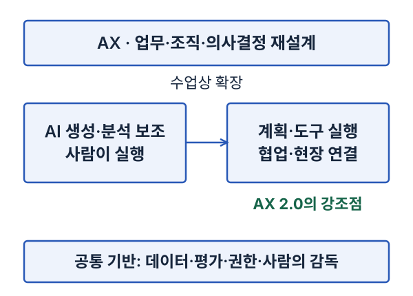

## 먼저 이해하기

챗봇 하나를 설치했다고 조직의 일하는 방식이 모두 바뀌지는 않는다. 어떤 업무를 AI와 나누고, 어떤 데이터로 판단하며, 누가 결과를 승인할지 정해야 전환이 된다.

## 답안에 남길 핵심

**정의:** AX(AI Transformation)는 AI를 활용하여 조직의 업무·제품·서비스와 의사결정 방식을 재설계하는 전환이다. 이 노트의 AX 2.0은 ITPE 지식관리에서 설명하는 추론·계획·실행·협업 중심 전환의 용례다.

**회상 단서:** 업무 재설계 · 데이터 · 모델·에이전트 · 사람·통제 · 성과

## 개념도

<figure class="concept-diagram">

<figcaption><strong>AX와 수업상 AX 2.0의 전환 구조</strong> 자료의 구조·설명을 바탕으로 직접 재구성한 학습용 SVG. <a href="/assets/subnotes/concepts/ax-transformation.svg" target="_blank" rel="noopener">그림 크게 보기</a></figcaption>
</figure>

**읽는 법:** AX 2.0은 이 수업과 지식관리의 설명 틀이다. 보편적으로 확정된 표준 단계·버전으로 쓰지 않는다.

**손으로 그리기:** 전체 AX 상자 → 보조에서 실행·협업으로 → 아래 공통 감독 기반.

개념도 참고: <a href="https://itpe.co.kr/main/portal/selectPortalContent.do?topicId=1782">ITPE 지식관리 · AX 2.0</a>. 확인: 2026-11-22. 핵심 관계만 남긴 학습용 재구성. 원본 이미지를 전재하지 않음.

## 전환의 흐름과 AX 2.0

| 비교 | AI 보조·자동화 중심 | ITPE의 AX 2.0 용례 |
| --- | --- | --- |
| 역할 | 생성·분석·개별 업무 보조 | 추론·계획·도구 실행·협업 |
| 예 | 문의 답변 초안 | 권한 범위 안의 조회·처리·검증 |
| 통제 | 출력 검토·품질·정보 보호 | 행동 권한·승인·감사·중지 추가 |

성공 전략은 과제 가치·데이터 품질·평가 기준·담당자·운영 위험을 함께 설계하는 것이다. 피지컬 AI처럼 현실에 행동하는 경우 안전 검증도 중요하다.

**용어 범위:** AX 2.0은 보편적인 국제표준의 버전명이 아니다. 자료·기관마다 의미가 다르므로 정의와 출처를 먼저 밝힌다.

## 가리고 설명하기

본문을 위로 올려 가린 뒤, 말하거나 빈 종이에 적는다. 정답을 읽기 전에 답한다.

1. DX와 AX를 항상 배타적인 단계로 나눌 수 있을까?
2. 에이전트가 행동할수록 무엇을 추가 통제해야 하나?

내 답과 비교할 기준

**1.** 아니다. 디지털 전환 안에서 AI 기반 전환이 중첩될 수 있다. 설명 목적과 정의를 밝힌다.

**2.** 도구·데이터 권한, 승인 경계, 결과 검증, 감사 로그, 중지·복구·책임을 통제한다.

## 상황에 적용하기

AI가 환불을 자동 실행하게 하려 한다. 답변 정확도만 평가하면 충분할까?

풀이와 판단 근거

환불 대상 확인·금액 한도·권한·중복 처리·승인·로그·취소·오류 복구도 평가한다. 낮은 위험 범위부터 실증하고 사람의 개입 조건과 책임을 정한다.

## 헷갈리지 않기

수업 메모에는 AX 강조만 있고 “2.0”의 별도 설명은 확인되지 않았다. 2.0 내용은 최종 숙제에 맞춰 ITPE 지식관리로 보완했다. 자율성 확대를 무제한 권한 부여로 해석하지 않는다.

## 수업 범위와 출처

- **최종 숙제 32/32:** AX/AX2.0.
- **수업 메모의 강조 수준:** AX 출제 강조 / 2.0 메모 미확인. AX는 강조. AX 2.0이라는 별도 명칭·범위는 메모에 없음. 최종 숙제에는 포함.
- 출제 관련 표현은 2026.11.21 수업에서 기록한 강사의 의견이다. 실제 출제 확정이나 미출제 이력의 독립 검증을 뜻하지 않는다.
- ITPE 『IT경영전략 V10.13 Part I』, PDF 파일 기준 418~421 및 별도 ITPE AX 2.0 지식관리쪽을 참고하여 개인 학습용으로 재구성했다. 교재 원문·도표를 전재하지 않았다.
- [ITPE · AX 2.0](https://itpe.co.kr/main/portal/selectPortalContent.do?topicId=1782). 추론·계획·실행·협업 중심 용례 확인(2026.11.22).

함께 보기: [신경망](/subnotes/notes/neural-network/) · [IT 거버넌스](/subnotes/notes/it-governance/) · [MES](/subnotes/notes/mes/)

읽은 뒤에는 [내 것으로 만드는 복습법](/subnotes/notes/mastery-method/)에 따라 다른 날 다시 설명해본다. 이 노트가 있다는 사실만으로 학습 완료·점수가 기록되지는 않는다.
