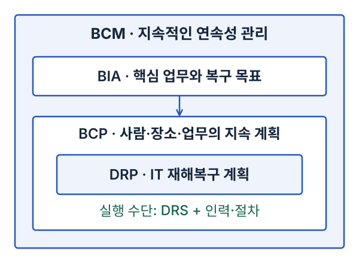

## 먼저 이해하기

센터에 불이 났다. 서버를 살렸어도 직원이 출근할 곳과 고객에게 알릴 방법이 없다면 업무는 계속되지 않는다. BCM은 이런 빈틈까지 평소에 관리하는 일이다.

## 답안에 남길 핵심

**정의:** BCM(Business Continuity Management)은 중단 사고의 영향을 분석하고, 핵심 업무를 허용 가능한 수준으로 지속·복구하도록 전략·계획·훈련·개선을 운영하는 관리 활동이다.

**회상 단서:** BIA → 전략 → BCP·DRP → 훈련 → 개선

## 개념도

<figure class="concept-diagram">

<figcaption><strong>BCM의 관리 범위와 계획의 포함관계</strong> 자료의 구조·설명을 바탕으로 직접 재구성한 학습용 SVG. <a href="/assets/subnotes/concepts/bcm.svg" target="_blank" rel="noopener">그림 크게 보기</a></figcaption>
</figure>

**읽는 법:** 상자는 관리 범위와 계획의 포함관계다. BCM은 관리 활동이고 BCMS는 이를 운영하는 경영시스템이다.

**손으로 그리기:** 큰 관리 상자 → BIA → BCP 상자 → 안에 DRP → 아래 실행 수단.

개념도 참고: <a href="https://itpe.co.kr/main/portal/selectPortalContent.do?topicId=78">ITPE 지식관리 · BCP·BCM</a> · <a href="https://cafe.naver.com/81th/242153">ITPE 카페 · BCMS·BCP·DRP 관계도</a>. 확인: 2026-11-22. 핵심 관계만 남긴 학습용 재구성. 원본 이미지를 전재하지 않음.

## 관계를 한 장으로

| 단계 | 실제로 정할 것 |
| --- | --- |
| 영향 분석 | 핵심 업무·의존 자원·복구 우선순위 |
| 전략·계획 | 대체 근무지·대체 인력·IT 복구·비상 연락 |
| 실행 준비 | 역할과 책임, 교육, 백업·대체 자원 |
| 검증·개선 | 실제 복구시간과 데이터 손실을 확인하고 계획 수정 |

## 가리고 설명하기

본문을 위로 올려 가린 뒤, 말하거나 빈 종이에 적는다. 정답을 읽기 전에 답한다.

1. BCM·BCP·DRP·DRS의 역할을 구분해보자.
2. 서버 이중화만으로 BCM이 완성되지 않는 이유는?

내 답과 비교할 기준

**1.** BCM은 관리 활동, BCP는 업무 지속 계획, DRP는 IT 재해복구 계획, DRS는 이를 실현하는 시스템·기술 체계다.

**2.** 인력·사업장·협력사·연락망·업무 절차가 함께 준비되어야 실제 업무를 재개할 수 있다.

## 상황에 적용하기

주문 서버는 정상인데 물류센터가 침수됐다. BCM 담당자는 무엇을 확인해야 할까?

풀이와 판단 근거

주문 접수를 계속할 최소 수준, 대체 물류 거점, 직원 안전·배치, 배송 협력사, 고객 안내, 주문 적체 처리 순서를 확인한다. IT 복구만 완료했다고 업무연속성을 달성한 것은 아니다.

## 헷갈리지 않기

BCM을 “무중단 서버 구축”으로 축소하지 않는다. 재난 중에도 모든 업무를 평소와 똑같이 유지한다는 뜻이 아니라, 우선 업무를 정해 합의한 수준으로 지속·복구하는 것이다.

## 수업 범위와 출처

- **최종 숙제 01/32:** BCM.
- **수업 메모의 강조 수준:** 출제·암기 강조. 업무연속성 묶음에서 암기 지시.
- 출제 관련 표현은 2026.11.21 수업에서 기록한 강사의 의견이다. 실제 출제 확정이나 미출제 이력의 독립 검증을 뜻하지 않는다.
- ITPE 『IT경영전략 V10.13 Part I』, PDF 파일 기준 294~301쪽을 참고하여 개인 학습용으로 재구성했다. 교재 원문·도표를 전재하지 않았다.

함께 보기: [BIA](/subnotes/notes/bia/) · [DRP](/subnotes/notes/drp/) · [ISO 22301](/subnotes/notes/iso-22301/)

읽은 뒤에는 [내 것으로 만드는 복습법](/subnotes/notes/mastery-method/)에 따라 다른 날 다시 설명해본다. 이 노트가 있다는 사실만으로 학습 완료·점수가 기록되지는 않는다.
