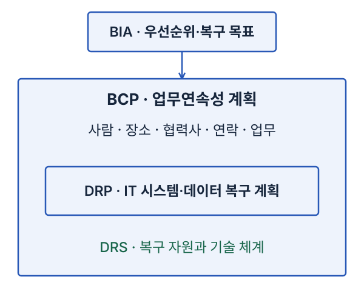

## 먼저 이해하기

센터 정전으로 서버는 복구센터에서 살아났지만 상담원은 접속 계정이 없고 고객 안내 문구도 없다. IT 복구는 됐어도 주문·상담 업무는 재개되지 않는다. BCP는 사람·장소·협력사·연락·IT를 함께 준비해 핵심 업무를 합의한 수준으로 이어가도록 정하는 계획이다.

## 답안에 남길 핵심

**정의:** BCP(Business Continuity Plan)는 업무 중단 사고에 대응해 우선 업무를 정해진 수준으로 지속·재개·복구하도록 역할·자원·절차·연락과 운영 방안을 문서화한 업무연속성 계획이다. DRP는 그중 IT 시스템·서비스·데이터의 재해복구에 초점을 둔다.

**회상 단서:** 핵심 업무 · BIA·위험평가 · 대체 인력·장소 · 연락·자원 · DRP · 훈련·현행화

## 개념도

<figure class="concept-diagram">

<figcaption><strong>BCP의 업무 범위와 그 안의 IT 복구</strong> 자료의 구조·설명을 바탕으로 직접 재구성한 학습용 SVG. <a href="/assets/subnotes/concepts/bcp.svg" target="_blank" rel="noopener">그림 크게 보기</a></figcaption>
</figure>

**읽는 법:** 큰 업무 지속 계획 안에 IT 복구 계획이 있다. IT 복구 결과도 실제 업무 재개로 검증해야 한다.

**손으로 그리기:** 위 BIA → 아래 큰 BCP 상자 → 그 안에 업무 요소와 DRP → 아래 DRS 실행 수단.

개념도 참고: <a href="https://itpe.co.kr/main/portal/selectPortalContent.do?topicId=78">ITPE 지식관리 · BCP·BCM</a> · <a href="https://itpe.co.kr/main/portal/selectPortalContent.do?topicId=80">ITPE 지식관리 · DRP</a> · <a href="https://cafe.naver.com/81th/242153">ITPE 카페 · BCP·DRP 관계도</a>. 확인: 2026-11-22. BCP·DRP 관계도와 지식관리 구성요소를 대조해 재구성. BCM 활동과 계획 문서의 범위를 구분함.

## BCP와 DRP를 같은 축에서 비교하기

| 비교 축 | BCP | DRP |
| --- | --- | --- |
| 질문 | 업무를 어떤 수준으로 어떻게 계속할까? | IT와 데이터를 어떻게 복구할까? |
| 범위 | 인력·장소·물류·협력사·고객·IT | 응용·서버·네트워크·데이터·복구환경 |
| 주요 내용 | 위기 대응, 비상 연락, 대체 업무·근무, 자원·책임 | 발동, 전환, 복원·정합성, 서비스 검증·원복 |
| 기준·검증 | 핵심 업무 수행과 최소 운영 수준 | RTO·RPO 충족 및 실제 서비스 복구 |
| 관계 | 전사 업무 지속 계획 | BCP와 연계되는 IT 복구 계획 |

수립 시에는 **계획·범위 확인 → BIA·위험평가 → 연속성 전략 → BCP 설계·문서화 → 훈련·검증 → 유지관리**로 연결해 설명할 수 있다. 이는 지식관리의 계·분·전·설·모·유 흐름을 풀어 쓴 것이다. 모든 업무를 무조건 평소 수준으로 유지하는 계획은 아니다.

BIA에서 무엇을 먼저 언제까지 살릴지 정한 뒤, 대체 장소·인력·장비·협력사와 연락 체계를 연결한다. 연락처·권한·업무·시스템이 바뀌면 문서를 현행화하고 훈련으로 실제 이용 가능성을 확인한다. BCM은 이 전체를 지속적으로 관리하는 활동이다.

## 가리고 설명하기

자료를 덮고 말하거나 빈 종이에 적는다. 정답을 열기 전에 두 질문에 먼저 답한다.

1. 서버 복구 완료를 업무연속성 확보와 동일시할 수 없는 이유는?
2. BCM·BCP·DRP·DRS를 각각 한 문장으로 구분해보자.

내 답과 비교할 기준

**1.** 직원·계정·장소·절차·협력사·고객 안내 등 업무 수행 조건이 함께 갖춰져야 한다. IT 가동은 그중 한 조건이다.

**2.** BCM은 지속적 관리, BCP는 업무 지속 계획, DRP는 IT 재해복구 계획, DRS는 복구를 구현할 시스템·기술 체계다.

## 상황에 적용하기

감염병으로 주요 상담센터 직원 절반이 출근하지 못한다. BCP와 DRP 중 어느 부분을 먼저 확인할까?

풀이와 판단 근거

우선 상담 우선순위와 최소 운영 수준, 대체 인력·근무지·재택 접속·교육·고객 안내 등 BCP의 업무 지속 대안을 확인한다. IT 자체 장애가 없다면 DR센터 전환이 핵심 대책은 아닐 수 있다. 필요한 IT 지원은 BCP와 연계해 준비한다.

## 헷갈리지 않기

BCP를 BCM이라는 경영시스템 전체와 섞거나, 백업 문서 한 장으로 축소하지 않는다. BCP와 DRP의 포함관계는 책임·범위의 관계이며 재난 때 BCP가 모두 끝나야 DRP를 시작한다는 직렬 순서가 아니다. [BCM](/subnotes/notes/bcm/)·[DRP](/subnotes/notes/drp/)와 연결해 복습한다.

## 셀프테스트 범위와 출처

- **셀프테스트 추가 범위:** 기본 25번 · BCP와 DRP 비교. 확정 숙제 32개에 새 숙제 번호를 붙이는 것이 아니라 문제지의 추가 주제를 별도로 보완한다.
- [ITPE 151기 셀프테스트 공지·문제지](https://cafe.naver.com/81th/243521). 문제 번호는 로컬 보관 PDF와 대조했다. 문제지의 출제 예상 표현은 실제 출제 확정을 뜻하지 않는다.
- [ITPE 지식관리 · BCP·BCM](https://itpe.co.kr/main/portal/selectPortalContent.do?topicId=78).
- [ITPE 지식관리 · DRP](https://itpe.co.kr/main/portal/selectPortalContent.do?topicId=80).
- [ITPE 카페 · BCP·DRP 관계도](https://cafe.naver.com/81th/242153).

확인일: 2026-11-22. 원문 도표를 전재하지 않고 개인 학습용 설명과 그림으로 재구성했다. 학습 여부는 가리고 설명·비교·적용하는 답변으로 확인한다.
