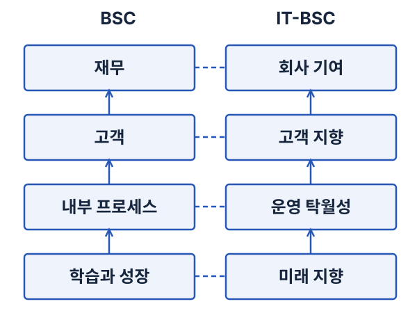

## 먼저 이해하기

매출이 늘었다고 미래도 안전할까? 고객 불만과 장애가 쌓이고 직원 역량이 줄어들면 다음 성과는 나빠질 수 있다. BSC는 결과 지표와 그 결과를 만드는 원인을 함께 보는 도구다.

## 답안에 남길 핵심

**정의:** BSC(Balanced Scorecard)는 조직의 전략을 재무·고객·내부 프로세스·학습과 성장 관점의 목표와 지표로 구체화하는 성과관리 체계다. IT-BSC는 이를 IT의 사업 기여와 서비스·역량 평가에 맞게 적용한다.

**회상 단서:** BSC 재고내학 / IT-BSC 회고운미

## 개념도

<figure class="concept-diagram">

<figcaption><strong>BSC와 IT-BSC의 전략 가설</strong> 자료의 구조·설명을 바탕으로 직접 재구성한 학습용 SVG. <a href="/assets/subnotes/concepts/bsc-it-bsc.svg" target="_blank" rel="noopener">그림 크게 보기</a></figcaption>
</figure>

**읽는 법:** 아래 역량이 위 성과에 기여한다는 전략 가설이다. 실제 인과관계와 KPI는 검증해야 한다.

**손으로 그리기:** 좌우 네 칸을 쌓고 아래에서 위로 화살표 → 같은 높이끼리 점선 대응.

개념도 참고: <a href="https://itpe.co.kr/main/portal/selectPortalContent.do?topicId=8">ITPE 지식관리 · BSC·IT-BSC</a>. 확인: 2026-11-22. BSC 구성도에 기존 노트의 IT-BSC 관점을 대응시켜 재구성. 점선은 기능적 대응이며 동일 개념이라는 뜻은 아님.

## 네 관점과 지표 예시

| BSC 관점 | 질문 | 지표 예시 |
| --- | --- | --- |
| 재무 | 어떤 경제적 성과가 났나? | 이익률·비용 절감 |
| 고객 | 고객에게 어떤 가치를 주나? | 만족도·재구매율 |
| 내부 프로세스 | 업무가 얼마나 잘 수행되나? | 처리시간·불량률 |
| 학습과 성장 | 미래를 위한 역량이 쌓이나? | 핵심 역량·지식 공유 |

| IT-BSC 관점 | 대응 지표 예시 |
| --- | --- |
| 회사 기여 | IT 투자 편익, 사업 목표 달성 기여 |
| 고객 지향 | 내부 사용자 만족도, 서비스 경험 |
| 운영 탁월성 | 가용성, 장애 복구시간, 변경 성공률 |
| 미래 지향 | 기술 역량, 부채 개선, 혁신 준비 |

인과관계는 전략 가설이므로 실제 데이터로 확인한다.

## 가리고 설명하기

본문을 위로 올려 가린 뒤, 말하거나 빈 종이에 적는다. 정답을 읽기 전에 답한다.

1. 재고내학과 회고운미를 각각 풀어보자.
2. 교육시간만 늘면 미래 역량이 좋아졌다고 할 수 있을까?

내 답과 비교할 기준

**1.** 재무·고객·내부 프로세스·학습과 성장 / 회사 기여·고객 지향·운영 탁월성·미래 지향.

**2.** 시간은 투입 지표다. 실제 기술 습득과 업무 적용도 함께 확인해야 한다.

## 상황에 적용하기

IT부서가 “서버 비용 20% 절감”만 보고한다. 균형을 위해 무엇을 함께 볼까?

풀이와 판단 근거

회사 기여의 비용 절감 외에 고객 만족·응답 경험, 운영 가용성·장애, 미래 역량·기술부채를 함께 본다. 비용을 줄이느라 품질과 역량을 훼손했는지 검증한다.

## 헷갈리지 않기

균형은 지표 개수를 똑같이 맞춘다는 뜻이 아니다. BSC는 조직 전체, IT-BSC는 IT 기여·운영·미래 역량에 초점이 있으며 KPI 목록만 나열하면 전략과의 연결이 빠진다.

## 수업 범위와 출처

- **최종 숙제 06/32:** BSC, IT-BSC.
- **수업 메모의 강조 수준:** 출제·암기 강조 / 출제 예상. BSC 재고내학 / IT-BSC 회고운미. IT-BSC는 미출제·숙제 예정·출제 예상으로 별도 명시.
- 출제 관련 표현은 2026.11.21 수업에서 기록한 강사의 의견이다. 실제 출제 확정이나 미출제 이력의 독립 검증을 뜻하지 않는다.
- ITPE 『IT경영전략 V10.13 Part I』, PDF 파일 기준 62~70쪽을 참고하여 개인 학습용으로 재구성했다. 교재 원문·도표를 전재하지 않았다.

함께 보기: [IT 거버넌스](/subnotes/notes/it-governance/) · [IT-ROI](/subnotes/notes/it-investment/)

읽은 뒤에는 [내 것으로 만드는 복습법](/subnotes/notes/mastery-method/)에 따라 다른 날 다시 설명해본다. 이 노트가 있다는 사실만으로 학습 완료·점수가 기록되지는 않는다.
