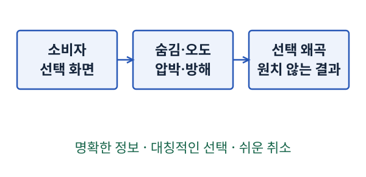

## 먼저 이해하기

가입 버튼은 크게 보이는데 해지는 여러 화면 안에 숨겨져 있다. 사용자가 충분히 알고 자유롭게 선택했다면 하지 않았을 행동을 유도하는 설계가 문제의 중심이다.

## 답안에 남길 핵심

**정의:** 다크패턴은 인터페이스와 절차를 기만적·조작적으로 설계하여 사용자의 자율적이고 충분한 정보에 근거한 선택을 왜곡하는 방식이다.

**회상 단서:** 편오방압 · 정보·동의 · 선택 대칭성 · 취소 용이성

## 개념도

<figure class="concept-diagram">

<figcaption><strong>다크패턴이 선택을 왜곡하는 경로</strong> 자료의 구조·설명을 바탕으로 직접 재구성한 학습용 SVG. <a href="/assets/subnotes/concepts/dark-patterns.svg" target="_blank" rel="noopener">그림 크게 보기</a></figcaption>
</figure>

**읽는 법:** 모든 설득 디자인이 다크패턴은 아니다. 충분한 정보와 자유로운 선택을 방해하는지 확인한다.

**손으로 그리기:** 화면 → 조작 요소 → 왜곡된 결과, 아래 대응 원칙 세 개.

개념도 참고: <a href="https://itpe.co.kr/main/portal/selectPortalContent.do?topicId=122">ITPE 지식관리 · 다크패턴</a>. 확인: 2026-11-22. 핵심 관계만 남긴 학습용 재구성. 원본 이미지를 전재하지 않음.

## 유형과 개선 예

| 수업 분류 | 사례 | 개선 설계 |
| --- | --- | --- |
| 편취형 | 결제 끝에서 추가 비용 공개 | 최종 지불 가격을 명확히 제시 |
| 오도형 | 광고를 일반 후기처럼 표시 | 광고·선택 의미 명확화 |
| 방해형 | 해지 절차 숨김·과도한 클릭 | 쉽게 찾는 해지·취소 경로 |
| 압박형 | 근거 없는 재고·시간 압박 | 사실에 근거한 정보·자유로운 선택 |

가입률만 높이는 설계와 신뢰를 지키는 설계를 구분한다. 자동 탐지는 보조 수단이며 실제 이용 흐름·사용자 이해를 함께 확인한다.

## 가리고 설명하기

본문을 위로 올려 가린 뒤, 말하거나 빈 종이에 적는다. 정답을 읽기 전에 답한다.

1. 버튼을 잘 보이게 만든 것은 모두 다크패턴일까?
2. 가입과 해지를 비교해 어떤 원칙을 점검할까?

내 답과 비교할 기준

**1.** 아니다. 기만·정보 은폐·선택 왜곡 여부를 맥락과 함께 봐야 한다.

**2.** 중요 정보의 명확성, 이해 가능한 동의, 선택·취소 경로의 과도한 비대칭을 점검한다.

## 상황에 적용하기

추가 보험이 기본 선택되어 있고 해제 방법을 작게 숨겼다. 어떻게 고칠까?

풀이와 판단 근거

선택 여부와 비용을 명확히 설명하고 사용자의 의도를 확인한다. 해제 경로를 쉽게 찾게 하고 실제로 선택하지 않은 항목이 청구되지 않는지 시험한다.

## 헷갈리지 않기

교재의 편오방압은 학습용 분류다. 법적 금지 유형과 자동으로 일대일 대응시키지 않는다. 국내외 특정 법안의 통과·시행을 교재 문구만으로 단정하지 않는다.

## 수업 범위와 출처

- **최종 숙제 29/32:** 다크패턴.
- **수업 메모의 강조 수준:** 출제 강조. 나옴이라고 명시.
- 출제 관련 표현은 2026.11.21 수업에서 기록한 강사의 의견이다. 실제 출제 확정이나 미출제 이력의 독립 검증을 뜻하지 않는다.
- ITPE 『IT경영전략 V10.13 Part I』, PDF 파일 기준 435~436쪽을 참고하여 개인 학습용으로 재구성했다. 교재 원문·도표를 전재하지 않았다.
- [FTC · Bringing Dark Patterns to Light](https://www.ftc.gov/reports/bringing-dark-patterns-light). 기만적 UI와 소비자 선택 침해 사례 참고. 이 노트는 개별 행위의 법률 판단을 하지 않는다.

함께 보기: [구독경제](/subnotes/notes/subscription-economy/) · [IT 컴플라이언스](/subnotes/notes/it-compliance/)

읽은 뒤에는 [내 것으로 만드는 복습법](/subnotes/notes/mastery-method/)에 따라 다른 날 다시 설명해본다. 이 노트가 있다는 사실만으로 학습 완료·점수가 기록되지는 않는다.
