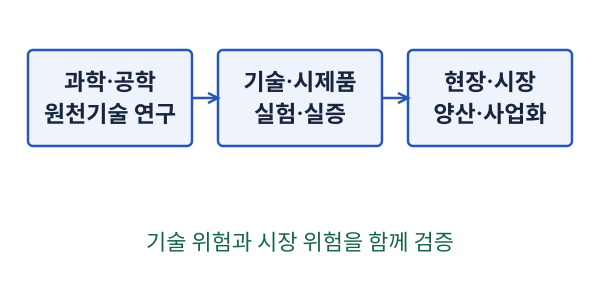

## 먼저 이해하기

앱 화면을 바꾸는 것과 새로운 배터리 소재를 개발하는 것은 불확실성의 종류가 다르다. 후자는 실험으로 성능을 입증하고 생산·인증·비용 문제를 넘어야 한다. 딥테크는 이런 과학·공학의 어려운 문제와 원천기술을 중심으로 혁신을 추구하는 영역이다.

## 답안에 남길 핵심

**정의:** 딥테크(Deep Tech)는 과학·공학의 연구 성과와 고난도 원천기술을 바탕으로 중요한 산업·사회 문제의 해결을 추구하는 기술 및 사업 영역이다.

**회상 단서:** 과학·공학 기반 · 기술 불확실성 · 장기 연구개발 · 실증 · 지식재산 · 사업화

## 개념도

<figure class="concept-diagram">

<figcaption><strong>딥테크의 연구·실증·사업화 연결</strong> 자료의 구조·설명을 바탕으로 직접 재구성한 학습용 SVG. <a href="/assets/subnotes/concepts/deep-tech.svg" target="_blank" rel="noopener">그림 크게 보기</a></figcaption>
</figure>

**읽는 법:** 연구 성공이 양산·시장 성공을 자동으로 보장하지 않는다. 각 단계의 근거를 확인한다.

**손으로 그리기:** 연구 → 기술·시제품 검증 → 사업화 세 칸을 잇는다.

개념도 참고: <a href="https://itpe.co.kr/main/portal/selectPortalContent.do?topicId=1318">ITPE 지식관리 · 딥테크 사업화</a>. 확인: 2026-11-22. 자료의 핵심 관계를 손으로 그릴 수 있도록 직접 재구성함.

## 핵심 구조와 비교

| 관점 | 확인 질문 | 대응 예 |
| --- | --- | --- |
| 기술 가능성 | 실험실 성능이 재현되는가? | 반복 실험·독립 검증·기술 단계 평가 |
| 실증·양산 | 현장과 생산 규모에서도 동작하는가? | 시제품·파일럿·수율·공급망 검토 |
| 시장 적합성 | 누구의 어떤 문제를 얼마나 개선하는가? | 고객 공동 실증·대체 수단 비교 |
| 자금·협력 | 긴 검증 기간을 버틸 역량이 있는가? | 단계별 투자·산학연·파트너 연계 |
| 보호·책임 | 무엇을 보호하고 어떤 위험을 관리할까? | 특허·영업비밀·안전·환경 검토 |

설명 문제에서는 기술 분야를 길게 나열하기보다 **기반–특징–검증–사업화**의 구조를 잡는다. 기술성만 강조하면 고객 가치와 생산·유통 조건을 놓치고, 수익성만 강조하면 연구개발과 실증의 불확실성을 놓친다. 두 위험을 분리해 검증하는 흐름을 보여준다.

## 가리고 설명하기

정답을 펼치기 전에 자료를 가리고, 정의와 그림을 내 말로 설명한다.

1. 딥테크와 단순히 최신 기술을 사용하는 서비스의 차이는?
2. 시제품이 성공하면 사업성도 입증됐다고 할 수 있을까?

내 답과 비교할 기준

**1.** 기술명의 새로움만이 아니라 과학·공학 기반의 난제, 원천기술과 검증 난도에 주목한다.

**2.** 아니다. 대량생산·비용·안전·고객 수용·사업 모델·자금 등은 별도의 검증이 필요하다.

## 상황에 적용하기

새로운 반도체 공정이 연구실에서 뛰어난 성능을 냈다. 바로 대규모 매출 목표를 확정해도 될까?

풀이와 판단 근거

성능 재현성, 수율·생산 비용·기존 설비 호환성, 고객 요구와 검증 기간을 확인한다. 단계별 실증 기준과 중단·보완 조건을 정하고 기술 위험과 시장 위험을 구분한다. 연구 성과와 사업화 성과를 같은 지표로 평가하지 않는다.

## 헷갈리지 않기

딥테크를 딥러닝과 같은 말로 쓰지 않는다. AI·양자·바이오·소재·로봇·반도체 등은 예시이며 분야 목록이 보편적으로 고정돼 있는 것은 아니다. 모든 AI 서비스가 같은 수준의 원천기술 사업인 것도 아니다.

## 셀프테스트 범위와 출처

- **셀프테스트 추가 범위:** 기본 50번. 확정 숙제 32개와 별도로 문제지에 포함된 주제다. 문제지에 실렸다는 사실과 강사의 출제 예상·암기 강조는 구분한다.
- [ITPE 151기 1~2주차 셀프테스트 공지와 첨부 문제지](https://cafe.naver.com/81th/243521). 원문을 전재하지 않고 질문의 요구에 맞춰 개인 학습용으로 정리했다.
- [ITPE 지식관리 · 딥테크 배경](https://itpe.co.kr/main/portal/selectPortalContent.do?topicId=1318)
- [ITPE 지식관리 · 딥테크 사업화](https://itpe.co.kr/main/portal/selectPortalContent.do?topicId=1318)
- 확인일: 2026-11-22. 개념도는 출처의 구조·설명을 바탕으로 직접 구성한 학습용 그림이다.
