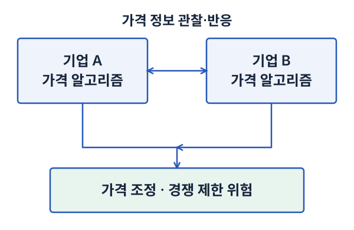

## 먼저 이해하기

가격을 자동 조정하는 도구는 효율을 높일 수 있다. 하지만 경쟁사가 합의한 가격을 실행하거나 민감정보를 공유하는 통로가 되면 경쟁 제한 문제가 생긴다. 자동화라는 이유로 책임이 사라지는 것은 아니다.

## 답안에 남길 핵심

**정의:** 디지털 카르텔은 디지털 기술·알고리즘을 이용해 경쟁자 사이의 가격 조정·정보 교환·감시 등 경쟁 제한적 협조가 형성·실행·유지되는 현상을 설명하는 개념이다.

**회상 단서:** 메허예자 · 합의·정보 교환 · 가격 알고리즘 · 감사·증거

## 개념도

<figure class="concept-diagram">

<figcaption><strong>디지털 카르텔의 가격 상호작용</strong> 자료의 구조·설명을 바탕으로 직접 재구성한 학습용 SVG. <a href="/assets/subnotes/concepts/digital-cartel.svg" target="_blank" rel="noopener">그림 크게 보기</a></figcaption>
</figure>

**읽는 법:** 그림은 위험의 개념 구조다. 가격 일치만으로 합의·위법성을 확정하지 않으며 유형별 증거를 확인한다.

**손으로 그리기:** 기업별 알고리즘 두 칸 → 관찰·반응 → 아래 경쟁 제한 위험.

개념도 참고: <a href="https://itpe.co.kr/main/portal/selectPortalContent.do?topicId=121">ITPE 지식관리 · 디지털 카르텔</a>. 확인: 2026-11-22. 핵심 관계만 남긴 학습용 재구성. 원본 이미지를 전재하지 않음.

## 수업의 네 유형

| 유형 | 핵심 구분 |
| --- | --- |
| Messenger | 이미 합의한 담합을 알고리즘으로 실행·감시 |
| Hub and Spoke | 공통 중개자·도구가 경쟁자 사이 조정을 매개 |
| Predictable Agent | 서로의 가격 행동을 예측·대응하며 협조적 결과 가능 |
| Autonomous Machine | 자율학습으로 협조적 결과가 생길 위험 |

대응은 알고리즘·데이터 출처·공급계약·변경·의사결정 로그를 점검하고 경쟁 민감정보의 부적절한 공유를 막는 것이다.

## 가리고 설명하기

본문을 위로 올려 가린 뒤, 말하거나 빈 종이에 적는다. 정답을 읽기 전에 답한다.

1. 가격이 함께 올랐다는 사실만으로 담합을 확정할 수 있을까?
2. 공통 가격 도구 사용 시 무엇을 볼까?

내 답과 비교할 기준

**1.** 아니다. 합의·정보 교환·시장 조건·행동 근거 등 추가 분석이 필요하다.

**2.** 민감정보 공유, 도구 운영자의 역할, 경쟁자 간 조정·인식, 계약·로그를 점검한다.

## 상황에 적용하기

여러 판매자가 같은 가격 추천 서비스를 이용한 뒤 가격이 비슷해졌다. 무엇을 조사할까?

풀이와 판단 근거

독립 의사결정인지, 비공개 경쟁정보가 공유됐는지, 공통 공급자가 가격을 조정했는지, 추천을 따를 의무와 합의가 있는지 검토한다. 결과 유사성만으로 위법을 확정하지 않는다.

## 헷갈리지 않기

교재의 “자율학습이므로 처벌 근거 부재” 같은 단정은 일반화하지 않는다. 법적 책임은 관할 법과 합의·관여·증거에 따라 달라지며 개별 법률 판단이 필요하다.

## 수업 범위와 출처

- **최종 숙제 30/32:** 디지털카르텔.
- **수업 메모의 강조 수준:** 출제 예상. 출제 예상이라고 명시.
- 출제 관련 표현은 2026.11.21 수업에서 기록한 강사의 의견이다. 실제 출제 확정이나 미출제 이력의 독립 검증을 뜻하지 않는다.
- ITPE 『IT경영전략 V10.13 Part I』, PDF 파일 기준 433~434쪽을 참고하여 개인 학습용으로 재구성했다. 교재 원문·도표를 전재하지 않았다.
- [OECD · Algorithms and Collusion](https://www.oecd.org/en/publications/algorithms-and-collusion-competition-policy-in-the-digital-age_258dcb14-en.html). 알고리즘과 경쟁 정책의 구분 참고.

함께 보기: [IT 컴플라이언스](/subnotes/notes/it-compliance/) · [AX](/subnotes/notes/ax-transformation/)

읽은 뒤에는 [내 것으로 만드는 복습법](/subnotes/notes/mastery-method/)에 따라 다른 날 다시 설명해본다. 이 노트가 있다는 사실만으로 학습 완료·점수가 기록되지는 않는다.
