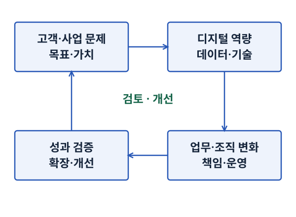

## 먼저 이해하기

종이 신청서를 PDF로 바꾸면 저장·전송은 쉬워진다. 그러나 고객이 같은 정보를 여러 번 입력하고 담당자가 부서마다 재확인한다면 업무의 핵심은 그대로다. 고객 여정과 데이터 흐름, 권한·절차를 다시 설계해 새로운 운영 방식과 가치를 만드는 것이 디지털 전환의 중심이다.

## 답안에 남길 핵심

**정의:** 디지털 전환(Digital Transformation, DX)은 디지털 역량을 활용해 고객 경험·업무 프로세스·사업 모델과 이를 지원하는 조직·문화를 지속적으로 변화시키는 경영적 전환이다.

**회상 단서:** 고객 가치 · 디지털 역량 · 업무 재설계 · 사업 모델 · 조직·문화 · 성과

## 개념도

<figure class="concept-diagram">

<figcaption><strong>DX의 가치·기술·운영 변화 연결</strong> 자료의 구조·설명을 바탕으로 직접 재구성한 학습용 SVG. <a href="/assets/subnotes/concepts/digital-transformation.svg" target="_blank" rel="noopener">그림 크게 보기</a></figcaption>
</figure>

**읽는 법:** 고객 가치와 사업 목표가 기술·업무·조직·측정을 연결한다.

**손으로 그리기:** 목표 → 역량 → 운영 변화 → 성과 네 칸을 순환으로 그린다.

개념도 참고: <a href="https://itpe.co.kr/main/portal/selectPortalContent.do?topicId=113">ITPE 지식관리 · DX 구성·추진</a>. 확인: 2026-11-22. 자료의 핵심 관계를 손으로 그릴 수 있도록 직접 재구성함.

## 핵심 구조와 비교

| 구분 | 중심 변화 | 예시 |
| --- | --- | --- |
| 디지털화·변환 | 아날로그 정보를 디지털 형태로 | 종이 문서를 전자 파일로 변환 |
| 업무의 디지털 활용 | 디지털 기술로 기존 업무 개선 | 전자결재·데이터 연계·자동화 |
| 디지털 전환 | 가치 제공과 운영·사업 방식의 변화 | 신청부터 심사·제공까지 고객 여정 재설계 |
| AX와 연결 | AI를 중심으로 판단·실행을 재설계 | AI 업무 지원과 권한·평가·책임 체계 |

지식관리의 추진 관점은 **비전 수립 → 조직·인재 → 거버넌스 → 비즈니스 모델 → 혁신·R&D**로 정리할 수 있다. 실제 사업에서는 고객·업무·데이터의 준비 수준을 평가하고 작은 실증을 통해 성과를 확인하며 확장한다. 이 보완 흐름은 운영을 위한 제안이며 모든 조직의 고정 표준 절차라는 뜻은 아니다.

## 가리고 설명하기

정답을 펼치기 전에 자료를 가리고, 정의와 그림을 내 말로 설명한다.

1. 클라우드로 이전했다는 사실만으로 DX 성공을 확정할 수 있을까?
2. DX에서 조직·문화가 기술만큼 중요한 이유는?

내 답과 비교할 기준

**1.** 아니다. 고객 가치·업무·운영·성과가 어떻게 바뀌었는지 확인해야 한다. 클라우드는 이를 지원하는 수단이다.

**2.** 부서 간 데이터 공유, 새로운 역할·의사결정, 학습과 변경 수용이 없으면 기술이 기존 방식 안에 갇힐 수 있기 때문이다.

## 상황에 적용하기

모든 부서가 같은 고객을 관리하지만 서로 다른 고객번호를 쓴다. AI 챗봇부터 붙이는 전환 계획을 평가해보자.

풀이와 판단 근거

고객 관점의 목표와 연결할 업무를 정하고, 식별·데이터 품질·공유 권한·업무 책임을 먼저 점검한다. 챗봇이 조회할 수 있는 정보와 처리 권한, 사람에게 넘길 조건을 설계한다. 도구 설치보다 고객의 반복 입력·처리시간·오류가 줄었는지를 측정한다.

## 헷갈리지 않기

DX를 기술 제품 목록이나 일회성 시스템 구축 프로젝트로 축소하지 않는다. 반대로 종이 업무의 전자화가 의미 없다는 뜻도 아니다. 현재 개선이 정보 형태·기존 업무·가치 모델 중 어느 층위에 있는지 설명한다.

## 셀프테스트 범위와 출처

- **셀프테스트 추가 범위:** 심화 3번. 확정 숙제 32개와 별도로 문제지에 포함된 주제다. 문제지에 실렸다는 사실과 강사의 출제 예상·암기 강조는 구분한다.
- [ITPE 151기 1~2주차 셀프테스트 공지와 첨부 문제지](https://cafe.naver.com/81th/243521). 원문을 전재하지 않고 질문의 요구에 맞춰 개인 학습용으로 정리했다.
- [ITPE 지식관리 · 디지털 전환](https://itpe.co.kr/main/portal/selectPortalContent.do?topicId=113)
- [ITPE 지식관리 · DX 구성·추진](https://itpe.co.kr/main/portal/selectPortalContent.do?topicId=113)
- 확인일: 2026-11-22. 개념도는 출처의 구조·설명을 바탕으로 직접 구성한 학습용 그림이다.
