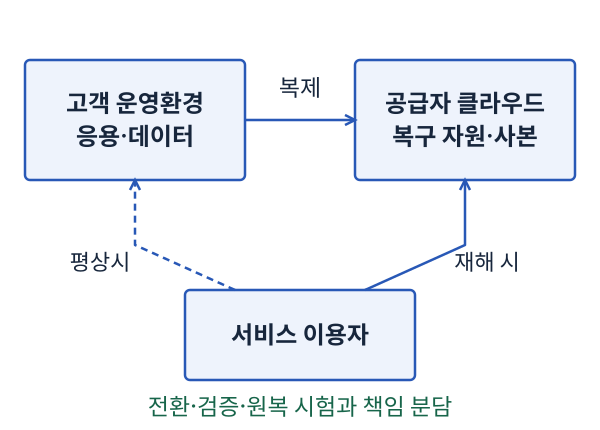

## 먼저 이해하기

별도 DR 센터를 모두 직접 마련하는 대신, 공급자의 복구 인프라와 운영 기능을 이용하는 방식이다. 평소 데이터를 복제해두고 재해가 나면 준비된 환경에서 서비스를 재개한다.

## 답안에 남길 핵심

**정의:** DRaaS(Disaster Recovery as a Service)는 IT 시스템과 데이터를 복제·보호하고 재해 시 복구 환경으로 전환하는 기능을 서비스 형태로 제공하는 모델이다.

**회상 단서:** 복제 · 복구 자원 · 오케스트레이션 · 전환 · RTO/RPO · 책임 분담

## 개념도

<figure class="concept-diagram">

<figcaption><strong>DRaaS의 복제와 재해 시 서비스 전환</strong> 자료의 구조·설명을 바탕으로 직접 재구성한 학습용 SVG. <a href="/assets/subnotes/concepts/draas.svg" target="_blank" rel="noopener">그림 크게 보기</a></figcaption>
</figure>

**읽는 법:** 복제 사본뿐 아니라 실제 서비스를 실행할 복구 자원과 전환 절차를 제공한다.

**손으로 그리기:** 좌우에 고객·공급자, 아래 이용자 → 복제 화살표 → 재해 시 접속 경로.

개념도 참고: <a href="https://itpe.co.kr/main/portal/selectPortalContent.do?topicId=81">ITPE 지식관리 · DR·BIA·DRaaS</a> · <a href="https://itpe.co.kr/main/portal/selectPortalContent.do?topicId=1251">ITPE 지식관리 · DRS</a>. 확인: 2026-11-22. DRaaS 설명·운영형태 표를 바탕으로 서비스 관계도를 직접 설계함. 점선은 평상시 접속 경로.

## 서비스 흐름

| 확인할 항목 | 확인 이유 |
| --- | --- |
| RTO·RPO | 계약 목표가 업무 요구를 충족하는가 |
| 전환·원복 시험 | 복구 후 실제 이용과 주센터 복귀가 가능한가 |
| 책임 분담 | 네트워크·계정·응용 변경은 누가 수행하는가 |
| 보안·보관 위치 | 접근권한, 암호화, 데이터 위치 요구를 만족하는가 |
| 전체 비용 | 복제 저장료뿐 아니라 전환·실행·전송 비용도 있는가 |

## 가리고 설명하기

본문을 위로 올려 가린 뒤, 말하거나 빈 종이에 적는다. 정답을 읽기 전에 답한다.

1. 일반 백업 서비스와 DRaaS를 구분하는 중심은?
2. DRaaS를 쓰면 복구훈련이 불필요할까?

내 답과 비교할 기준

**1.** 데이터 사본 보관을 넘어 서비스 실행에 필요한 복구 환경과 전환 절차를 제공하는지다.

**2.** 아니다. 응용 의존성·계정·네트워크·정합성을 포함한 실제 전환을 검증해야 한다.

## 상황에 적용하기

공급자가 “데이터는 안전하게 저장된다”고만 안내한다. 2시간 내 업무 재개 요구를 충족한다고 볼 수 있을까?

풀이와 판단 근거

저장만으로는 판단할 수 없다. 응용 실행 자원, 전환 절차, 네트워크 연결과 실제 복구시간을 확인해야 한다. 데이터 복제 지연과 RPO도 별도로 검증한다.

## 헷갈리지 않기

백업 보관과 업무 재개는 다르다. 공급자 장애·종속성도 검토하고, “클라우드이므로 자동으로 RPO=0”이라고 쓰지 않는다.

## 수업 범위와 출처

- **최종 숙제 03/32:** DRaaS.
- **수업 메모의 강조 수준:** 용어 암기. 단어 암기 지시. 독립 출제 강조로 확대하지 않음.
- 출제 관련 표현은 2026.11.21 수업에서 기록한 강사의 의견이다. 실제 출제 확정이나 미출제 이력의 독립 검증을 뜻하지 않는다.
- ITPE 『IT경영전략 V10.13 Part I』, PDF 파일 기준 314~322쪽을 참고하여 개인 학습용으로 재구성했다. 교재 원문·도표를 전재하지 않았다.

함께 보기: [DRS](/subnotes/notes/drs/) · [RTO](/subnotes/notes/rto/) · [RPO](/subnotes/notes/rpo/)

읽은 뒤에는 [내 것으로 만드는 복습법](/subnotes/notes/mastery-method/)에 따라 다른 날 다시 설명해본다. 이 노트가 있다는 사실만으로 학습 완료·점수가 기록되지는 않는다.
