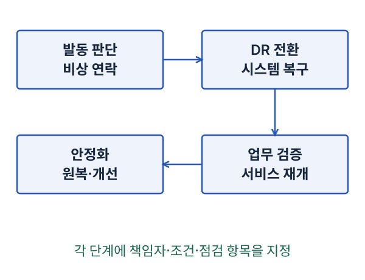

## 먼저 이해하기

재해가 나자 담당자마다 “누가 먼저 DB를 켜지?”라고 묻는다. 장비가 있어도 순서와 책임이 없으면 복구가 지연된다. DRP는 그때 실행할 복구 지침이다.

## 답안에 남길 핵심

**정의:** DRP(Disaster Recovery Plan)는 재해 발생 시 IT 서비스와 데이터를 목표에 맞게 복구하기 위한 조직·자원·절차·검증 기준을 정한 계획이다. Planning은 이 계획을 수립하는 활동을 가리킨다.

**회상 단서:** 발동 기준 · R&R · 의존성 · 복구 절차 · 검증 · 원복 · 훈련

## 개념도

<figure class="concept-diagram">

<figcaption><strong>DRP의 발동·복구·검증 흐름</strong> 자료의 구조·설명을 바탕으로 직접 재구성한 학습용 SVG. <a href="/assets/subnotes/concepts/drp.svg" target="_blank" rel="noopener">그림 크게 보기</a></figcaption>
</figure>

**읽는 법:** 서비스 재개 전 업무 검증이 필요하다. 원복은 주센터 안전성과 복귀 조건 확인 후 수행한다.

**손으로 그리기:** 네 상자를 지그재그로 잇고, 각 상자 아래 책임자·조건을 떠올린다.

개념도 참고: <a href="https://itpe.co.kr/main/portal/selectPortalContent.do?topicId=80">ITPE 지식관리 · DRP</a> · <a href="https://cafe.naver.com/81th/242153">ITPE 카페 · BCP·DRP 답안</a>. 확인: 2026-11-22. 핵심 관계만 남긴 학습용 재구성. 원본 이미지를 전재하지 않음.

## 복구 절차의 흐름

| 문서 항목 | 적어야 할 내용 |
| --- | --- |
| 대상·목표 | 핵심 시스템, RTO·RPO, 시스템 간 의존성 |
| 책임·연락 | 발동 승인자, 실행 담당자, 협력사 연락망 |
| 실행 지침 | 복구 순서, 명령·체크리스트, 대체 접근 방법 |
| 검증·복귀 | 정합성·업무 처리 시험, 원복 조건, 결과 보고 |

문서를 작성한 뒤 모의훈련으로 검증하고 변경된 구성과 연락처를 갱신한다.

## 가리고 설명하기

본문을 위로 올려 가린 뒤, 말하거나 빈 종이에 적는다. 정답을 읽기 전에 답한다.

1. 복구 장비가 있는데 DRP가 필요한 이유는?
2. DRP 마지막에 복구 완료 선언만 넣으면 충분할까?

내 답과 비교할 기준

**1.** 실행 권한·담당자·순서·성공 기준을 합의해야 동일한 장비로도 목표 내 복구할 수 있다.

**2.** 정합성·업무 정상 처리 검증과 주센터 복귀 조건·원복 절차, 개선까지 필요하다.

## 상황에 적용하기

DB는 복구됐지만 인증 서비스가 살아나지 않아 고객이 로그인하지 못한다. 계획의 어느 부분을 고쳐야 할까?

풀이와 판단 근거

업무·시스템 의존성을 반영해 인증·네트워크·DB·응용의 복구 순서를 설계한다. 마지막 검증도 DB 접속 성공이 아니라 고객 로그인과 주문 처리까지 확인해야 한다.

## 헷갈리지 않기

DRP는 DRS 장비 목록과 다르다. 문서의 존재보다 실제 실행 가능성이 중요하다. 비상시에 주센터 안에서만 열 수 있는 문서라면 접근 경로도 보완해야 한다.

## 수업 범위와 출처

- **최종 숙제 02/32:** DRP.
- **수업 메모의 강조 수준:** 관련 문맥 확인. DRS를 위한 계획 문서로 설명. DRP 자체에 별도 나옴 표현은 없음.
- 출제 관련 표현은 2026.11.21 수업에서 기록한 강사의 의견이다. 실제 출제 확정이나 미출제 이력의 독립 검증을 뜻하지 않는다.
- ITPE 『IT경영전략 V10.13 Part I』, PDF 파일 기준 307~312쪽을 참고하여 개인 학습용으로 재구성했다. 교재 원문·도표를 전재하지 않았다.

함께 보기: [BCM](/subnotes/notes/bcm/) · [DRS](/subnotes/notes/drs/)

읽은 뒤에는 [내 것으로 만드는 복습법](/subnotes/notes/mastery-method/)에 따라 다른 날 다시 설명해본다. 이 노트가 있다는 사실만으로 학습 완료·점수가 기록되지는 않는다.
