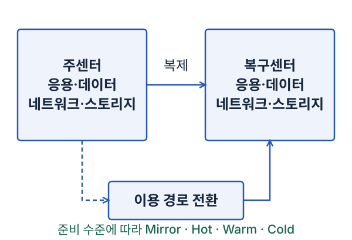

## 먼저 이해하기

주센터가 멈추면 다른 곳에서 데이터를 꺼내고 프로그램을 실행하며 고객 연결을 바꿔야 한다. DRS는 이를 가능하게 하는 기술 체계다.

## 답안에 남길 핵심

**정의:** DRS(Disaster Recovery System)는 재해로 중단된 IT 서비스와 데이터를 복구하기 위한 대체 인프라·백업·복제·전환 및 운영 체계다.

**회상 단서:** BIA → RTO/RPO → 전략 → 구축 → DR Drill

## 개념도

<figure class="concept-diagram">

<figcaption><strong>DRS의 주센터·복구센터 이중 구조</strong> 자료의 구조·설명을 바탕으로 직접 재구성한 학습용 SVG. <a href="/assets/subnotes/concepts/drs.svg" target="_blank" rel="noopener">그림 크게 보기</a></figcaption>
</figure>

**읽는 법:** 복구센터가 존재하는 것과 실제 복구 가능한 것은 다르다. 복제·의존성·전환 시험을 확인한다.

**손으로 그리기:** 좌우 센터 상자 → 복제 화살표 → 아래 서비스 전환 경로.

개념도 참고: <a href="https://itpe.co.kr/main/portal/selectPortalContent.do?topicId=1251">ITPE 지식관리 · DRS</a> · <a href="https://cafe.naver.com/81th/239556">ITPE 카페 · DRS 구성도</a>. 확인: 2026-11-22. 카페 센터 구성도와 지식관리 DRS 유형을 대조해 단순화. DWDM은 특정 구현 예이므로 필수 구성처럼 표시하지 않음.

## 준비 수준 비교

| 방식 | 사전 준비 | 검토 초점 |
| --- | --- | --- |
| Mirror | 양쪽에서 운영·처리 | 정합성·동시 장애 |
| Hot | 실행 자원을 충분히 준비 | 신속 전환·운영비 |
| Warm | 일부 자원을 준비 | 추가 확장·복구 시간 |
| Cold | 시설 중심 확보 | 장비·설치·복원 시간 |
| Pilot Light | 데이터·핵심 기반 유지, 필요 시 확장 | 확장·기동 검증 |

유형 이름만으로 고정 RTO·RPO를 보장하지 않는다. 네트워크·인증·DNS·외부 연계와 복구 후 거래 검증까지 설계한다.

## 셀프테스트 보완 · Active-Active·Passive·Pilot Light

**2교시형 6**에서는 서비스 처리 방식과 대기 자원의 준비 수준을 구분한다.

| 구분 | 평상시 | 재해 시 핵심 작업 | 설계 유의점 |
| --- | --- | --- | --- |
| Active-Active | 여러 사이트가 실제 요청을 처리 | 정상 사이트로 트래픽을 재분배 | 데이터 충돌·정합성, 잔여 사이트의 처리 용량 |
| Active-Passive | 주 사이트가 처리하고 보조는 대기 | 보조를 활성화하고 경로 전환 | 대기 자원 준비 수준에 따라 기동·확장·복구 작업이 달라짐 |
| Pilot Light | 보조에 데이터·핵심 기반만 유지 | 응용·실행 자원을 기동·확장한 뒤 서비스 검증 | 서비스 준비 완료 전에는 전체 요청을 처리할 수 없음 |

**Pilot Light는 Active-Passive 계열의 한 전략**이다. 세 항목을 서로 배타적인 동일 수준의 분류처럼 쓰지 않는다. Warm Standby는 축소된 전체 서비스를 실행해 두는 방식으로 Pilot Light와 구분할 수 있다.

먼저 BIA로 요구 RTO·RPO를 정하고, 복제 지연·자원 기동·네트워크 전환·거래 검증을 포함한 시험으로 달성 여부를 확인한다. 무중단 목표를 선언하는 것과 실제 재해 복구 목표를 만족하는 것은 다르다.

근거: [AWS · Disaster recovery options in the cloud](https://docs.aws.amazon.com/whitepapers/latest/disaster-recovery-workloads-on-aws/disaster-recovery-options-in-the-cloud.html). 관련: [IDC 입지와 재난 대응](/subnotes/notes/idc-location/).

## 가리고 설명하기

본문을 위로 올려 가린 뒤, 말하거나 빈 종이에 적는다. 정답을 읽기 전에 답한다.

1. DRP와 DRS의 차이는?
2. Mirror면 데이터 손실이 항상 0인가?

내 답과 비교할 기준

**1.** DRP는 실행 계획, DRS는 이를 실현하는 기술·인프라 체계다.

**2.** 아니다. 복제 방식·장애 형태·정합성·전환 설계에 따라 달라진다.

## 상황에 적용하기

랜섬웨어 암호화가 복제 대상에도 전파됐다. 대체 센터만 있으면 될까?

풀이와 판단 근거

오염된 최신 복제본만으로는 어려울 수 있다. 격리·불변 백업, 과거 복원 시점, 무결성 확인과 깨끗한 실행 환경도 준비해야 한다.

## 헷갈리지 않기

HA는 일상 장애의 지속, DR은 재해 수준 중단의 복구에 주로 초점을 둔다. 서로 보완한다. “Hot Site=무조건 2시간”처럼 사례값을 보편 규칙으로 쓰지 않는다.

## 수업 범위와 출처

- **최종 숙제 14/32:** DRS.
- **수업 메모의 강조 수준:** 출제 강조. DRS 및 DR 나옴이라고 기록.
- 출제 관련 표현은 2026.11.21 수업에서 기록한 강사의 의견이다. 실제 출제 확정이나 미출제 이력의 독립 검증을 뜻하지 않는다.
- ITPE 『IT경영전략 V10.13 Part I』, PDF 파일 기준 314~322쪽을 참고하여 개인 학습용으로 재구성했다. 교재 원문·도표를 전재하지 않았다.

함께 보기: [DRP](/subnotes/notes/drp/) · [DRaaS](/subnotes/notes/draas/) · [RTO](/subnotes/notes/rto/) · [RPO](/subnotes/notes/rpo/)

읽은 뒤에는 [내 것으로 만드는 복습법](/subnotes/notes/mastery-method/)에 따라 다른 날 다시 설명해본다. 이 노트가 있다는 사실만으로 학습 완료·점수가 기록되지는 않는다.
