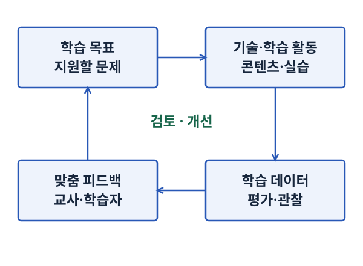

## 먼저 이해하기

같은 오답을 반복하는 학습자에게 강의 영상을 한 번 더 보여주는 것만으로 충분할까? 풀이 과정과 오답 유형을 보고 적절한 연습을 제시하고, 교사가 개입할 지점을 알려줄 수 있다. 에듀테크는 도구 자체보다 이런 학습 문제를 개선하는 데 초점을 둔다.

## 답안에 남길 핵심

**정의:** 에듀테크(EduTech)는 교육에 디지털 기술과 데이터를 적용해 교수·학습·평가·교육 운영을 지원하고 개선하는 기술·서비스와 산업이다.

**회상 단서:** 교육 목표 · 학습 활동 · 데이터 · 맞춤 피드백 · 효과 검증

## 개념도

<figure class="concept-diagram">

<figcaption><strong>에듀테크의 목표·활동·피드백 순환</strong> 자료의 구조·설명을 바탕으로 직접 재구성한 학습용 SVG. <a href="/assets/subnotes/concepts/edutech.svg" target="_blank" rel="noopener">그림 크게 보기</a></figcaption>
</figure>

**읽는 법:** 활동을 기록하는 것에서 끝내지 않고 평가·피드백으로 다시 연결한다.

**손으로 그리기:** 목표 → 활동 → 평가 → 피드백 네 칸을 순환으로 잇는다.

개념도 참고: <a href="https://www.unesco.org/en/query-list/d/digital-education">UNESCO · Digital education</a> · <a href="https://connect.unevoc.unesco.org/home/%2BTVETipedia%2BGlossary/lang%3Den/lang%3Den/show%3Dterm/term%3DEducational%2Btechnology">UNESCO-UNEVOC · Educational technology</a>. 확인: 2026-11-22. 지식관리 에듀테크 항목을 확인했으나 본문·도식이 없어 근거로 사용하지 않음. UNESCO 설명을 바탕으로 직접 구성한 학습용 도식.

## 핵심 구조와 비교

| 요소 | 하는 일 | 확인할 것 |
| --- | --- | --- |
| 콘텐츠·LMS | 학습 자료와 수업·과제·이력 관리 | 학습 목표와 내용의 정합성 |
| 학습분석·AI | 오답·진도·참여에서 지원 필요성 파악 | 편향·오진·과잉 추론 |
| 상호작용·실습 | 협업, 모의실험, 실감형 연습 제공 | 기술을 쓰는 것이 학습에 필요한가 |
| 평가·피드백 | 이해 수준 확인, 다음 활동 안내 | 점수뿐 아니라 실제 수행의 개선 |
| 운영 기반 | 접근성·보안·교사 역량·서비스 연속성 | 기기·네트워크 격차와 개인정보 |

답안은 **교육상의 문제 → 적용 기술 → 학습 활동의 변화 → 검증 지표**로 연결한다. 예를 들어 오답 반복이라는 문제에 AI 추천을 붙였다면, 다음 연습 선택과 교사 피드백이 어떻게 달라지는지까지 적는다. 기술명을 많이 나열하는 것보다 교육적 역할을 설명하는 편이 명확하다.

## 가리고 설명하기

정답을 펼치기 전에 자료를 가리고, 정의와 그림을 내 말로 설명한다.

1. 에듀테크와 단순한 동영상 업로드의 차이는?
2. AI가 추천한 학습 경로를 교사가 확인해야 하는 이유는?

내 답과 비교할 기준

**1.** 영상은 수단이다. 에듀테크는 목표와 활동·평가·피드백을 연결해 학습을 지원하는 전체 설계까지 본다.

**2.** 데이터가 학습자의 실제 이해를 완전히 대표하지 않으며 추천 오류·편향·접근성 차이가 있을 수 있다. 교사의 판단과 학습자 선택이 필요하다.

## 상황에 적용하기

학습 앱 도입 후 접속시간은 늘었지만 새로운 문제를 푸는 능력은 그대로다. 성공으로 평가할까?

풀이와 판단 근거

접속시간은 이용 지표다. 학습 목표에 맞는 사전·사후 수행, 오답 변화, 새로운 상황의 적용 여부를 확인한다. 시간만 늘어난 이유를 점검하고 활동·피드백을 수정한다. 기술 이용량을 교육 성과와 동일시하지 않는다.

## 헷갈리지 않기

에듀테크를 AI 튜터 하나로 한정하지 않는다. 온라인·오프라인을 결합한 수업, 접근성 지원, 평가·행정 도구도 포함될 수 있다. 학습자 데이터 수집 범위와 피드백의 근거를 설명할 수 있어야 한다.

## 셀프테스트 범위와 출처

- **셀프테스트 추가 범위:** 기본 11번. 확정 숙제 32개와 별도로 문제지에 포함된 주제다. 문제지에 실렸다는 사실과 강사의 출제 예상·암기 강조는 구분한다.
- [ITPE 151기 1~2주차 셀프테스트 공지와 첨부 문제지](https://cafe.naver.com/81th/243521). 원문을 전재하지 않고 질문의 요구에 맞춰 개인 학습용으로 정리했다.
- [UNESCO · Digital education](https://www.unesco.org/en/query-list/d/digital-education)
- [UNESCO-UNEVOC · Educational technology](https://connect.unevoc.unesco.org/home/%2BTVETipedia%2BGlossary/lang%3Den/lang%3Den/show%3Dterm/term%3DEducational%2Btechnology)
- 확인일: 2026-11-22. 개념도는 출처의 구조·설명을 바탕으로 직접 구성한 학습용 그림이다.
