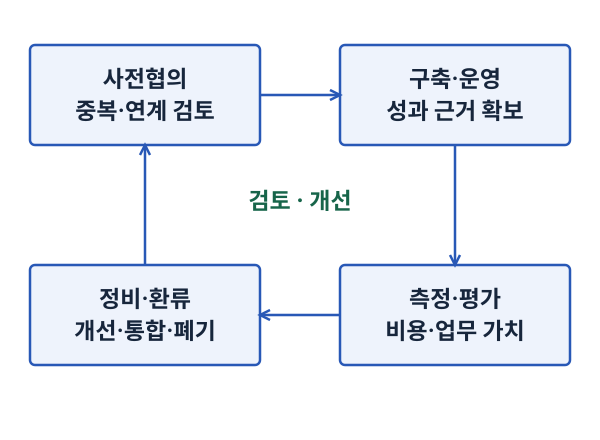

## 먼저 이해하기

비슷한 민원 시스템을 여러 기관이 각각 만들고, 이용자가 거의 없는 시스템도 비용을 들여 계속 운영한다면 예산이 낭비된다. 전자정부 성과관리는 만들기 전 “함께 쓸 수 있는가”를 보고, 운영 후 “계속 쓸 가치가 있는가”를 확인하는 관리다.

## 답안에 남길 핵심

**정의:** 전자정부 성과관리 지침은 전자정부사업·지역정보화사업의 사전협의 및 성과 분석·진단 등 운영에 필요한 사항을 정하여 정보화 투자의 효율성과 운영 성과를 관리하는 행정규칙이다.

**회상 단서:** 사전협의 · 중복·연계·공동이용 · 비용·업무 측정 · 평가 · 정비 · 환류

## 개념도

<figure class="concept-diagram">

<figcaption><strong>전자정부사업의 검토·운영·정비 순환</strong> 자료의 구조·설명을 바탕으로 직접 재구성한 학습용 SVG. <a href="/assets/subnotes/concepts/egov-performance.svg" target="_blank" rel="noopener">그림 크게 보기</a></figcaption>
</figure>

**읽는 법:** 계획 전 검토와 운영 후 평가를 한 생애주기로 연결한 학습용 그림이다.

**손으로 그리기:** 네 칸을 순환으로 잇고 앞에는 사전협의, 뒤에는 측정·정비를 적는다.

개념도 참고: <a href="https://itpe.co.kr/main/portal/selectPortalContent.do?topicId=1317">ITPE 지식관리 · 전자정부 성과관리 지침</a> · <a href="https://www.law.go.kr/LSW/admRulInfoP.do?admRulSeq=2100000287088&amp;chrClsCd=010201">국가법령정보센터 · 전자정부 성과관리 지침(2026.10.19.)</a>. 확인: 2026-11-22. 원문 구조·설명을 검토하여 핵심 관계만 직접 재구성한 학습용 도식. 원본 이미지는 전재하지 않음.

## 핵심 구조와 답안 포인트

| 시점 | 무엇을 확인하나? | 대표 결과 |
| --- | --- | --- |
| 사업 추진 전 | 중복투자, 상호연계·공동이용, 표준·과업 적정성 | 사전협의 결과 및 사업계획 반영 |
| 운영 성과측정 | 비용: 운영 적정성·유지 용이성·비용 효율성 | 기초 데이터·측정값·증빙 |
| 운영 성과측정 | 업무: 기능 활용도·업무성과 달성도 | 업무 가치와 실제 이용의 근거 |
| 성과평가·정비 | 기준에 따른 평가, 폐기·통폐합·고도화 등 검토 | 정비계획·이행 결과 |
| 다음 투자·운영 | 분석 결과와 개선사항 반영 | 계획·예산·운영 개선 |

**답안 구성:** 정의 → 사전협의 → 성과 분석·진단 → 정비·환류 순으로 설명한다. 평가 결과를 발표하는 데서 끝내지 않고 개선 책임·계획·이행을 연결해야 한다. 지침의 현재 시행일을 적으면 교재 구판과 현행 기준의 혼동을 줄일 수 있다.

## 가리고 설명하기

본문을 덮고 먼저 내 말로 답한다.

1. 사전협의와 운영 성과측정의 질문은 어떻게 다른가?
2. 성과가 낮다는 이유만으로 즉시 시스템을 폐기해도 될까?

내 답과 비교할 기준

**1.** 사전협의는 사업 전 중복·공동이용·연계 등을 검토하고 사업 내용을 조정한다. 운영 성과측정은 운영 중인 시스템의 비용과 업무 가치를 확인한다.

**2.** 아니다. 현행 지침의 정비 기준·예외와 서비스 연속성, 데이터 보존·이관, 이용자 불편 방지를 함께 검토한다.

## 상황에 적용하기

이용량이 적고 평가점수가 낮은 재난 대응 시스템을 발견했다. 이용량이 적으니 불필요한 시스템이라고 판단해도 될까?

풀이와 판단 근거

재난 시스템은 평상시 이용량이 적어도 국민의 생명과 안전을 위해 필요할 수 있다. 측정값의 원인과 법적 구축·운영 근거, 국가안전·생활 영향 및 폐기권고 예외를 확인한다. 유지가 필요하다면 비용 효율화·연계·중복 기능 정비를 검토하고, 단순 이용량만으로 업무 가치를 부정하지 않는다.

## 헷갈리지 않기

2026.10.19. 시행본 제26조에는 총점 60점 미만 정비 권고와 40점 미만 폐기 기준이 있으나, 폐기권고 예외도 있다. “40점 미만이면 어떤 시스템이든 자동 폐기”로 암기하지 않는다. 실제 지표 산식과 적용대상은 해당 시점 지침·별표·매뉴얼을 확인한다.

## 셀프테스트 범위와 출처

- **기본 32번.** 확정 숙제 32개와 구분하여 추가한 셀프테스트 보완 노트다.
- [151기 셀프테스트 공지와 첨부 문제지](https://cafe.naver.com/81th/243521). 문제지의 출제 예상 표현은 강사의 의견이며 실제 출제를 확정하지 않는다.
- [ITPE 지식관리 · 전자정부 성과관리 지침](https://itpe.co.kr/main/portal/selectPortalContent.do?topicId=1317)
- [국가법령정보센터 · 전자정부 성과관리 지침(2026.10.19.)](https://www.law.go.kr/LSW/admRulInfoP.do?admRulSeq=2100000287088&chrClsCd=010201)
- 확인일: 2026-11-22. 아래 설명과 사례는 개인 학습용으로 재구성했으며 원문 도표를 전재하지 않았다.
