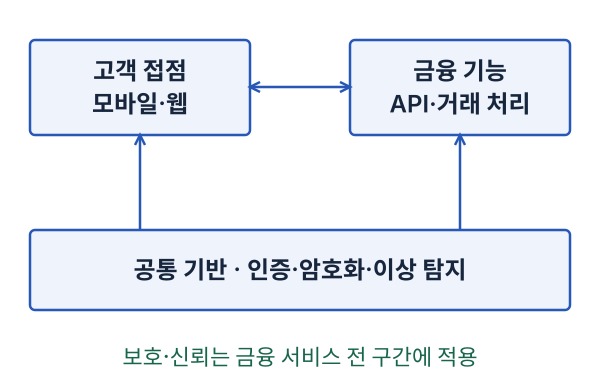

## 먼저 이해하기

휴대전화로 송금을 누르는 짧은 동작 뒤에는 본인 확인, 계좌 접근 권한, 거래 처리, 이상 탐지, 결과 통지가 있다. 핀테크는 이런 금융 기능을 기술과 결합해 서비스를 개선한다. “간편하다”는 결과만 쓰지 말고 이를 가능하게 하는 요소를 설명해야 한다.

## 답안에 남길 핵심

**정의:** 핀테크(FinTech)는 금융과 기술의 결합으로 지급결제·송금·대출·투자·보험 등 금융 서비스와 그 제공 방식을 개선하는 기술·서비스 및 산업이다.

**회상 단서:** 금융 기능 · 디지털 인증 · API · 데이터 분석 · 거래 보호 · 신뢰

## 개념도

<figure class="concept-diagram">

<figcaption><strong>핀테크의 접점·금융 기능·보호 기반</strong> 자료의 구조·설명을 바탕으로 직접 재구성한 학습용 SVG. <a href="/assets/subnotes/concepts/fintech.svg" target="_blank" rel="noopener">그림 크게 보기</a></figcaption>
</figure>

**읽는 법:** 고객 접점과 금융 기능의 연결을 인증·암호화·이상 탐지가 공통 기반으로 보호한다. 보호는 마지막 처리 단계가 아니다.

**손으로 그리기:** 위에 고객 접점·금융 기능 두 칸 → 아래 보호 기반 한 칸 → 위 두 칸으로 연결선.

개념도 참고: <a href="https://itpe.co.kr/main/portal/selectPortalContent.do?topicId=107">ITPE 지식관리 · 핀테크 공통기반</a> · <a href="https://www.fsb.org/work-of-the-fsb/financial-innovation-and-structural-change/financial-innovation/">FSB · Financial Innovation</a>. 확인: 2026-11-22. 지식관리 개념도와 기술요소 표를 대조해 역할별로 재구성. 원본의 TEE·인증 관련 모호한 설명은 그대로 옮기지 않음.

## 핵심 구조와 비교

| 기술요소 | 금융에서 하는 일 | 유의점 |
| --- | --- | --- |
| 인증·접근제어 | 사용자·단말 확인, 권한 통제 | 인증과 거래 승인·동의를 구분 |
| API·플랫폼 | 계좌·결제·금융 기능을 표준 인터페이스로 연결 | 권한 범위·호출 통제·연계 장애 |
| 암호화·토큰화 | 거래·저장 데이터와 결제 정보를 보호 | 키 관리와 토큰 사용 범위 |
| 데이터·AI·FDS | 신용평가·개인화·이상거래 탐지 | 데이터 품질·편향·오탐 |
| 모바일·클라우드 | 서비스 접근과 확장·운영을 지원 | 가용성·복구·책임 분담 |

**기본 18번은 “핀테크의 기술요소”**가 중심이다. 정의는 짧게 두고 기술–역할–주의점으로 표를 구성한다. NFC·QR은 접점이나 통신·인식 방식, API는 연계, FDS는 탐지처럼 같은 목록에 적더라도 역할의 차이를 분명히 한다. 규제 수치나 의무 인증을 오래된 표에서 그대로 가져오지 않는다.

## 가리고 설명하기

정답을 펼치기 전에 자료를 가리고, 정의와 그림을 내 말로 설명한다.

1. 핀테크의 기술요소를 묻는 문제에서 서비스 이름만 쓰면 부족한 이유는?
2. FIDO와 FDS는 같은 기능일까?

내 답과 비교할 기준

**1.** 결제·송금은 서비스 기능이다. 인증·API·암호화·분석 등이 그 기능을 어떻게 구현·보호하는지 설명해야 기술요소 질문에 답한다.

**2.** 다르다. FIDO는 인증과 관련된 표준 체계이고 FDS는 거래·행동의 이상 징후를 탐지하는 체계다.

## 상황에 적용하기

송금 앱의 로그인이 안전하므로 거래 한도와 이상거래 탐지는 없애도 된다는 주장이 나왔다. 타당한가?

풀이와 판단 근거

본인 인증 성공만으로 모든 거래가 안전하다고 볼 수 없다. 탈취된 세션·오인 송금·사기 유도·비정상 거래를 고려해 거래 승인, 한도, 이상 탐지, 이력과 대응을 함께 설계한다. 편의성과 보호 기능의 역할이 다르다.

## 헷갈리지 않기

블록체인·AI·생체인증을 모두 써야 핀테크가 되는 것은 아니다. 서비스 위험과 목적에 맞는 기술을 선택한다. 핀테크와 테크핀은 금융·기술을 결합한다는 공통점이 있지만 출발 역량과 사업 접근에서 차이를 설명하는 용어다.

## 셀프테스트 범위와 출처

- **셀프테스트 추가 범위:** 기본 11·18번. 확정 숙제 32개와 별도로 문제지에 포함된 주제다. 문제지에 실렸다는 사실과 강사의 출제 예상·암기 강조는 구분한다.
- [ITPE 151기 1~2주차 셀프테스트 공지와 첨부 문제지](https://cafe.naver.com/81th/243521). 원문을 전재하지 않고 질문의 요구에 맞춰 개인 학습용으로 정리했다.
- [ITPE 지식관리 · 핀테크·테크핀](https://itpe.co.kr/main/portal/selectPortalContent.do?topicId=107)
- [ITPE 지식관리 · 핀테크 기술요소](https://itpe.co.kr/main/portal/selectPortalContent.do?topicId=107)
- [ITPE 지식관리 · 핀테크 공통기반](https://itpe.co.kr/main/portal/selectPortalContent.do?topicId=107)
- [FSB · Financial Innovation](https://www.fsb.org/work-of-the-fsb/financial-innovation-and-structural-change/financial-innovation/)
- 확인일: 2026-11-22. 개념도는 출처의 구조·설명을 바탕으로 직접 구성한 학습용 그림이다.
