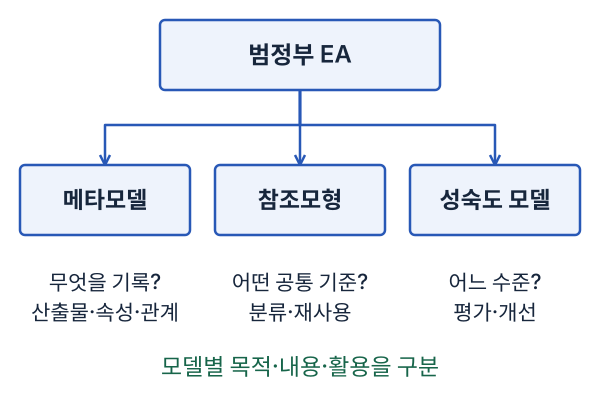

## 먼저 이해하기

각 기관이 업무·시스템·데이터를 제각각 이름 붙이면 중복 투자나 데이터 연계를 검토하기 어렵다. 공통으로 어떤 정보를 등록하고 서로 어떤 관계가 있는지 정하고, 공통 분류를 사용해야 한다. 등록만 한 뒤 갱신·활용하지 않는 문제는 성숙도와 품질관리로 살핀다.

## 답안에 남길 핵심

**정의:** 범정부 EA는 공공 정보화의 업무·응용·데이터·기술·보안 등 구성요소와 관계를 일관되게 정리하고, 공통 모델과 관리체계를 활용해 정보자원의 연계·공동활용·투자 의사결정을 지원하는 전사적 아키텍처 체계다.

**회상 단서:** 메타모델 · 참조모형 5종 · 현행·목표·이행계획 · 수립·관리·활용 · 현행화

## 개념도

<figure class="concept-diagram">

<figcaption><strong>메타모델·참조모형·성숙도 모델의 서로 다른 역할</strong> 자료의 구조·설명을 바탕으로 직접 재구성한 학습용 SVG. <a href="/assets/subnotes/concepts/government-ea.svg" target="_blank" rel="noopener">그림 크게 보기</a></figcaption>
</figure>

**읽는 법:** 세 모델은 동일한 단계가 아니라 서로 다른 질문에 답한다. 무엇을 기록하는지, 어떤 공통 기준을 쓰는지, 어느 수준으로 활용하는지를 구분한다.

**손으로 그리기:** 위 범정부 EA → 아래 메타모델·참조모형·성숙도 세 가지 → 각 모델의 질문을 한 줄씩 적는다.

개념도 참고: <a href="https://itpe.co.kr/main/portal/selectPortalContent.do?topicId=2">ITPE 지식관리 · EA 참조모형·성숙도</a> · <a href="https://www.law.go.kr/LSW/admRulLsInfoP.do?admRulSeq=2100000244120">국가법령정보센터 · 정보기술아키텍처 도입·운영 지침(2024.07.10.)</a>. 확인: 2026-11-22. ITPE EA 그림과 2024.07.10. 시행 지침 본문·별표2·3·5를 대조한 역할 관계도. 메타모델 원본의 세부 항목을 전재하지 않음.

## 핵심 구조와 답안 포인트

| 모델 | 질문 | 답안에 남길 것 |
| --- | --- | --- |
| 메타모델 | 어떤 정보와 관계를 공통 관리하는가? | 공통 필수 정보·구성과 기관 적용 |
| 참조모형 | 같은 의미를 어떻게 분류·표준화하는가? | 성과·업무·데이터·서비스·기술의 5종 |
| 성숙도 모델 | EA를 얼마나 수립·관리·활용하는가? | 수준 진단, 부족 역량, 개선 방향 |
| 현행·목표·이행계획 | 현재에서 원하는 상태로 어떻게 이동하는가? | 차이·과제·우선순위·예산·일정 |

**참조모형 5종:** 성과(PRM)는 성과요소, 업무(BRM)는 업무·관련 정보, 데이터(DRM)는 표준·재사용, 서비스(SRM)는 재활용 가능한 응용서비스, 기술(TRM)는 기술·표준의 분류다. SRM을 보안참조모형으로 혼동하지 않는다.

**성숙도 설명:** 확인한 2024.07.10. 시행본의 별표5는 EA 기반 정보화 역량·정보자원관리 수준의 자체 진단과 개선을 강조한다. 교재는 수립 관점에서 현행 수립 → 이행전략 수립 → 목표 수립 → 아키텍처 완성 → 최적화의 5단계를 제시한다. 이는 교재의 수립 관점 표현으로 기록하며, 모든 시점의 공식 평가모델 단계 명칭과 동일하다고 단정하지 않는다.

### 범정부 EA 메타모델을 답안에 적을 때

- **관리 대상:** 범정부 차원에서 함께 정의하고 공유할 EA의 필수 정보와 그 구성을 정한다.
- **기관 적용:** 기관은 범정부 모델을 적용하고, 기관 고유의 EA 목적·활용을 고려한 메타모델을 마련한다.
- **상세 정의의 위치:** 구성 영역·등록 항목·관계의 구체 명세는 행정안전부와 정보자원관리시스템의 별도 공지를 대조한다. 지침 별표2 자체에는 영역별 구성표나 항목 목록이 없다.

근거: [「정보기술아키텍처 도입·운영 지침」 별표2, 2024.7.10. 시행본](https://www.law.go.kr/LSW/flDownload.do?flSeq=142399681&bylClsCd=200201). 1쪽 전체를 확인했다. 확인일: 2026-11-22.

## 가리고 설명하기

본문을 덮고 먼저 내 말로 답한다.

1. 메타모델과 참조모형의 차이는?
2. EA 관리시스템에 정보를 등록했으면 높은 성숙도가 보장될까?

내 답과 비교할 기준

**1.** 메타모델은 관리할 정보와 그 관계의 구조를 정한다. 참조모형은 구성요소의 공통 분류·형식을 제공해 일관성과 상호운용성을 돕는다.

**2.** 아니다. 현행성·충실성·정확성·정합성, 책임·관리절차, 실제 투자·사업 의사결정 활용과 개선을 확인해야 한다.

## 상황에 적용하기

새 민원시스템을 도입했는데 EA에는 폐기한 시스템과 예전 데이터 연계가 남아 있다. 어떤 문제가 생기고 무엇을 고칠까?

풀이와 판단 근거

중복성·공동활용·장애 영향 분석이 잘못될 수 있다. 시스템·업무·데이터·연계 변경을 메타모델에 따라 현행화하고 책임자·변경통지·품질점검 절차를 정한다. 참조모형에 맞는 분류도 확인하며, 현행·목표·이행계획과 실제 사업의 연결을 복원한다. 성숙도 진단 결과를 다음 개선 과제와 교육·활용 체계에 반영한다.

## 헷갈리지 않기

지침 제7조의 범정부 참조모형은 성과·업무·데이터·서비스·기술의 다섯 종류다. 아키텍처 구분에 보안이 있다고 해서 범정부 참조모형의 목록에 보안을 임의로 여섯 번째 추가하지 않는다. 성숙도 측정 모델의 구체적 버전과 단계 명칭은 지침 별표 및 공식 공지와 교재 표현을 구분한다.

## 셀프테스트 범위와 출처

- **2교시 5번.** 확정 숙제 32개와 구분하여 추가한 셀프테스트 보완 노트다.
- [151기 셀프테스트 공지와 첨부 문제지](https://cafe.naver.com/81th/243521). 문제지의 출제 예상 표현은 강사의 의견이며 실제 출제를 확정하지 않는다.
- [ITPE 지식관리 · EA 참조모형·성숙도](https://itpe.co.kr/main/portal/selectPortalContent.do?topicId=2)
- [국가법령정보센터 · 정보기술아키텍처 도입·운영 지침(2024.07.10.)](https://www.law.go.kr/LSW/admRulLsInfoP.do?admRulSeq=2100000244120)
- 확인일: 2026-11-22. 아래 설명과 사례는 개인 학습용으로 재구성했으며 원문 도표를 전재하지 않았다.
