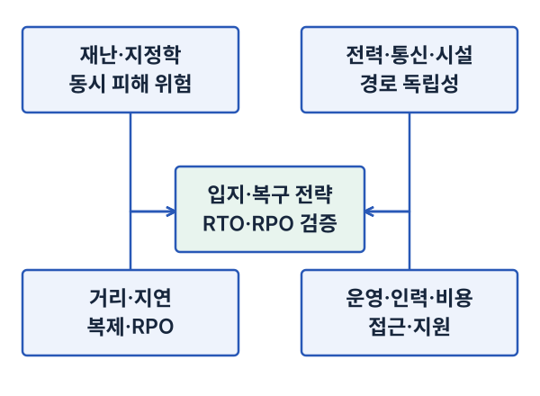

## 먼저 이해하기

주센터와 복구센터가 다른 건물에 있어도 같은 변전소와 같은 통신 관로를 사용하면 한 사고로 모두 멈출 수 있다. 반대로 무조건 멀리 두면 안전하다고 생각하기 쉽지만, 복제 지연과 인력 이동·물류 때문에 목표 복구가 어려울 수 있다. 위치 선정은 위험 분리와 실행 가능성의 균형이다.

## 답안에 남길 핵심

**정의:** IDC 지리적 위치 선정은 주·복구 거점이 동일 재난과 공유 자원 장애에 함께 영향받지 않도록 위험을 분리하면서 업무연속성 목표, 연결성·접근성·보안·비용을 만족하는 후보지를 평가하는 활동이다.

**회상 단서:** 상관위험 · 독립 전력·통신 · 재난·전쟁 · RTO·RPO · 복제 지연 · 접근·운영

## 개념도

<figure class="concept-diagram">

<figcaption><strong>위험 분리와 복구 가능성을 함께 보는 선정 흐름</strong> 자료의 구조·설명을 바탕으로 직접 재구성한 학습용 SVG. <a href="/assets/subnotes/concepts/idc-location.svg" target="_blank" rel="noopener">그림 크게 보기</a></figcaption>
</figure>

**읽는 법:** 주변 네 칸은 후보지를 평가하는 관점이다. 서로 독립적인 위험 분리와 복구 목표를 함께 고려한다.

**손으로 그리기:** 가운데 입지·복구 전략 → 주변에 재난, 전력·통신, 거리·지연, 운영·인력 네 칸.

개념도 참고: <a href="https://itpe.co.kr/main/portal/selectPortalContent.do?topicId=1251">ITPE 지식관리 · DRS 전략·복구센터 위치</a> · <a href="https://nvlpubs.nist.gov/nistpubs/Legacy/SP/nistspecialpublication800-34r1.pdf">NIST SP 800-34 Rev.1 · 비상계획과 대체 사이트</a>. 확인: 2026-11-22. 원문 구조·설명을 검토하여 핵심 관계만 직접 재구성한 학습용 도식. 원본 이미지는 전재하지 않음.

## 핵심 구조와 답안 포인트

| 평가 축 | 확인 사항 | 전략에 반영할 것 |
| --- | --- | --- |
| 자연·지역 위험 | 지진·침수·화재·기상, 같은 재난권역 여부 | 주·복구 거점의 공통 위험 분리 |
| 전쟁·사회 위험 | 공격 목표 집중, 대피·통제·치안 | 거점 분산·비상 연락·인력 대체 |
| 전력·통신 | 독립 공급, 경로·관로·사업자 의존 | 표면상 이중화가 아닌 실제 독립성 |
| 기술·복구 | 통신 지연, 복제 방식, 데이터 정합성 | 업무별 RTO·RPO·전환 구조 |
| 운영·준수 | 인력 접근, 물류, 데이터 보관·접근 규정 | 원격운영·계약·교육·비용 |

## 가리고 설명하기

본문을 덮고 먼저 내 말로 답한다.

1. 두 센터가 떨어져 있다는 사실만으로 위험이 분리됐다고 볼 수 있을까?
2. 복구센터는 최대한 멀수록 항상 좋은가?

내 답과 비교할 기준

**1.** 아니다. 재난권역·전력·통신 경로·공급자·접근 통제 같은 공통 원인을 조사해야 한다.

**2.** 아니다. 위험 분리 이점과 복제 지연·비용·운영 접근성, 업무별 복구 목표를 함께 비교한다.

## 상황에 적용하기

본사와 복구센터를 100km 이상 떨어뜨렸지만 전쟁 시 특정 통신 중계국이 끊기면 두 곳 모두 외부 연결을 잃는다. 무엇을 보완할까?

풀이와 판단 근거

거리 기준 충족만 보고 승인하지 않는다. 통신 경로와 중계 인프라의 공통 장애점을 파악하고 물리적으로 분리된 경로·접속 거점·사업자 구성을 검토한다. 필요하면 추가 거점·오프라인 사본·원격운영·대체 인력을 준비한다. 분산만 늘리면 되는 것이 아니라 실제 단절·전환·복구 시험으로 RTO·RPO와 업무 재개를 검증한다.

## 헷갈리지 않기

교재의 특정 거리 예시는 위험 분리를 설명하기 위한 참고다. 모든 조직에 통용되는 보편적인 안전 거리나 법정 최소거리로 외우지 않는다. NIST도 위험평가로 지역·접근성·보안·환경·비용을 고려하도록 설명한다. 클라우드 리전·가용영역 이름만 달라도 실제 의존성이 분리됐다고 자동 가정하지 않는다.

## 셀프테스트 범위와 출처

- **심화 7번.** 확정 숙제 32개와 구분하여 추가한 셀프테스트 보완 노트다.
- [151기 셀프테스트 공지와 첨부 문제지](https://cafe.naver.com/81th/243521). 문제지의 출제 예상 표현은 강사의 의견이며 실제 출제를 확정하지 않는다.
- [ITPE 지식관리 · DRS 전략·복구센터 위치](https://itpe.co.kr/main/portal/selectPortalContent.do?topicId=1251)
- [NIST SP 800-34 Rev.1 · 비상계획과 대체 사이트](https://nvlpubs.nist.gov/nistpubs/Legacy/SP/nistspecialpublication800-34r1.pdf)
- 확인일: 2026-11-22. 아래 설명과 사례는 개인 학습용으로 재구성했으며 원문 도표를 전재하지 않았다.
