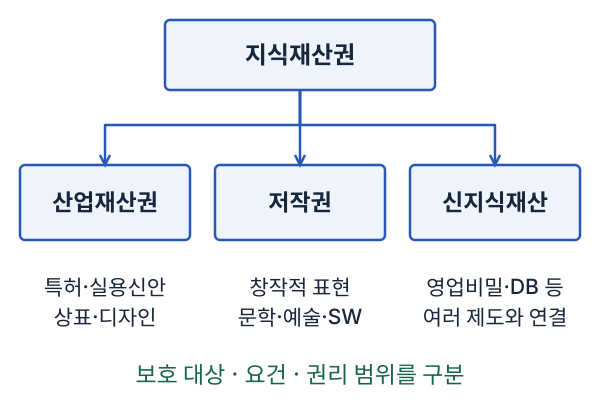

## 먼저 이해하기

프로그램을 만들면 코드 표현, 기술적 발명, 서비스 이름, 비공개 노하우가 각각 생길 수 있다. 같은 제품도 보호 대상이 달라 적용할 권리가 다르다.

## 답안에 남길 핵심

**정의:** 지식재산권은 창작·발명·표지 등 지적 활동의 성과에 대해 법이 인정하는 권리다. 대상과 성립 요건에 따라 보호 범위가 달라진다.

**회상 단서:** 산저신 · 특실상디 · 표현/기술/표지/비밀 구분

## 개념도

<figure class="concept-diagram">

<figcaption><strong>지식재산권을 보호 대상별로 나눈 구조</strong> 자료의 구조·설명을 바탕으로 직접 재구성한 학습용 SVG. <a href="/assets/subnotes/concepts/intellectual-property.svg" target="_blank" rel="noopener">그림 크게 보기</a></figcaption>
</figure>

**읽는 법:** 학습용 분류이며 모든 법적 권리가 서로 배타적인 것은 아니다. 아이디어와 구체적 표현의 보호도 구분한다.

**손으로 그리기:** 큰 권리 상자 → 세 가지 → 각 보호 대상 예시 두 개.

개념도 참고: <a href="https://itpe.co.kr/main/portal/selectPortalContent.do?topicId=130">ITPE 지식관리 · 지식재산권</a>. 확인: 2026-11-22. 핵심 관계만 남긴 학습용 재구성. 원본 이미지를 전재하지 않음.

## 보호 대상의 분류

| 범주·권리 | 무엇을 보호하나? | IT 사례 |
| --- | --- | --- |
| 특허 | 요건을 충족하는 발명 | 기술적 처리 방법 |
| 실용신안 | 요건을 충족하는 물품의 고안 | 물품의 형상·구조 개선 |
| 상표 | 상품·서비스의 출처 식별 표지 | 서비스명·로고 |
| 디자인 | 물품 등의 시각적 디자인 | 제품 외관·해당 요건의 화면 디자인 |
| 저작권 | 창작적인 표현 | 프로그램 코드·문서·그림 |
| 영업비밀 등 | 법적 요건을 갖춘 비공개 정보 등 | 비밀 관리한 노하우·자료 |

“신지식재산권”은 교재의 확장 분류다. 영업비밀·반도체 배치설계·데이터베이스 등은 각각의 보호 근거와 요건을 확인한다. 프로그램 표현의 보호를 별도 독립된 구법 체계와 혼동하지 않는다.

## 가리고 설명하기

본문을 위로 올려 가린 뒤, 말하거나 빈 종이에 적는다. 정답을 읽기 전에 답한다.

1. 아이디어와 코드 표현은 저작권에서 어떻게 구분할까?
2. 공개한 코드라면 아무 조건 없이 이용해도 될까?

내 답과 비교할 기준

**1.** 추상적 아이디어와 구체적 창작 표현은 구분된다. 기술적 발명은 특허 요건 등 다른 보호를 검토할 수 있다.

**2.** 아니다. 라이선스와 권리자의 이용 조건을 확인해야 한다.

## 상황에 적용하기

외부 코드를 제품에 넣고 AI로 설명문을 만들었다. 배포 전에 무엇을 확인할까?

풀이와 판단 근거

코드의 출처·라이선스·고지·소스 제공 등 의무와 제3자 권리를 확인한다. 생성물도 출처·유사성·계약·사람의 기여를 검토하며 AI가 만들었다는 이유로 권리 문제가 없다고 단정하지 않는다.

## 헷갈리지 않기

권리 존속기간은 국가·종류·기산점·예외가 다르다. 암기용 숫자만으로 실제 권리를 판단하지 않는다. 이 노트는 보호 대상 구분을 우선한다.

## 수업 범위와 출처

- **최종 숙제 31/32:** 지식재산권.
- **수업 메모의 강조 수준:** 출제 강조 / 후속 학습. 저작권/IP 많이 나오지만 상세 학습 시점은 뒤로 언급.
- 출제 관련 표현은 2026.11.21 수업에서 기록한 강사의 의견이다. 실제 출제 확정이나 미출제 이력의 독립 검증을 뜻하지 않는다.
- ITPE 『IT경영전략 V10.13 Part I』, PDF 파일 기준 445~448쪽을 참고하여 개인 학습용으로 재구성했다. 교재 원문·도표를 전재하지 않았다.
- [WIPO · What is Intellectual Property?](https://www.wipo.int/en/web/about-ip). 권리별 보호 대상의 공식 개요.

함께 보기: [기술 가치 평가](/subnotes/notes/technology-valuation/) · [IT 컴플라이언스](/subnotes/notes/it-compliance/)

읽은 뒤에는 [내 것으로 만드는 복습법](/subnotes/notes/mastery-method/)에 따라 다른 날 다시 설명해본다. 이 노트가 있다는 사실만으로 학습 완료·점수가 기록되지는 않는다.
