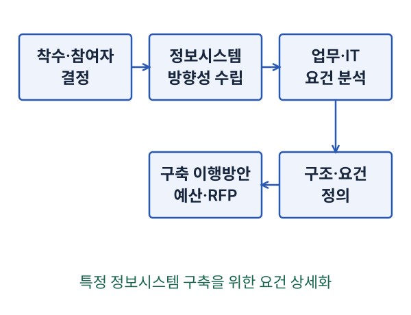

## 먼저 이해하기

ISP에서 “주문 시스템을 개선하자”가 나왔다면, ISMP는 어떤 기능·성능·연계를 어느 범위와 비용으로 발주할지 구체화한다. 직접 프로그램을 구축하는 단계와는 다르다.

## 답안에 남길 핵심

**정의:** ISMP(Information System Master Plan)는 특정 SW 개발사업의 현황·요구사항을 기능점수 산정이 가능한 수준으로 상세화하고 구축전략·이행계획 및 RFP 작성 근거를 마련하는 활동이다.

**회상 단서:** 프방어구축 · 기능/비기능 · FP · 구축계획 · RFP

## 개념도

<figure class="concept-diagram">

<figcaption><strong>ISMP의 요건 상세화와 발주 준비</strong> 자료의 구조·설명을 바탕으로 직접 재구성한 학습용 SVG. <a href="/assets/subnotes/concepts/ismp.svg" target="_blank" rel="noopener">그림 크게 보기</a></figcaption>
</figure>

**읽는 법:** ISP의 전사 방향과 연결하되, 특정 사업의 기능·비기능·기술 요건과 발주 준비에 초점을 둔다.

**손으로 그리기:** 세 칸에서 두 칸으로 이어지는 흐름 → 마지막에 예산·RFP를 표시한다.

개념도 참고: <a href="https://itpe.co.kr/main/portal/selectPortalContent.do?topicId=3">ITPE 지식관리 · ISP·ISMP</a>. 확인: 2026-11-22. 핵심 관계만 남긴 학습용 재구성. 원본 이미지를 전재하지 않음.

## 수행 5단계

| 단계 | 핵심 활동 | 대표 산출물 |
| --- | --- | --- |
| 프로젝트 착수·참여자 결정 | 조직·역할·수행계획 | 수행계획, 역할·책임 정의 |
| 정보시스템 방향성 수립 | 전략과 정렬, 추진 범위·목표 | 정보시스템 범위·방향성 검토 결과 |
| 업무·정보기술 요건 분석 | 업무·기술 현황, 사용자 요구 | 현황 분석, 업무·기술 요건 분석 결과 |
| 정보시스템 구조·요건 정의 | 목표 구조와 상세 기능·비기능 요건 | 목표 아키텍처, 상세 요건·연관성 정의 |
| 구축사업 이행방안 수립 | 발주 범위·예산·일정·RFP | 구축 이행계획, 예산, 제안요청서 |

**기본 6**은 ISP와 ISMP 각각의 활동뿐 아니라 산출물도 요구한다. 표의 산출물 명칭은 이해를 위한 요약이며, 사업별 서식·명칭은 해당 공통가이드와 발주 조건에 따른다.

**FP는 기능 규모, MM은 인력 투입 공수**다. SW 직접구매·분리발주 검토도 범위·비용 구체화와 연결된다. 금액 기준·예외는 해당 시점의 공식 규정을 별도 확인한다.

## 가리고 설명하기

본문을 위로 올려 가린 뒤, 말하거나 빈 종이에 적는다. 정답을 읽기 전에 답한다.

1. ISMP의 마지막 “구축”을 실제 개발이라고 쓰면 왜 부정확할까?
2. 5명×3개월은 몇 FP인가?

내 답과 비교할 기준

**1.** 구축사업의 이행방안을 수립하는 계획 활동이다. 실제 개발·테스트 수행과 구분한다.

**2.** FP로 바꿀 수 없다. 이는 15MM의 투입 공수이며 기능 규모와 다른 단위다.

## 상황에 적용하기

RFP에 “빠르고 안전한 시스템 구축”만 있다. ISMP에서 어떻게 구체화할까?

풀이와 판단 근거

사용자 업무·기능 범위, 처리량·응답시간 등 성능, 보안·연계·운영·지원 요구를 검증 가능한 형태로 정의한다. 그 결과로 기능 규모·예산·일정과 발주 범위를 정한다.

## 헷갈리지 않기

요구사항을 상세화한다고 내부 프로그램 설계를 모두 확정하는 것은 아니다. 계획·발주·구축의 산출물 경계를 구분한다.

## 수업 범위와 출처

- **최종 숙제 19/32:** ISMP.
- **수업 메모의 강조 수준:** 핵심 암기 강조. 단계 두음 암기, 분리발주와 연계.
- 출제 관련 표현은 2026.11.21 수업에서 기록한 강사의 의견이다. 실제 출제 확정이나 미출제 이력의 독립 검증을 뜻하지 않는다.
- ITPE 『IT경영전략 V10.13 Part I』, PDF 파일 기준 43~49쪽을 참고하여 개인 학습용으로 재구성했다. 교재 원문·도표를 전재하지 않았다.
- [NIA ISP·ISMP 수립 공통가이드 제9판 배포](https://www.nia.or.kr/site/nia_kor/ex/bbs/View.do?bcIdx=28088&cbIdx=99835&parentSeq=28088).

함께 보기: [ISP](/subnotes/notes/isp/)

읽은 뒤에는 [내 것으로 만드는 복습법](/subnotes/notes/mastery-method/)에 따라 다른 날 다시 설명해본다. 이 노트가 있다는 사실만으로 학습 완료·점수가 기록되지는 않는다.
