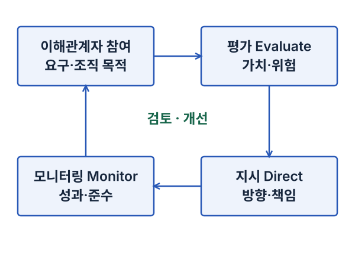

## 먼저 이해하기

IT 부서가 서버를 정상 운영해도 그 투자가 경영 목표에 맞지 않거나 중요한 위험을 방치하면 조직 차원의 문제가 된다. ISO/IEC 38500은 IT를 잘 사용하는 방향과 책임·감독을 다루도록 경영 의사결정을 돕는다. 장비 설정 지침과는 질문의 수준이 다르다.

## 답안에 남길 핵심

**정의:** ISO/IEC 38500은 조직의 IT를 효과적·효율적이며 수용 가능한 방식으로 사용하도록 지배기구와 지원자를 위한 IT 거버넌스 원칙·모델·프레임워크 지침을 제공하는 국제표준이다.

**회상 단서:** 조직 목적 · 원칙 · 이해관계자 참여 · 평가(E) · 지시(D) · 모니터링(M)

## 개념도

<figure class="concept-diagram">

<figcaption><strong>이해관계자와 EDM이 실행을 감독하는 구조</strong> 자료의 구조·설명을 바탕으로 직접 재구성한 학습용 SVG. <a href="/assets/subnotes/concepts/iso-38500.svg" target="_blank" rel="noopener">그림 크게 보기</a></figcaption>
</figure>

**읽는 법:** 2024판의 참여 요소와 EDM을 연결한 학습용 그림이며 네 항목을 PDCA와 동일한 절차로 단정하지 않는다.

**손으로 그리기:** 네 칸에 참여·평가·지시·감독을 배치하고 가운데 관리 실행을 떠올린다.

개념도 참고: <a href="https://itpe.co.kr/main/portal/selectPortalContent.do?topicId=85">ITPE 지식관리 · ISO/IEC 38500(교재 2015판)</a> · <a href="https://committee.iso.org/sites/jtc1sc40/home/projects/wg-1/published-wg1/content-left-area/isoiec-sc-40-wg-1-develops-the-s/white-paper-on-the-differences-b.html">ISO SC40 · 2015판과 2024판 차이</a> · <a href="https://webstore.ansi.org/preview-pages/DS/preview_M364614CURES.pdf">ISO/IEC 38500:2024 · 표준 목차 미리보기</a>. 확인: 2026-11-22. ITPE의 2015판 EDM 그림과 ISO SC40의 2024판 변경 설명을 대조한 재구성. 판본 간 원칙 수를 구분함.

## 핵심 구조와 답안 포인트

| 구분 | 무엇을 보는가? | 답안에서 구분할 점 |
| --- | --- | --- |
| 평가 | 현재·미래 IT 활용과 변화·위험 | 어떤 가치를 만들고 무엇을 감수하는가 |
| 지시 | 정책·방향·책임과 우선순위 | 실행 조직이 따를 의사결정 기준 |
| 모니터링 | 성과·준수·위험을 근거로 감독 | 목표와 차이가 나면 방향·조치 재검토 |
| 관리 활동 | 계획·구축·운영 등 실행 | 거버넌스가 정한 틀 안에서 수행 |
| 2024판 보완 | 이해관계자 참여와 조직 거버넌스 정렬 | EDM 세 단어만으로 최신 모델 전부를 설명하지 않음 |

**판본별 원칙:** 2015판은 책임·전략·획득·성과·준거·인간행동의 6가지다. 2024판의 11가지는 목적, 가치 창출, 전략, 감독, 책무성, 이해관계자 참여, 리더십, 데이터와 의사결정, 위험 거버넌스, 사회적 책임, 시간에 따른 생존 가능성과 성과로 정리할 수 있다. 번역은 학습용이며 공식 원문 용어와 함께 대조한다.

## 가리고 설명하기

본문을 덮고 먼저 내 말로 답한다.

1. ISO 38500과 ITSM을 구분하는 질문은?
2. 교재의 6원칙을 “최신 표준의 6원칙”이라고 적어도 될까?

내 답과 비교할 기준

**1.** ISO 38500은 조직의 IT 활용을 누가 어떤 방향과 책임으로 평가·지시·감독할지 다룬다. ITSM은 고객 가치에 맞는 서비스를 관리·제공·개선하는 실행 활동에 초점을 둔다.

**2.** 아니다. 교재의 2015판은 6원칙이며, 2024판은 ISO 37000과 정렬해 11원칙으로 확대됐다. 판본을 명시한다.

## 상황에 적용하기

AI 서비스 투자 검토에서 IT 부서는 운영 가능하다고 했으나 데이터의 법적 이용 근거와 책임자가 정해지지 않았다. 거버넌스 관점에서 무엇을 요구할까?

풀이와 판단 근거

기술 가능성만 승인 근거로 삼지 않는다. 조직 목적·가치, 이해관계자 영향, 데이터 활용 근거, 위험 수용 책임, 성과·준수 모니터링 기준을 확인한다. 지배기구가 정책·책임·의사결정 한계를 정하고 관리는 이를 실행 가능한 운영·통제로 구체화한다.

## 헷갈리지 않기

ISO/IEC 38500은 IT 거버넌스 지침 표준이다. ISO/IEC 42001 같은 경영시스템 요구사항 표준과 인증 성격을 동일시하지 않는다. “기획·구축·운영·모니터링” 같은 관리 활동을 EDM 자체의 정의로 바꾸지 않는다.

## 셀프테스트 범위와 출처

- **기본 39번.** 확정 숙제 32개와 구분하여 추가한 셀프테스트 보완 노트다.
- [151기 셀프테스트 공지와 첨부 문제지](https://cafe.naver.com/81th/243521). 문제지의 출제 예상 표현은 강사의 의견이며 실제 출제를 확정하지 않는다.
- [ITPE 지식관리 · ISO/IEC 38500(교재 2015판)](https://itpe.co.kr/main/portal/selectPortalContent.do?topicId=85)
- [ISO SC40 · 2015판과 2024판 차이](https://committee.iso.org/sites/jtc1sc40/home/projects/wg-1/published-wg1/content-left-area/isoiec-sc-40-wg-1-develops-the-s/white-paper-on-the-differences-b.html)
- [ISO/IEC 38500:2024 · 표준 목차 미리보기](https://webstore.ansi.org/preview-pages/DS/preview_M364614CURES.pdf)
- 확인일: 2026-11-22. 아래 설명과 사례는 개인 학습용으로 재구성했으며 원문 도표를 전재하지 않았다.
