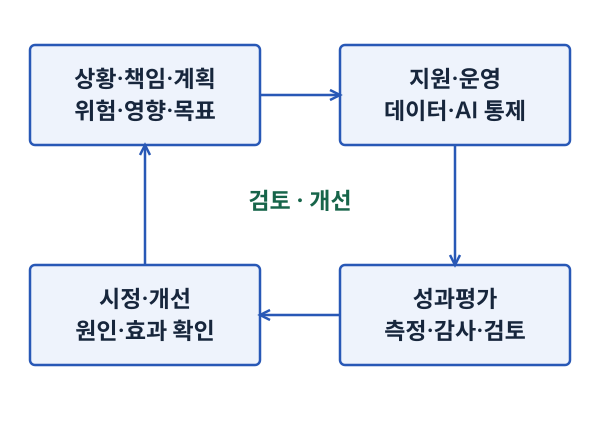

## 먼저 이해하기

AI 채용 도구의 정확도가 높더라도 어떤 집단에 불리한지, 학습 데이터가 적절한지, 오류 시 누가 중단할지 정해지지 않았다면 책임 있게 운영하기 어렵다. ISO/IEC 42001은 한 모델의 시험 점수뿐 아니라 조직이 AI를 관리하는 체계에 질문한다.

## 답안에 남길 핵심

**정의:** ISO/IEC 42001:2023은 조직이 AI 경영시스템(AIMS)을 수립·구현·유지·지속 개선하기 위한 요구사항을 정한 국제표준으로, AI의 책임 있는 개발·제공·이용을 관리한다.

**회상 단서:** AIMS · 조직 상황 · 리더십 · 위험·영향 · 운영 통제 · 성과평가 · 지속 개선

## 개념도

<figure class="concept-diagram">

<figcaption><strong>AI 경영시스템의 운영·평가·개선</strong> 자료의 구조·설명을 바탕으로 직접 재구성한 학습용 SVG. <a href="/assets/subnotes/concepts/iso-42001.svg" target="_blank" rel="noopener">그림 크게 보기</a></figcaption>
</figure>

**읽는 법:** 네 칸은 표준 경영시스템 구조를 학습용으로 묶은 것이다. 특정 알고리즘의 학습 절차와 구분한다.

**손으로 그리기:** 정책·운영·평가·개선 네 칸을 순환으로 잇고 중심에 AIMS를 적는다.

개념도 참고: <a href="https://itpe.co.kr/main/portal/selectPortalContent.do?topicId=137">ITPE 지식관리 · ISO/IEC 42001</a> · <a href="https://www.iso.org/standard/42001">ISO · ISO/IEC 42001:2023 AIMS</a>. 확인: 2026-11-22. 원문 구조·설명을 검토하여 핵심 관계만 직접 재구성한 학습용 도식. 원본 이미지는 전재하지 않음.

## 핵심 구조와 답안 포인트

| 구조 | AI 관리에서 확인할 것 | 남겨야 할 근거 |
| --- | --- | --- |
| 조직 상황·리더십 | AI 사용 목적·범위, 이해관계자, 책임·정책 | 적용 범위, 승인된 정책·역할 |
| 계획·지원 | AI 위험·영향, 목표, 역량·자원·소통 | 위험·영향 평가, 목표·교육·문서 |
| 운영 | 데이터·개발·제공·이용의 통제 | 데이터·모델·변경 이력, 운영·검증 기록 |
| 성과평가 | 목표·통제 효과, 감사·경영검토 | 모니터링·평가 결과와 검토 조치 |
| 개선 | 부적합 시정과 재발 방지 | 원인·시정조치·효과 확인 |

**답안의 중심:** 기술적 편향 검출이나 설명 가능성 도구도 필요할 수 있지만 이것만으로 경영시스템이 완성되지는 않는다. 책임자·역량·의사소통·문서화·감사·경영검토가 함께 있어야 한다. AI를 직접 개발하는 조직과 외부 모델을 이용하는 조직은 역할이 다르므로 적용 범위와 통제도 구체화한다.

## 가리고 설명하기

본문을 덮고 먼저 내 말로 답한다.

1. AIMS 인증과 특정 AI 제품의 정확도 시험은 같은가?
2. 출시 전에 한 번 위험평가를 했으면 운영 중 평가가 끝난 것일까?

내 답과 비교할 기준

**1.** 다르다. AIMS는 조직의 관리체계와 적용 범위에 관한 것이며, 특정 제품의 정확도·무오류를 자동 보증하지 않는다.

**2.** 아니다. 데이터·사용 맥락·모델이 바뀌면 위험과 영향도 달라진다. 지속적인 운영·성과평가·개선이 필요하다.

## 상황에 적용하기

대출 심사 AI가 출시 후 특정 집단에 불리한 결과를 내기 시작했다. “인증 받은 회사이므로 모델 문제는 없다”라고 답해도 될까?

풀이와 판단 근거

인증 여부와 별개로 실제 영향을 조사한다. 데이터 변화·대표성·편향, 목표와 허용 위험, 사람의 검토·중단 절차, 고객 설명·이의제기 경로를 확인한다. 문제 범위를 통제하고 원인을 교정한 후 재검증하며, 증거와 변경 이력을 남긴다. 조직의 관리체계는 이런 문제를 발견하고 개선하기 위해 작동해야 한다.

## 헷갈리지 않기

ISO/IEC 38500은 조직의 IT 거버넌스 지침, ISO/IEC 42001은 AI 경영시스템 요구사항이다. 부속 통제나 윤리 키워드를 모두 나열하는 것보다 조직의 적용 범위·위험·운영·평가가 연결되는지 설명한다. 인증을 “AI가 윤리적이고 안전하다는 영구 보증”으로 쓰지 않는다.

## 셀프테스트 범위와 출처

- **기본 49번.** 확정 숙제 32개와 구분하여 추가한 셀프테스트 보완 노트다.
- [151기 셀프테스트 공지와 첨부 문제지](https://cafe.naver.com/81th/243521). 문제지의 출제 예상 표현은 강사의 의견이며 실제 출제를 확정하지 않는다.
- [ITPE 지식관리 · ISO/IEC 42001](https://itpe.co.kr/main/portal/selectPortalContent.do?topicId=137)
- [ISO · ISO/IEC 42001:2023 AIMS](https://www.iso.org/standard/42001)
- 확인일: 2026-11-22. 아래 설명과 사례는 개인 학습용으로 재구성했으며 원문 도표를 전재하지 않았다.
