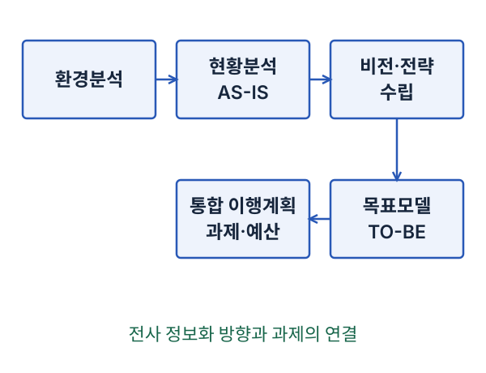

## 먼저 이해하기

기관이 “AI를 도입하자”고 해도 무엇을 어떤 순서로 바꿀지는 별개다. ISP는 사업 방향과 현재 문제를 연결해 목표 정보시스템과 실행 로드맵을 만드는 계획이다.

## 답안에 남길 핵심

**정의:** ISP(Information Strategy Planning)는 경영전략과 정보화 환경·현황을 분석해 정보화 비전·전략, 목표모델 및 통합 이행계획을 수립하는 활동이다.

**회상 단서:** 환경 → 현황 → 비전·전략 → 목표모델 → 통합 이행

## 개념도

<figure class="concept-diagram">

<figcaption><strong>ISP의 5단계와 통합 이행계획</strong> 자료의 구조·설명을 바탕으로 직접 재구성한 학습용 SVG. <a href="/assets/subnotes/concepts/isp.svg" target="_blank" rel="noopener">그림 크게 보기</a></figcaption>
</figure>

**읽는 법:** 지식관리 구축절차의 핵심 단계를 유지했다. 실제 산출물과 검토 항목은 가이드·사업 조건에 맞춘다.

**손으로 그리기:** 세 칸 뒤 아래로 내려가 두 칸 → 환·현·비·목·통을 적는다.

개념도 참고: <a href="https://itpe.co.kr/main/portal/selectPortalContent.do?topicId=3">ITPE 지식관리 · ISP·ISMP</a>. 확인: 2026-11-22. 핵심 관계만 남긴 학습용 재구성. 원본 이미지를 전재하지 않음.

## 5단계·활동·산출물

| 단계 | 무엇을 하나? | 대표 산출물 |
| --- | --- | --- |
| 환경분석 | 경영환경·법제도·기술 동향 분석 | 환경·법제도·기술 분석 결과 |
| 현황분석 | 업무·시스템·요구·벤치마킹 분석 | 현황 분석, 개선과제·차이 분석 |
| 정보화 비전·전략 | 사업 방향과 정보화 목표 정렬 | 정보화 전략 정의서 |
| 목표모델 설계 | 개선 업무·시스템·데이터·보안 구조 | 목표모델·개선과제 |
| 통합 이행계획 | 과제 순서·일정·예산·효과 정리 | 통합 이행계획서·총구축비·효과 분석 |

수업의 두음 “환형비목통”은 회상용 단서다. 실제 답안에는 단계명과 활동·산출물을 함께 쓴다. 목표모델은 보통 구현 수준의 상세 설계와 다르다.

## 가리고 설명하기

본문을 위로 올려 가린 뒤, 말하거나 빈 종이에 적는다. 정답을 읽기 전에 답한다.

1. 환경분석과 현황분석의 차이는?
2. 목표모델 뒤 통합 이행계획이 필요한 이유는?

내 답과 비교할 기준

**1.** 환경은 사업·법·기술 변화와 조건, 현황은 현재 내부 업무·시스템과 문제·요구를 분석한다.

**2.** 목표를 과제·순서·일정·비용으로 바꿔 실제 추진 가능성을 확보하기 위해서다.

## 상황에 적용하기

목표 시스템 그림은 있지만 예산과 선후행 과제가 없다. ISP의 어느 부분이 부족한가?

풀이와 판단 근거

통합 이행계획이 부족하다. 과제 의존성과 우선순위, 단계별 일정·총구축비·효과를 정해 목표모델을 실행 가능한 로드맵으로 바꿔야 한다.

## 헷갈리지 않기

ISP 수행 5단계와 공통가이드의 산출물 검토 절차는 다르다. 수업에서 사용한 공통가이드 9판은 판본으로 표기하며 영구적인 최신판이라고 단정하지 않는다.

## 수업 범위와 출처

- **최종 숙제 18/32:** ISP.
- **수업 메모의 강조 수준:** 출제·암기 강조. 5단계·활동·산출물까지 무조건 암기.
- 출제 관련 표현은 2026.11.21 수업에서 기록한 강사의 의견이다. 실제 출제 확정이나 미출제 이력의 독립 검증을 뜻하지 않는다.
- ITPE 『IT경영전략 V10.13 Part I』, PDF 파일 기준 34~42쪽을 참고하여 개인 학습용으로 재구성했다. 교재 원문·도표를 전재하지 않았다.
- [NIA ISP·ISMP 수립 공통가이드 제9판 배포](https://www.nia.or.kr/site/nia_kor/ex/bbs/View.do?bcIdx=28088&cbIdx=99835&parentSeq=28088). 수업 기준판의 공식 출처.

함께 보기: [ISMP](/subnotes/notes/ismp/) · [경제성 평가](/subnotes/notes/it-investment/)

읽은 뒤에는 [내 것으로 만드는 복습법](/subnotes/notes/mastery-method/)에 따라 다른 날 다시 설명해본다. 이 노트가 있다는 사실만으로 학습 완료·점수가 기록되지는 않는다.
