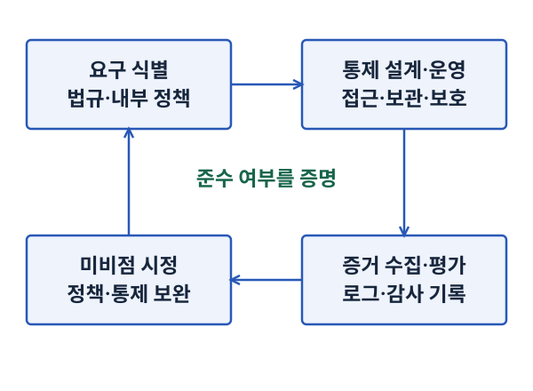

## 먼저 이해하기

“개인정보를 잘 보호하자”는 선언만으로는 준수를 입증할 수 없다. 어떤 요구에 맞춰 누가 접근을 승인하고, 어떤 로그로 확인할지까지 정해야 한다.

## 답안에 남길 핵심

**정의:** IT 컴플라이언스는 조직에 적용되는 법령·규제·계약 및 내부 정책의 요구사항을 IT 통제와 운영에 반영하고 준수 여부를 점검·개선하는 활동이다.

**회상 단서:** 요구사항 식별 → 통제 설계 → 운영 → 증적 → 점검·시정

## 개념도

<figure class="concept-diagram">

<figcaption><strong>IT 컴플라이언스의 요구·통제·증거 연결</strong> 자료의 구조·설명을 바탕으로 직접 재구성한 학습용 SVG. <a href="/assets/subnotes/concepts/it-compliance.svg" target="_blank" rel="noopener">그림 크게 보기</a></figcaption>
</figure>

**읽는 법:** 법규 이름을 나열하는 데서 끝내지 않고, 운영 통제와 준수 증거를 연결한다.

**손으로 그리기:** 요구 → 통제 → 증거 → 시정, 네 상자를 순환으로 잇는다.

개념도 참고: <a href="https://itpe.co.kr/main/portal/selectPortalContent.do?topicId=87">ITPE 지식관리 · IT 컴플라이언스</a>. 확인: 2026-11-22. 핵심 관계만 남긴 학습용 재구성. 원본 이미지를 전재하지 않음.

## 요구를 운영으로 바꾸기

| 요구 | 통제 예시 | 확인 증적 |
| --- | --- | --- |
| 인가된 사용자만 접근 | 역할별 권한, 승인·회수 절차 | 승인 기록, 권한 검토 결과 |
| 약속한 서비스 수준 충족 | 가용성 측정, 장애 대응 | SLA 보고서, 장애 기록 |
| 소프트웨어 사용조건 준수 | 라이선스 자산·배포 관리 | 구매 계약, 설치 목록 |

답안은 “법 준수”라는 단어에서 멈추지 말고 **요구-통제-증적**을 한 줄로 연결한다.

## 가리고 설명하기

본문을 위로 올려 가린 뒤, 말하거나 빈 종이에 적는다. 정답을 읽기 전에 답한다.

1. 보안과 컴플라이언스는 같은 개념일까?
2. 통제를 만들었다는 사실과 운영 증적의 차이는?

내 답과 비교할 기준

**1.** 보안은 위험과 보호 목표에 집중하고, 컴플라이언스는 적용 요구의 준수에 집중한다. 서로 겹치지만 일치하지 않는다.

**2.** 규정·설계가 있어도 실제로 시행했는지는 별도다. 승인·로그·점검 기록으로 운영 여부를 확인한다.

## 상황에 적용하기

퇴사자 계정을 즉시 회수한다는 내부 규정은 있지만 실제 회수 기록이 없다. 어떻게 보완할까?

풀이와 판단 근거

인사 변경과 계정 회수 절차를 연결하고 담당자·처리기한·예외 승인을 정한다. 회수 기록과 정기적인 잔존 계정 점검 결과를 남겨 설계와 운영을 함께 검증한다.

## 헷갈리지 않기

인증을 받았다는 사실만으로 모든 법·계약 준수를 보장하지 않는다. 구체적 법 조항·기한·벌칙은 적용 시점의 공식 원문을 확인하며, 이 노트의 예시는 법률 판단이 아니다.

## 수업 범위와 출처

- **최종 숙제 04/32:** IT-Compliance.
- **수업 메모의 강조 수준:** 용어·답안 활용. 준거성·준수 의미와 답안 활용 중심.
- 출제 관련 표현은 2026.11.21 수업에서 기록한 강사의 의견이다. 실제 출제 확정이나 미출제 이력의 독립 검증을 뜻하지 않는다.
- ITPE 『IT경영전략 V10.13 Part I』, PDF 파일 기준 345~347쪽을 참고하여 개인 학습용으로 재구성했다. 교재 원문·도표를 전재하지 않았다.

함께 보기: [IT 거버넌스](/subnotes/notes/it-governance/) · [SLA](/subnotes/notes/sla/)

읽은 뒤에는 [내 것으로 만드는 복습법](/subnotes/notes/mastery-method/)에 따라 다른 날 다시 설명해본다. 이 노트가 있다는 사실만으로 학습 완료·점수가 기록되지는 않는다.
