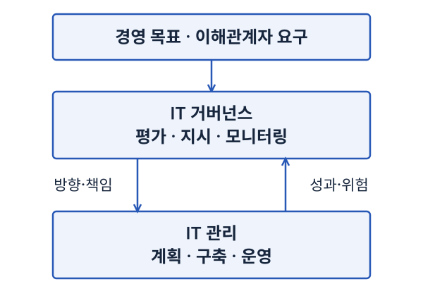

## 먼저 이해하기

IT팀이 프로젝트를 일정대로 끝내도 사업에 필요 없는 시스템이면 성공이라 하기 어렵다. 거버넌스는 무엇을 왜 할지, 누가 책임질지 정하고 결과를 감독한다. 관리는 정해진 방향을 실행한다.

## 답안에 남길 핵심

**정의:** IT 거버넌스는 조직의 IT 활용이 사업 목적과 이해관계자 요구에 부합하도록 의사결정·책임·감독 체계를 통해 평가하고 방향을 제시하며 성과와 준수를 확인하는 활동이다.

**회상 단서:** 전략 정렬 · 가치 전달 · 위험·자원 · 성과 · EDM

## 개념도

<figure class="concept-diagram">

<figcaption><strong>IT 거버넌스의 방향·책임과 실행의 연결</strong> 자료의 구조·설명을 바탕으로 직접 재구성한 학습용 SVG. <a href="/assets/subnotes/concepts/it-governance.svg" target="_blank" rel="noopener">그림 크게 보기</a></figcaption>
</figure>

**읽는 법:** 거버넌스가 방향·책임·감독을 정하고, 관리가 실행과 운영을 수행한다.

**손으로 그리기:** 위 경영 목표 → 거버넌스 → 관리, 가운데 왕복 화살표에 방향·성과.

개념도 참고: <a href="https://itpe.co.kr/main/portal/selectPortalContent.do?topicId=83">ITPE 지식관리 · IT 거버넌스</a>. 확인: 2026-11-22. 핵심 관계만 남긴 학습용 재구성. 원본 이미지를 전재하지 않음.

## 거버넌스와 관리의 연결

| 활동 | 질문 |
| --- | --- |
| 평가 | 투자 가치·위험·대안이 적절한가? |
| 지시 | 우선순위·정책·책임을 어떻게 정할까? |
| 감독 | 목표 성과·준수·위험 상태를 충족하는가? |

**판본 주의:** 교재의 책임·전략·획득·성과·준거·인간행동 6원칙은 ISO/IEC 38500:2015 맥락이다. ISO의 공식 비교 설명은 2024판이 ISO 37000과 정렬하면서 11원칙으로 바뀌었다고 명시한다. 6원칙을 최신판 전체 원칙으로 쓰지 않는다.

## 가리고 설명하기

본문을 위로 올려 가린 뒤, 말하거나 빈 종이에 적는다. 정답을 읽기 전에 답한다.

1. 거버넌스와 관리를 주문 시스템 투자로 구분하자.
2. EDM을 풀고 실제 활동을 말해보자.

내 답과 비교할 기준

**1.** 거버넌스는 투자 필요·우선순위·책임·결과 감독, 관리는 개발·운영 자원을 계획하고 실행하는 활동이다.

**2.** 평가: 가치·위험 검토, 지시: 정책·목표 설정, 감독: 결과·준수 확인.

## 상황에 적용하기

AI 도입 사업이 많지만 중복투자와 책임 공백이 생겼다. 거버넌스 관점에서 무엇을 바꿀까?

풀이와 판단 근거

전사 우선순위와 투자 승인 기준, 데이터·모델 책임자, 성과·위험 지표를 정한다. 기존 과제와 중복을 평가하고 실행 결과를 정기 감독해 조정한다.

## 헷갈리지 않기

IT 거버넌스를 ITSM 운영절차나 컴플라이언스만으로 축소하지 않는다. 교재의 판본과 공식 표준의 현재 구조를 구분해 답안의 기준을 밝힌다.

## 수업 범위와 출처

- **최종 숙제 21/32:** IT 거버넌스.
- **수업 메모의 강조 수준:** 출제 강조. 시험문제 나옴이라고 별도 강조. ISO38500/EDM 연계.
- 출제 관련 표현은 2026.11.21 수업에서 기록한 강사의 의견이다. 실제 출제 확정이나 미출제 이력의 독립 검증을 뜻하지 않는다.
- ITPE 『IT경영전략 V10.13 Part I』, PDF 파일 기준 328~339쪽을 참고하여 개인 학습용으로 재구성했다. 교재 원문·도표를 전재하지 않았다.
- [ISO · 38500:2015와 2024의 차이](https://committee.iso.org/sites/jtc1sc40/home/projects/wg-1/published-wg1/content-left-area/isoiec-sc-40-wg-1-develops-the-s/white-paper-on-the-differences-b.html). 판본 교정 근거.

함께 보기: [IT 컴플라이언스](/subnotes/notes/it-compliance/) · [BSC·IT-BSC](/subnotes/notes/bsc-it-bsc/)

읽은 뒤에는 [내 것으로 만드는 복습법](/subnotes/notes/mastery-method/)에 따라 다른 날 다시 설명해본다. 이 노트가 있다는 사실만으로 학습 완료·점수가 기록되지는 않는다.
