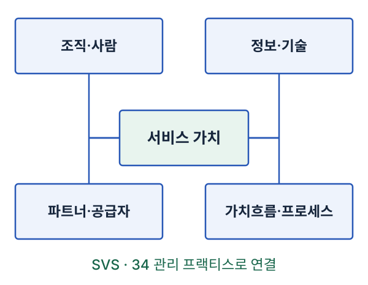

## 먼저 이해하기

장애 처리팀은 빨리 닫은 티켓 수를 자랑하지만 고객은 같은 문제로 계속 전화한다. ITIL 4는 부서별 처리량을 넘어 고객과 함께 얻는 서비스 가치를 보도록 돕는 관리 지침이다. 도구 설치나 문서 양식 자체가 목적은 아니다. 이 노트는 문제에서 지정한 **ITIL 4**의 구성에 답하며, 이를 무조건 최신 버전이라고 부르지 않는다.

## 답안에 남길 핵심

**정의:** ITIL 4는 디지털 제품·서비스를 통해 가치를 공동 창출하도록 조직의 서비스관리 활동을 연결하는 모범사례 프레임워크다.

**회상 단서:** 4차원 · SVS · SVC 6활동 · 34 관리 프랙티스 · 7 지도 원칙 · 가치 공동창출

## 개념도

<figure class="concept-diagram">

<figcaption><strong>ITIL 4의 4차원과 서비스 가치</strong> 자료의 구조·설명을 바탕으로 직접 재구성한 학습용 SVG. <a href="/assets/subnotes/concepts/itil-v4.svg" target="_blank" rel="noopener">그림 크게 보기</a></figcaption>
</figure>

**읽는 법:** 주변 네 칸은 동시에 고려할 차원이다. 가운데 서비스 가치를 두고 SVS·관리 프랙티스로 연결한다.

**손으로 그리기:** 가운데 서비스 가치 → 주변에 조직·사람, 정보·기술, 파트너·공급자, 가치흐름·프로세스 네 칸.

개념도 참고: <a href="https://itpe.co.kr/main/portal/selectPortalContent.do?topicId=72">ITPE 지식관리 · ITIL 4</a> · <a href="https://www.peoplecert.org/browse-certifications/it-governance-and-service-management/ITIL-1/itil-4-foundation-2565">PeopleCert · ITIL 4 Foundation</a>. 확인: 2026-11-22. 지식관리 4차원 그림을 단순화. SVC를 7활동으로 적은 일부 원본 표기는 공식 6활동으로 정정함.

## ITIL 4를 설명할 네 묶음

| 묶음 | 기억할 구성 | 답안의 연결 |
| --- | --- | --- |
| 서비스관리 4차원 | 조직과 사람 / 정보와 기술 / 파트너와 공급자 / 가치흐름과 프로세스 | 기술만 바꾸지 않고 사람·협력·업무 전체를 본다 |
| SVS | 지도 원칙·거버넌스·서비스 가치사슬·프랙티스·지속적 개선 | 기회·수요가 가치로 이어지는 전체 체계 |
| 관리 프랙티스 | 일반관리 14·서비스관리 17·기술관리 3, 합계 34 | 사고·문제·변경·서비스 수준 등을 실제로 수행하는 역량 |
| 지도 원칙 | 아래 7개 | 환경이 달라도 판단을 돕는 권고 |

**7 지도 원칙:** 가치에 집중, 현재 상태에서 시작, 피드백과 함께 반복적으로 진전, 협업과 가시성 증진, 전체적으로 사고·업무 수행, 단순하고 실용적으로 유지, 최적화와 자동화.

‘원칙 7개’와 ‘SVC 활동 6개’를 섞지 않는다. [SVS·SVC](/subnotes/notes/svs-svc/)의 SVC 6활동은 **계획·개선·관여·설계 및 전환·획득/구축·제공 및 지원**이다. 제품·서비스는 이 활동들의 산출물이며 일곱 번째 활동이 아니다.

ITIL 3의 서비스 수명주기 틀과 달리, ITIL 4 답안은 SVS와 4차원을 중심에 둔다. 다만 이전 버전의 지식이 전부 폐기됐다는 뜻은 아니다.

## 가리고 설명하기

자료를 덮고 말하거나 빈 종이에 적는다. 정답을 열기 전에 두 질문에 먼저 답한다.

1. ITIL 4의 4차원을 모두 설명해보자.
2. 7 지도 원칙과 SVC 6활동은 어떻게 다른가?

내 답과 비교할 기준

**1.** 조직·사람, 정보·기술, 파트너·공급자, 가치흐름·프로세스다. 서비스의 설계·운영에서 네 측면을 균형 있게 고려한다.

**2.** 지도 원칙은 의사결정의 권고이며, SVC는 수요를 가치로 연결하는 운영 활동 모델이다. 개수와 역할이 모두 다르다.

## 상황에 적용하기

새 서비스관리 도구를 샀지만 직원의 역할이 불명확하고 협력사는 장애 정보를 받지 못한다. 어느 차원을 보완해야 할까?

풀이와 판단 근거

정보·기술만 바꾼 상태다. 조직·사람의 역할과 교육, 파트너·공급자의 협업·책임, 가치흐름·프로세스의 인계와 정보공유를 함께 설계한다. 도구 도입 완료보다 고객의 복구·해결 경험을 기준으로 효과를 검증한다.

## 헷갈리지 않기

ITIL은 ITSM이라는 활동 자체와 동일하지 않다. 준수 인증 규격이나 모든 조직이 같은 절차를 따라야 하는 고정 매뉴얼로 쓰지도 않는다. ITPE 일부 그림은 SVC를 7개로 적지만, 공식 ITIL 설명의 **6개 활동**으로 바로잡았다.

## 셀프테스트 범위와 출처

- **셀프테스트 추가 범위:** 기본 12번 · ITIL V4. 확정 숙제 32개에 새 숙제 번호를 붙이는 것이 아니라 문제지의 추가 주제를 별도로 보완한다.
- [ITPE 151기 셀프테스트 공지·문제지](https://cafe.naver.com/81th/243521). 문제 번호는 로컬 보관 PDF와 대조했다. 문제지의 출제 예상 표현은 실제 출제 확정을 뜻하지 않는다.
- [ITPE 지식관리 · ITIL 4](https://itpe.co.kr/main/portal/selectPortalContent.do?topicId=72).
- [PeopleCert · ITIL 4 Foundation](https://www.peoplecert.org/browse-certifications/it-governance-and-service-management/ITIL-1/itil-4-foundation-2565).
- [PeopleCert 공식 발표자료 · 7 지도 원칙](https://www.peoplecert.org/news-and-announcements/2024/-/media/2048efb812304872960038ec981a791a.ashx) PDF 15쪽(인쇄 16쪽).
- [공식 ITIL 채널 · SVC 6활동](https://www.youtube.com/watch?v=qF2Ccw5tiZg).

확인일: 2026-11-22. 원문 도표를 전재하지 않고 개인 학습용 설명과 그림으로 재구성했다. 학습 여부는 가리고 설명·비교·적용하는 답변으로 확인한다.
