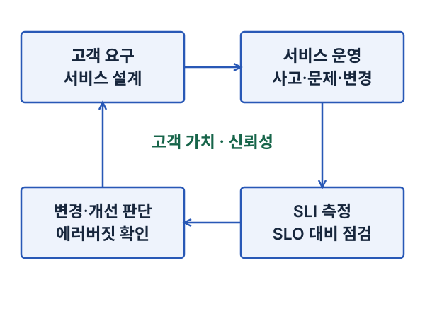

## 먼저 이해하기

서버가 정상이어도 고객이 주문을 못 하면 좋은 서비스가 아니다. ITSM은 필요한 서비스를 제공·개선하는 관리이고, SLO·에러버짓은 품질과 변경 속도를 조정하는 기준이다.

## 답안에 남길 핵심

**정의:** ITSM(IT Service Management)은 고객 가치와 요구에 맞춰 IT 서비스를 설계·전환·제공·운영·개선하는 관리 활동이다. SLO는 서비스 수준 목표이며 에러버짓은 목표가 허용하는 불완전성의 범위다.

**회상 단서:** 서비스 가치 · 사고/문제/변경 · SLI · SLO · 에러버짓

## 개념도

<figure class="concept-diagram">

<figcaption><strong>ITSM에서 SLO와 에러버짓을 쓰는 위치</strong> 자료의 구조·설명을 바탕으로 직접 재구성한 학습용 SVG. <a href="/assets/subnotes/concepts/itsm-slo-error-budget.svg" target="_blank" rel="noopener">그림 크게 보기</a></figcaption>
</figure>

**읽는 법:** 에러버짓은 SLO가 허용하는 불완전성의 범위다. SLO 99.9%이면 허용 실패 비율은 0.1%다.

**손으로 그리기:** 서비스 운영 순환 네 칸 → 점검에 SLI·SLO, 판단에 에러버짓을 적는다.

개념도 참고: <a href="https://itpe.co.kr/main/portal/selectPortalContent.do?topicId=75">ITPE 지식관리 · ITSM</a> · <a href="https://itpe.co.kr/main/portal/selectPortalContent.do?topicId=3162">ITPE 지식관리 · SLO·에러버짓</a>. 확인: 2026-11-22. 핵심 관계만 남긴 학습용 재구성. 원본 이미지를 전재하지 않음.

## 지표에서 판단으로

| 용어 | 질문 | 예 |
| --- | --- | --- |
| SLI | 무엇을 어떻게 측정하나? | 유효 요청 중 성공 비율 |
| SLO | 어느 기간에 어느 수준을 목표로 하나? | 30일간 성공률 99.9% |
| SLA | 고객과 어떤 수준·책임을 약속했나? | 목표·측정·미달 조치 합의 |
| 에러버짓 | 허용되는 실패 범위는? | 성공률 99.9%이면 실패 비율 0.1% |

시간 기반 가용성이라면 30일은 43,200분이므로 **허용 중단시간 = 43,200 × 0.001 = 43.2분**이다. 요청 기반이면 분 대신 실패 요청 건수로 계산한다.

사고 관리는 복구, 문제 관리는 원인·재발 방지, 변경 관리는 변경 위험을 통제한다. 예산을 초과하면 합의한 정책에 따라 신뢰성 개선에 집중한다.

## 가리고 설명하기

본문을 위로 올려 가린 뒤, 말하거나 빈 종이에 적는다. 정답을 읽기 전에 답한다.

1. SLI·SLO·SLA를 구분해보자.
2. 0.1%는 장애를 내도 되는 권리일까?

내 답과 비교할 기준

**1.** SLI는 지표, SLO는 목표치, SLA는 고객과의 서비스 수준 합의다.

**2.** 아니다. 변경과 신뢰성을 조정하는 기준이며 계약·안전 요구를 면제하지 않는다.

## 상황에 적용하기

30일 가용성 SLO 99.9%인데 이미 50분 중단됐다. 큰 변경을 바로 배포할까?

풀이와 판단 근거

시간 예산 43.2분을 초과했다. 정책에 따라 위험한 변경을 제한하고 안정화·원인 제거를 우선한다. 긴급 보안 수정 등 예외는 영향과 승인 기준에 따라 판단한다.

## 헷갈리지 않기

ITSM=ITIL은 아니다. ITIL은 참고 체계 중 하나다. 요청 실패율을 중단 분으로 바로 환산하지 않는다.

## 수업 범위와 출처

- **최종 숙제 11/32:** ITSM(+SLO/에러버짓).
- **수업 메모의 강조 수준:** ITSM 출제 강조 / 하위 항목 메모 미확인. ITSM은 반복 강조. SLO·에러버짓은 메모에 직접 언급 없음. 최종 숙제에는 포함.
- 출제 관련 표현은 2026.11.21 수업에서 기록한 강사의 의견이다. 실제 출제 확정이나 미출제 이력의 독립 검증을 뜻하지 않는다.
- ITPE 『IT경영전략 V10.13 Part I』, PDF 파일 기준 243~247, 280~284쪽을 참고하여 개인 학습용으로 재구성했다. 교재 원문·도표를 전재하지 않았다.
- [Google SRE Workbook · Implementing SLOs](https://sre.google/workbook/implementing-slos/). SLI·SLO·에러버짓 개념 보완.

함께 보기: [SLA](/subnotes/notes/sla/)

읽은 뒤에는 [내 것으로 만드는 복습법](/subnotes/notes/mastery-method/)에 따라 다른 날 다시 설명해본다. 이 노트가 있다는 사실만으로 학습 완료·점수가 기록되지는 않는다.
