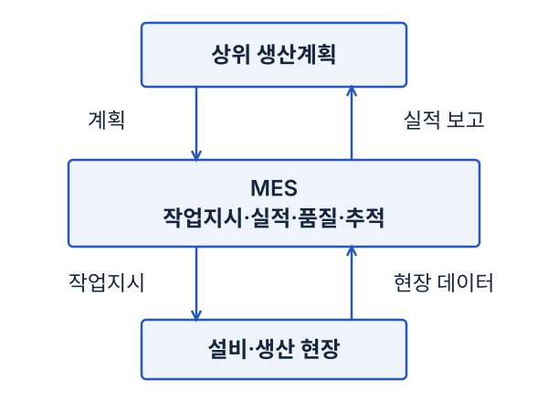

## 먼저 이해하기

오늘 1,000개를 만들라는 계획만으로 현장이 돌아가지는 않는다. 어떤 설비에서 어떤 순서로 만들고 불량이 얼마나 났는지 알아야 한다. MES는 생산 실행의 상태와 이력을 관리한다.

## 답안에 남길 핵심

**정의:** MES(Manufacturing Execution System)는 생산 현장의 작업지시·공정 진척·자원·품질·실적 및 이력을 관리하여 생산 활동을 지원하는 시스템이다.

**회상 단서:** 작업지시 · 공정·진척 · 품질 · 실적 · 추적성 · POP

## 개념도

<figure class="concept-diagram">

<figcaption><strong>MES가 계획과 현장 실행을 연결하는 위치</strong> 자료의 구조·설명을 바탕으로 직접 재구성한 학습용 SVG. <a href="/assets/subnotes/concepts/mes.svg" target="_blank" rel="noopener">그림 크게 보기</a></figcaption>
</figure>

**읽는 법:** MES는 현장 실행을 관리한다. 장기 계획이나 설비 제어 각각과 범위를 구분한다.

**손으로 그리기:** 계획·MES·현장 세 층 → 왼쪽은 아래 지시, 오른쪽은 위 실적.

개념도 참고: <a href="https://itpe.co.kr/main/portal/selectPortalContent.do?topicId=53">ITPE 지식관리 · MES</a>. 확인: 2026-11-22. 핵심 관계만 남긴 학습용 재구성. 원본 이미지를 전재하지 않음.

## 계획과 제어 사이

| 용어 | 초점 |
| --- | --- |
| MES | 생산 실행의 관리·가시성·추적 |
| POP(Point of Production) | 현장 실적·상태 데이터 수집 |
| PLC | 설비 논리·순차 제어 |
| DCS | 분산된 공정 제어 |
| SCADA | 감시·제어·데이터 수집 |

계층은 이해를 위한 개략도다. 실제 제품 구성과 기능 중첩은 달라질 수 있다. 핵심은 계획-실행-현장 데이터의 연결이다.

## 가리고 설명하기

본문을 위로 올려 가린 뒤, 말하거나 빈 종이에 적는다. 정답을 읽기 전에 답한다.

1. MES가 PLC와 다른 이유는?
2. 불량 원인을 추적하려면 어떤 기록을 연결할까?

내 답과 비교할 기준

**1.** MES는 작업·품질·이력 등 실행 관리, PLC는 설비의 제어 논리에 초점을 둔다.

**2.** 원자재·로트·설비·작업자·공정 조건·검사 결과·시간을 연결한다.

## 상황에 적용하기

특정 시간대에 생산한 제품에서 불량이 나왔다. MES 데이터를 어떻게 활용할까?

풀이와 판단 근거

해당 시간의 로트·설비 조건·작업 이력·원자재·검사 결과를 추적해 영향 범위를 식별한다. 작업 중지·격리·재작업과 원인 개선으로 연결한다.

## 헷갈리지 않기

MES를 센서 데이터 저장소만으로 설명하지 않는다. 수집 데이터가 지시·진척·품질·추적에 어떻게 쓰이는지 연결한다. 생산 현장에서는 안전·가용성 제약도 함께 고려한다.

## 수업 범위와 출처

- **최종 숙제 26/32:** MES.
- **수업 메모의 강조 수준:** 출제 강조. 잘 나옴. PLC·DCS·SCADA·POP 용어 연계.
- 출제 관련 표현은 2026.11.21 수업에서 기록한 강사의 의견이다. 실제 출제 확정이나 미출제 이력의 독립 검증을 뜻하지 않는다.
- ITPE 『IT경영전략 V10.13 Part I』, PDF 파일 기준 188~189쪽을 참고하여 개인 학습용으로 재구성했다. 교재 원문·도표를 전재하지 않았다.

함께 보기: [SCM](/subnotes/notes/scm/) · [AX](/subnotes/notes/ax-transformation/)

읽은 뒤에는 [내 것으로 만드는 복습법](/subnotes/notes/mastery-method/)에 따라 다른 날 다시 설명해본다. 이 노트가 있다는 사실만으로 학습 완료·점수가 기록되지는 않는다.
