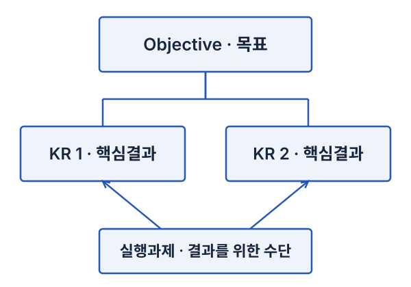

## 먼저 이해하기

“서비스 신뢰를 높이자”는 방향만으로는 얼마나 좋아졌는지 알기 어렵다. “반복 장애를 월 8건에서 3건으로 줄이고, 장애 고객 만족도를 70점에서 85점으로 높인다”처럼 확인 가능한 결과가 필요하다. OKR은 도전할 목표와 그 목표의 진전을 보여주는 핵심결과를 연결하는 방식이다.

## 답안에 남길 핵심

**정의:** OKR(Objectives and Key Results)은 달성하려는 목표(Objective)에 측정 가능한 핵심결과(Key Results)를 연결하고, 조직·팀의 우선순위를 정렬하며 진행을 점검하는 목표 설정·실행 관리 프레임워크다.

**회상 단서:** 목표 O · 측정 가능한 결과 KR · 우선순위·정렬·점검 · 결과와 활동 구분

## 개념도

<figure class="concept-diagram">

<figcaption><strong>목표·핵심결과·실행과제의 연결</strong> 자료의 구조·설명을 바탕으로 직접 재구성한 학습용 SVG. <a href="/assets/subnotes/concepts/okr.svg" target="_blank" rel="noopener">그림 크게 보기</a></figcaption>
</figure>

**읽는 법:** 위에서 목표를 읽고 아래 결과로 진전을 확인한다. 실행과제는 결과를 만들기 위한 수단이다.

**손으로 그리기:** 위 O 한 칸 → 가운데 KR 두 칸 → 아래 실행과제 한 칸. 결과에서 목표로 기여 관계를 설명한다.

개념도 참고: <a href="https://itpe.co.kr/main/portal/selectPortalContent.do?topicId=9">ITPE 지식관리 · OKR 구성도</a> · <a href="https://rework.withgoogle.com/intl/en/guides/set-goals-with-okrs">Google re:Work · OKR 가이드</a>. 확인: 2026-11-22. 원본 목표 계층도를 단순화하고, 핵심결과와 실행과제의 역할 차이를 Google 가이드와 대조해 보완함.

## O·KR·실행과제를 구분하기

| 항목 | 질문 | 예 |
| --- | --- | --- |
| Objective | 어떤 상태로 나아가고 싶은가? | 고객이 안심하고 쓰는 주문 서비스 |
| Key Result | 진전을 어떤 증거로 확인하나? | 분기 내 반복 장애 8→3건, 만족도 70→85점 |
| 실행과제 | 결과를 위해 무엇을 할 것인가? | 장애 재발 방지, 복구 훈련, 관측성 개선 |

실행과제의 완료와 고객에게 생긴 결과는 다르다. “교육 3회 개최”만으로 역량 향상을 확인하기 어렵다면, 실제 업무에서의 오류율·처리 정확도 같은 결과 지표를 보완한다. 기준선·목표치·기간·측정 책임·데이터를 같이 정해야 같은 결과를 보고 판단할 수 있다.

## OKR과 BSC 비교

| 비교 축 | OKR | BSC |
| --- | --- | --- |
| 중심 | 선택한 목표와 핵심결과의 실행·학습 | 전략을 균형 있는 관점과 지표로 구체화 |
| 구조 | O 아래 측정 가능한 KR | 재무·고객·내부 프로세스·학습과 성장 |
| 점검 | 짧은 주기 점검·조정에 활용 | 전략과 성과의 연결을 지속 검토 |
| 연결 | 전략 과제의 집중 실행에 활용 가능 | OKR의 방향·관점 선택에 근거 제공 가능 |

분기 운영이나 60~70% 달성은 알려진 운영 사례이지 모든 OKR의 고정 법칙은 아니다. 반드시 지킬 약속과 도전 목표를 구분하고, 평가·보상에 어떻게 사용하는지도 조직에서 합의해야 한다. OKR은 조직 목표를 무시한 개인 할 일 목록도 아니다.

## 가리고 설명하기

자료를 덮고 말하거나 빈 종이에 적는다. 정답을 열기 전에 두 질문에 먼저 답한다.

1. “분기 중 고객 인터뷰 10회”는 언제나 좋은 KR일까?
2. OKR과 BSC는 서로 하나만 선택해야 하는 대체 관계일까?

내 답과 비교할 기준

**1.** 활동·산출물 지표일 수 있다. 무엇을 알아내 어떤 고객 결과를 바꾸려는지 연결하고, 목표 달성을 보여줄 결과 증거를 보완한다.

**2.** 아니다. BSC의 전략 관점·목표를 바탕으로 특정 개선 과제의 OKR을 설정하는 등 함께 쓸 수 있다. 두 체계의 목적과 측정 중복을 조정한다.

## 상황에 적용하기

앱 팀이 “신뢰 향상”의 KR로 새 화면 5개 출시만 정했다. 이대로 목표 달성을 판단해도 될까?

풀이와 판단 근거

화면 출시가 신뢰를 높였다는 증거가 부족하다. 오류·불만·거래 성공률·고객 경험 등 목표와 연결된 결과 지표를 선택하고 기준선과 기간을 정한다. 화면 출시는 그 결과를 위한 실행과제로 관리할 수 있다.

## 헷갈리지 않기

Objective는 모호한 구호로, KR은 숫자 붙인 할 일로 끝내지 않는다. 모든 KR의 100% 달성이 쉬워야 한다거나 항상 70%만 달성하면 된다고 단정하지 않는다. [BSC·IT-BSC](/subnotes/notes/bsc-it-bsc/)와 같은 축으로 비교해본다.

## 셀프테스트 범위와 출처

- **셀프테스트 추가 범위:** 기본 42번 · OKR과 BSC 설명·비교. 확정 숙제 32개에 새 숙제 번호를 붙이는 것이 아니라 문제지의 추가 주제를 별도로 보완한다.
- [ITPE 151기 셀프테스트 공지·문제지](https://cafe.naver.com/81th/243521). 문제 번호는 로컬 보관 PDF와 대조했다. 문제지의 출제 예상 표현은 실제 출제 확정을 뜻하지 않는다.
- [ITPE 지식관리 · OKR 구성도](https://itpe.co.kr/main/portal/selectPortalContent.do?topicId=9).
- [Google re:Work · OKR 가이드](https://rework.withgoogle.com/intl/en/guides/set-goals-with-okrs).

확인일: 2026-11-22. 원문 도표를 전재하지 않고 개인 학습용 설명과 그림으로 재구성했다. 학습 여부는 가리고 설명·비교·적용하는 답변으로 확인한다.
