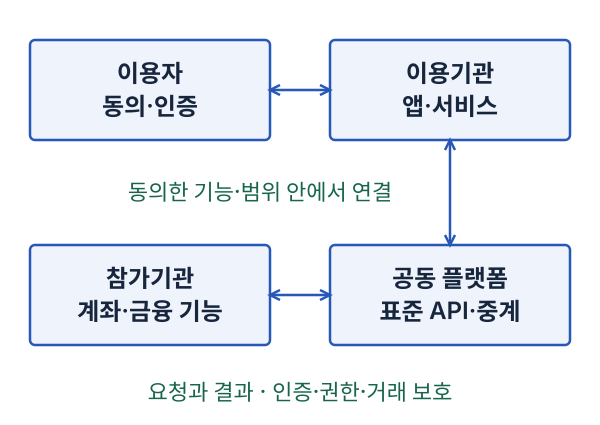

## 먼저 이해하기

하나의 앱에서 여러 은행 계좌를 조회한다고 해서 앱이 은행 비밀번호를 받아 화면을 대신 조작해야 하는 것은 아니다. 이용자의 동의와 인증을 바탕으로 허용된 금융 기능을 표준 API로 호출할 수 있다. 국내 오픈뱅킹은 이를 위한 공동의 금융결제 플랫폼을 제공한다.

## 답안에 남길 핵심

**정의:** 오픈뱅킹(Open Banking)은 참가기관의 금융 기능을 표준화된 API로 제공해 이용기관이 통합 금융 서비스를 구현하도록 지원하는 개방형 금융결제 인프라다. 국내에서는 금융결제원이 거래중계 등 공동업무를 제공한다.

**회상 단서:** 표준 API · 이용자 동의 · 인증·권한 · 이용기관 · 참가기관 · 거래중계

## 개념도

<figure class="concept-diagram">

<figcaption><strong>국내 오픈뱅킹의 서비스 연결 관계</strong> 자료의 구조·설명을 바탕으로 직접 재구성한 학습용 SVG. <a href="/assets/subnotes/concepts/open-banking.svg" target="_blank" rel="noopener">그림 크게 보기</a></figcaption>
</figure>

**읽는 법:** 화살표는 기능의 연결 관계다. 동의 범위와 인증·권한 검증은 전체 연계에서 유지한다.

**손으로 그리기:** 이용자·이용기관·플랫폼·참가기관 네 칸과 요청·결과 방향을 그린다.

개념도 참고: <a href="https://openapi.kftc.or.kr/service/openBanking">금융결제원 · 오픈뱅킹 개요</a> · <a href="https://openapi.kftc.or.kr/openapi/openbanking/userAuth">금융결제원 · 오픈뱅킹 사용자 인증</a>. 확인: 2026-11-22. 지식관리 오픈뱅킹 항목을 확인했으나 본문·도식이 없어 근거로 사용하지 않음. 금융결제원 공식 설명과 인증 문서를 바탕으로 직접 구성함.

## 핵심 구조와 비교

| 구성 | 역할 | 확인할 통제 |
| --- | --- | --- |
| 이용자 | 계좌 연결과 서비스 이용의 의사 표시 | 동의 대상·목적·철회·인증 |
| 이용기관 | 앱 등에서 통합 금융 서비스를 제공 | 권한 범위·토큰 보호·오류 처리 |
| 공동 플랫폼 | 표준 API와 거래중계 제공 | 연계 가용성·인증·거래 추적 |
| 참가기관 | 허용된 계좌 정보·금융 기능 처리 | 요청 권한·처리 결과·거래 보호 |

답안은 **이용자 → 이용기관 → 공동 플랫폼 → 참가기관**의 관계로 구성하면 쉽다. 반환되는 결과와 인증·권한을 함께 표시한다. 제공 API의 개수·참여기관·세부 이용 조건은 바뀔 수 있으므로 오래된 숫자를 외운 채 정의처럼 쓰지 않고 해당 공식 안내를 확인한다.

## 가리고 설명하기

정답을 펼치기 전에 자료를 가리고, 정의와 그림을 내 말로 설명한다.

1. 오픈뱅킹에서 “오픈”은 아무나 모든 계좌 정보를 볼 수 있다는 뜻일까?
2. 표준 API를 이용해도 동의와 거래 보호가 필요한 이유는?

내 답과 비교할 기준

**1.** 아니다. 정해진 참여·이용 조건, 사용자 인증·동의, 허용된 권한 아래 기능을 연결한다는 뜻이다.

**2.** 인터페이스 표준화와 사용자 권한·거래 안전은 다른 문제다. 계좌·기능의 범위와 허용 여부를 확인하고 접근정보·결과를 보호해야 한다.

## 상황에 적용하기

계좌 조회에 동의한 이용자에게 앱이 별도 확인 없이 자동 이체 기능까지 켜려고 한다. API가 있으니 가능하다고 볼까?

풀이와 판단 근거

조회와 이체는 기능과 위험이 다르다. 이용자가 허용한 권한 범위와 실제 요청이 일치하는지 확인하고, 필요한 동의·인증·거래 승인 절차를 적용해야 한다. 토큰의 존재만으로 모든 금융 기능의 이용 권한을 확장하지 않는다.

## 헷갈리지 않기

오픈뱅킹과 화면 스크래핑, 마이데이터를 같은 용어로 쓰지 않는다. 표준 API로 금융 기능을 제공하는 인프라와 정보를 전송·관리하는 제도·서비스는 관점과 범위가 다를 수 있다. 전체 금융 데이터를 무조건 제공한다는 설명도 피한다.

## 셀프테스트 범위와 출처

- **셀프테스트 추가 범위:** 심화 6번. 확정 숙제 32개와 별도로 문제지에 포함된 주제다. 문제지에 실렸다는 사실과 강사의 출제 예상·암기 강조는 구분한다.
- [ITPE 151기 1~2주차 셀프테스트 공지와 첨부 문제지](https://cafe.naver.com/81th/243521). 원문을 전재하지 않고 질문의 요구에 맞춰 개인 학습용으로 정리했다.
- [금융결제원 · 오픈뱅킹 개요](https://openapi.kftc.or.kr/service/openBanking)
- [금융결제원 · 오픈뱅킹 사용자 인증](https://openapi.kftc.or.kr/openapi/openbanking/userAuth)
- 확인일: 2026-11-22. 개념도는 출처의 구조·설명을 바탕으로 직접 구성한 학습용 그림이다.
