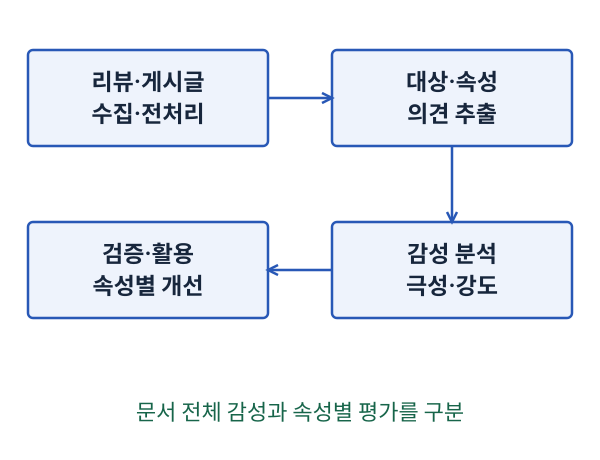

## 먼저 이해하기

“화면은 예쁜데 배터리는 너무 빨리 닳는다.” 이 문장을 통째로 긍정이나 부정 하나로만 분류하면 제품의 개선점을 놓친다. 화면 디자인에는 긍정, 배터리 지속시간에는 부정이라는 **대상·속성별 의견**을 나눠야 한다. 사실을 적은 문장과 평가를 담은 문장도 먼저 구분할 필요가 있다.

## 답안에 남길 핵심

**정의:** 오피니언 마이닝(Opinion Mining)은 리뷰·게시글 등 텍스트에서 의견의 대상·속성과 평가 표현을 추출하고, 감성의 극성·강도·맥락을 분석해 평가·요구·동향을 파악하는 기술이다.

**회상 단서:** 대상·속성 · 의견 추출 · 긍정·부정·중립 · 감성 강도 · 부정어·풍자·도메인

## 개념도

<figure class="concept-diagram">

<figcaption><strong>의견에서 속성별 평가와 개선점 추출</strong> 자료의 구조·설명을 바탕으로 직접 재구성한 학습용 SVG. <a href="/assets/subnotes/concepts/opinion-mining.svg" target="_blank" rel="noopener">그림 크게 보기</a></figcaption>
</figure>

**읽는 법:** 분석은 추정이다. 속성·맥락을 함께 봐야 같은 문장의 긍정과 부정을 구분할 수 있다.

**손으로 그리기:** 수집·추출·감성·활용 네 상자 → 추출 아래 대상·속성, 감성 아래 극성·강도. 

개념도 참고: <a href="https://itpe.co.kr/main/portal/selectPortalContent.do?topicId=17">ITPE 지식관리 · 오피니언 구성요소</a>. 확인: 2026-11-22. 원본 처리 흐름과 구성요소 표를 대조해 대상·속성 중심으로 단순화함.

## 문장에서 개선 근거로

| 분석 요소 | 질문 | 예 |
| --- | --- | --- |
| 대상·개체 | 무엇에 대한 평가인가? | 특정 휴대전화 |
| 속성(Aspect) | 어떤 특성에 대한 평가인가? | 화면·배터리 |
| 평가·극성 | 좋아하는가, 불만인가? | 디자인 긍정·지속시간 부정 |
| 강도·맥락 | 얼마나, 어떤 조건에서 그런가? | 게임 중 배터리가 매우 빨리 감소 |

일반적인 흐름은 **수집 → 전처리 → 의견·대상·속성 추출 → 감성 분류·집계 → 검증·활용**이다. 형태소·부정어·문맥을 처리하고, 감성사전·분류 모델·언어모델 등을 목적에 맞게 선택한다. 결과는 문서 단위, 문장 단위, 속성 단위로 낼 수 있다.

텍스트 마이닝은 주제·개체·분류·요약 등 텍스트의 정보 추출 전반을 다룬다. 오피니언 마이닝은 그중 의견·평가의 방향과 대상을 중심으로 본다. 단어 빈도만 세는 것보다 맥락이 중요하며, “작다”도 휴대성에는 칭찬이지만 화면 크기에는 불만일 수 있다.

분석 후 실제 리뷰 표본과 대조해 오분류를 확인하고, 수집 채널·언어·시점·조작 리뷰 편향을 함께 기록한다. 전체 고객을 대표하지 않는 SNS 표본을 시장 전체의 생각으로 일반화하지 않는다.

## 가리고 설명하기

자료를 덮고 말하거나 빈 종이에 적는다. 정답을 열기 전에 두 질문에 먼저 답한다.

1. 한 문장 안에 긍정과 부정이 함께 있으면 어떻게 처리할까?
2. 긍정 단어를 많이 찾으면 정확한 의견 분석이라고 볼 수 있을까?

내 답과 비교할 기준

**1.** 대상·속성을 분리해 각각의 평가를 추출한다. 문서 전체의 극성 하나만으로 세부 개선점을 덮지 않는다.

**2.** 아니다. 부정어, 풍자, 비교, 조건, 도메인 의미를 확인해야 한다. “좋기는 한데 다시 안 산다”는 단어 수만으로 해석하기 어렵다.

## 상황에 적용하기

신제품 리뷰 100개에서 “배송은 빠르지만 설치가 어렵다”가 반복된다. 보고서를 “대체로 긍정적”으로 끝내도 될까?

풀이와 판단 근거

배송과 설치를 분리해 배송 만족과 설치 불편을 각각 보고한다. 설치 단계·설명서·지원 채널에 대한 추가 근거를 찾고 개선 우선순위를 제안한다. 리뷰 수집 기간·채널과 표본의 한계도 명시해 전체 고객 만족도와 혼동하지 않는다.

## 헷갈리지 않기

감성 분류 결과는 사람의 마음을 직접 측정한 사실이 아니다. 모델이 텍스트 표현에서 추정한 결과다. 개인정보가 포함된 리뷰는 수집·보관·공개 범위를 통제하며, 출처와 표본 조건을 보존한다. [데이터 마이닝](/subnotes/notes/data-mining/)의 일반 패턴 탐색과 분석 목적을 구분한다.

## 셀프테스트 범위와 출처

- **셀프테스트 추가 범위:** 기본 22번 · 오피니언 마이닝. 확정 숙제 32개에 새 숙제 번호를 붙이는 것이 아니라 문제지의 추가 주제를 별도로 보완한다.
- [ITPE 151기 셀프테스트 공지·문제지](https://cafe.naver.com/81th/243521). 문제 번호는 로컬 보관 PDF와 대조했다. 문제지의 출제 예상 표현은 실제 출제 확정을 뜻하지 않는다.
- [ITPE 지식관리 · 오피니언 마이닝](https://itpe.co.kr/main/portal/selectPortalContent.do?topicId=17).
- [ITPE 지식관리 · 오피니언 구성요소](https://itpe.co.kr/main/portal/selectPortalContent.do?topicId=17).

확인일: 2026-11-22. 원문 도표를 전재하지 않고 개인 학습용 설명과 그림으로 재구성했다. 학습 여부는 가리고 설명·비교·적용하는 답변으로 확인한다.
