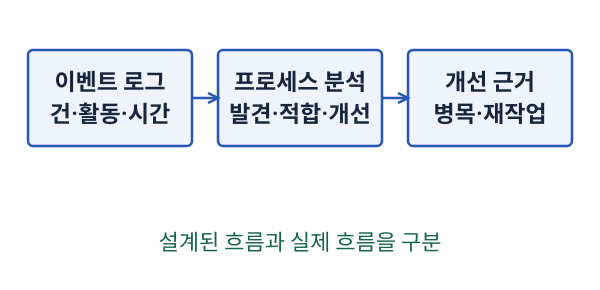

## 먼저 이해하기

규정에는 “접수→검토→승인”이라고 쓰였지만 실제 업무는 검토를 세 번 되돌아가느라 오래 걸린다. 담당자에게 물어본 이상적인 절차 대신, 시스템의 처리 기록을 연결하면 어떤 경로로 업무가 흘렀는지 확인할 수 있다. 프로세스 마이닝의 출발점은 이런 **이벤트 로그**다.

## 답안에 남길 핵심

**정의:** 프로세스 마이닝은 정보시스템의 이벤트 로그를 이용해 실제 프로세스를 발견하고, 기존 모델과의 적합성을 검사하며, 성능·조직 정보를 추가해 프로세스를 개선하는 기법이다.

**회상 단서:** Case ID · Activity · Timestamp · 발견·적합성 검사·개선 · 병목·재작업

## 개념도

<figure class="concept-diagram">

<figcaption><strong>이벤트 로그에서 실제 프로세스와 개선 근거로</strong> 자료의 구조·설명을 바탕으로 직접 재구성한 학습용 SVG. <a href="/assets/subnotes/concepts/process-mining.svg" target="_blank" rel="noopener">그림 크게 보기</a></figcaption>
</figure>

**읽는 법:** 왼쪽은 분석 증거이며 가운데의 세 기법은 선택·조합할 분석 방식이다. 로그가 완전하다는 보장은 없다.

**손으로 그리기:** 세 상자에 로그·분석·근거를 쓰고 화살표로 잇는다. 로그 아래 Case·Activity·Time을 적는다.

개념도 참고: <a href="https://itpe.co.kr/main/portal/selectPortalContent.do?topicId=16">ITPE 지식관리 · 프로세스 마이닝</a> · <a href="https://www.tf-pm.org/resources/manifesto">IEEE Task Force · Process Mining Manifesto</a>. 확인: 2026-11-22. ITPE 본문의 기법 설명과 IEEE 선언문의 입출력 관계를 바탕으로 직접 재구성. 해당 ITPE 현재 이미지 2개는 RPA·초자동화 도식이므로 프로세스 마이닝 원본 그림으로 사용하지 않음.

## 먼저 로그를 읽고, 데이터 마이닝과 비교하기

| 로그 필드 | 역할 | 예 |
| --- | --- | --- |
| Case ID | 같은 업무 건의 사건들을 묶는다 | 반품 101번 |
| Activity | 수행한 활동을 구분한다 | 접수·검토·승인 |
| Timestamp | 순서·대기·처리시간을 파악한다 | 접수 10시, 검토 11시 |
| 추가 속성 | 원인·자원·상황을 분석한다 | 담당자·금액·채널 |

| 비교 축 | 프로세스 마이닝 | 데이터 마이닝 |
| --- | --- | --- |
| 주된 질문 | 어떤 순서로 흘렀고 어디서 지연·이탈했나? | 어떤 관계·패턴·예측 규칙이 있나? |
| 중심 데이터 | 업무 건별 활동 이벤트와 순서 | 거래·고객·속성 등 분석 데이터 |
| 결과 예 | 프로세스 모델, 재작업 경로, 병목·규정 이탈 | 분류·회귀·군집·연관규칙 |
| 개선 예 | 승인 인계·반복 검토 흐름 수정 | 이탈 고객 예측·상품 추천 |

**발견**은 로그에서 모델을 만든다. **적합성 검사**는 로그와 기존 모델을 비교한다. **개선(Enhancement)**은 로그에서 얻은 시간·자원 정보 등으로 모델을 확장·보완한다. 로그에 남지 않은 전화·수작업은 빠질 수 있으므로 데이터 품질과 업무 경계를 먼저 확인한다.

## 가리고 설명하기

자료를 덮고 말하거나 빈 종이에 적는다. 정답을 열기 전에 두 질문에 먼저 답한다.

1. 단순 웹 접근 로그만 있으면 항상 업무 흐름을 재구성할 수 있을까?
2. 발견과 적합성 검사의 입력은 어떻게 다른가?

내 답과 비교할 기준

**1.** 아니다. 업무 건 식별·활동 의미·순서가 연결돼야 한다. 필요한 사건 누락, 서로 다른 시간대, 잘못된 Case ID는 분석을 왜곡한다.

**2.** 발견은 이벤트 로그에서 모델을 도출한다. 적합성 검사는 기존 모델과 실제 이벤트 로그를 함께 받아 차이를 확인한다.

## 상황에 적용하기

Case ID 없이 “승인 완료” 시각만 모았다. 이 자료로 반품 검토의 재작업률과 대기시간을 확정할 수 있을까?

풀이와 판단 근거

확정하기 어렵다. 어떤 접수·검토 사건이 같은 반품 건인지 연결해야 재작업과 인계 시간을 계산할 수 있다. Case ID와 활동별 시각을 보완하고, 누락·중복·동시 수행·시간대도 검증한다. 화면에 그럴듯한 흐름도가 나오는 것만으로 정확성을 보장하지 않는다.

## 헷갈리지 않기

프로세스 마이닝을 RPA 자체나 프로세스 설계 도구와 동일시하지 않는다. 마이닝은 실제 흐름의 증거를 찾고, RPA는 정해진 업무의 실행 자동화를 수행한다. 데이터 마이닝과도 분석 초점이 다르지만 함께 활용할 수 있다.

## 셀프테스트 범위와 출처

- **셀프테스트 추가 범위:** 기본 13번 · 프로세스 마이닝과 Data Mining 비교. 확정 숙제 32개에 새 숙제 번호를 붙이는 것이 아니라 문제지의 추가 주제를 별도로 보완한다.
- [ITPE 151기 셀프테스트 공지·문제지](https://cafe.naver.com/81th/243521). 문제 번호는 로컬 보관 PDF와 대조했다. 문제지의 출제 예상 표현은 실제 출제 확정을 뜻하지 않는다.
- [ITPE 지식관리 · 프로세스 마이닝](https://itpe.co.kr/main/portal/selectPortalContent.do?topicId=16).
- [IEEE Task Force · Process Mining Manifesto](https://www.tf-pm.org/resources/manifesto).

확인일: 2026-11-22. 원문 도표를 전재하지 않고 개인 학습용 설명과 그림으로 재구성했다. 학습 여부는 가리고 설명·비교·적용하는 답변으로 확인한다.
