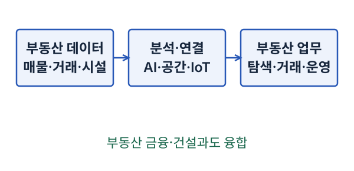

## 먼저 이해하기

집을 보러 가기 전에 가상 공간으로 내부를 확인하고, 주변 거래·입지 데이터를 비교하며, 입주 뒤 설비 상태를 관리할 수 있다. 부동산 앱 하나가 아니라 부동산의 생애주기에서 생기는 정보·거래·운영 문제를 기술로 개선하는 접근이 프롭테크다.

## 답안에 남길 핵심

**정의:** 프롭테크(PropTech)는 부동산(Property)에 정보기술(Technology)을 결합해 부동산의 개발·탐색·거래·금융·관리·운영을 개선하는 기술과 서비스다.

**회상 단서:** 부동산 · 데이터 분석 · 거래 연결 · 자산 운영 · 핀테크·콘테크 융합

## 개념도

<figure class="concept-diagram">

<figcaption><strong>프롭테크가 연결하는 부동산 업무</strong> 자료의 구조·설명을 바탕으로 직접 재구성한 학습용 SVG. <a href="/assets/subnotes/concepts/proptech.svg" target="_blank" rel="noopener">그림 크게 보기</a></figcaption>
</figure>

**읽는 법:** 입력 데이터와 적용 기술이 어떤 부동산 업무를 개선하는지 연결한다.

**손으로 그리기:** 데이터 → 기술 → 업무 세 칸, 마지막에 탐색·거래·관리를 적는다.

개념도 참고: <a href="https://itpe.co.kr/main/portal/selectPortalContent.do?topicId=1245">ITPE 지식관리 · 프롭테크 구성</a>. 확인: 2026-11-22. 자료의 핵심 관계를 손으로 그릴 수 있도록 직접 재구성함.

## 핵심 구조와 비교

| 적용 영역 | 기술·서비스 예 | 실제로 줄이려는 문제 |
| --- | --- | --- |
| 탐색·중개 | 위치·매물 데이터, AI 추천, VR 투어 | 정보 비대칭·탐색 비용 |
| 개발·건설 연계 | BIM, 드론, 공정 데이터 | 설계·현장의 단절과 재작업 |
| 금융·투자 | 디지털 심사·중개·투자 플랫폼 | 자금 조달·거래 접근의 불편 |
| 관리·운영 | IoT 설비 감시, 에너지 관리 | 고장·낭비·관리 사각지대 |
| 신뢰 기반 | 권리·거래 정보 확인, 접근 통제 | 허위·오류 정보와 개인정보 위험 |

답안에서는 **부동산 업무 → 문제 → 적용 기술 → 서비스 변화**를 한 줄로 연결한다. “IoT 활용”보다 “설비 센서로 이상 징후를 모아 예방 정비를 지원한다”가 의미가 분명하다. 법적 권리나 수익률을 보장하는 표현은 피하고, 개인정보·거래 정보의 신뢰를 함께 적는다.

## 가리고 설명하기

정답을 펼치기 전에 자료를 가리고, 정의와 그림을 내 말로 설명한다.

1. 프롭테크를 온라인 부동산 중개와 같다고 하면 빠지는 것은?
2. VR 투어를 제공하면 실제 거래 검증은 생략해도 될까?

내 답과 비교할 기준

**1.** 부동산 개발·금융·관리·운영 등 전체 생애주기의 기술 활용을 놓친다.

**2.** 아니다. 영상의 최신성, 실제 상태, 권리·계약 조건을 별도로 확인해야 한다. 편리한 시각화가 정보의 진실성을 자동 보장하지 않는다.

## 상황에 적용하기

매물 추천 모델이 특정 지역만 반복 추천한다. 사용자가 많이 클릭했으니 좋은 서비스라고 평가할까?

풀이와 판단 근거

이용자의 요구와 예산에 맞는 후보를 충분히 제공했는지, 데이터 누락·광고 우선순위·편향으로 선택이 좁아졌는지 확인한다. 추천 근거와 광고 여부를 명확히 하고 정보 최신성·오류 정정 경로를 마련한다. 클릭률 외에 탐색 효율·정보 정확도·이용자 만족을 함께 본다.

## 헷갈리지 않기

프롭테크·핀테크·콘테크는 서로 배타적인 상자가 아니다. 부동산 금융 서비스는 핀테크와 겹치고 스마트 건설은 콘테크와 연결된다. 다만 부동산을 다룬다고 모든 서비스를 동일한 기술 구조로 설명하지 않는다.

## 셀프테스트 범위와 출처

- **셀프테스트 추가 범위:** 기본 46번. 확정 숙제 32개와 별도로 문제지에 포함된 주제다. 문제지에 실렸다는 사실과 강사의 출제 예상·암기 강조는 구분한다.
- [ITPE 151기 1~2주차 셀프테스트 공지와 첨부 문제지](https://cafe.naver.com/81th/243521). 원문을 전재하지 않고 질문의 요구에 맞춰 개인 학습용으로 정리했다.
- [ITPE 지식관리 · 프롭테크](https://itpe.co.kr/main/portal/selectPortalContent.do?topicId=1245)
- [ITPE 지식관리 · 프롭테크 구성](https://itpe.co.kr/main/portal/selectPortalContent.do?topicId=1245)
- 확인일: 2026-11-22. 개념도는 출처의 구조·설명을 바탕으로 직접 구성한 학습용 그림이다.
