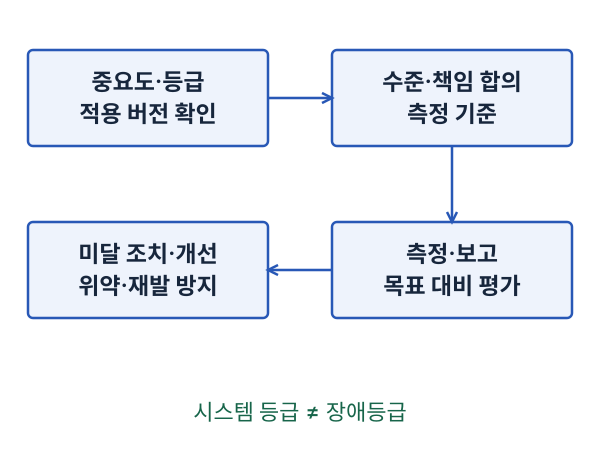

## 먼저 이해하기

주민등록·안전·민원 서비스의 장애는 기관 내부 불편을 넘어 국민 생활에 영향을 준다. 중요도에 맞는 품질을 약속하려면 “중요한 시스템인가”, “이번 장애가 얼마나 심각한가”, “운영자가 무엇을 지켜야 하는가”를 나누어야 한다. 이 세 질문을 한 등급으로 뭉치면 가용률·복구시간·위약금도 잘못 연결된다.

## 답안에 남길 핵심

**정의:** 공공 SLA는 행정·공공기관과 정보시스템 위탁 운영자가 서비스 대상·목표수준·측정·평가와 미달 시 조치 등을 정하는 서비스수준협약이다.

**회상 단서:** 국민 영향 · 시스템 등급 · 장애등급 · 가용률 · 측정·평가 · 계약상 위약

## 개념도

<figure class="concept-diagram">

<figcaption><strong>공공 SLA의 중요도·약속·측정·조치 연결</strong> 자료의 구조·설명을 바탕으로 직접 재구성한 학습용 SVG. <a href="/assets/subnotes/concepts/public-sla.svg" target="_blank" rel="noopener">그림 크게 보기</a></figcaption>
</figure>

**읽는 법:** 서비스 중요도와 사고 심각도를 구분하고 측정에서 계약상 조치까지 연결한다.

**손으로 그리기:** 등급 → 약속 → 측정 → 조치 네 칸, 등급 두 종류를 옆에 따로 적는다.

개념도 참고: <a href="https://itpe.co.kr/main/portal/selectPortalContent.do?topicId=68">ITPE 지식관리 · SLA의 측정·보상 체계</a> · <a href="https://www.mois.go.kr/frt/bbs/type010/commonSelectBoardArticle.do?bbsId=BBSMSTR_000000000008&amp;nttId=120101">행안부 · 2025.08.28. 공공 SLA 표준안(첨부 PDF 1~3쪽)</a> · <a href="https://www.mois.go.kr/frt/bbs/type010/commonSelectBoardArticle.do?bbsId=BBSMSTR_000000000008&amp;nttId=129047">행안부 · 2026.08.27. A1~A4 정보시스템 재분류</a> · <a href="https://www.law.go.kr/LSW/admRulLsInfoP.do?admRulSeq=2100000277792">국가법령정보센터 · 정보시스템 안정성 고시(2026.4.13.)</a>. 확인: 2026-11-22. ITPE SLA 관계도와 행안부 정책·현행 고시를 대조한 학습용 재구성. 시스템 등급·장애등급·사업 범위를 구분하며, 도식은 법정 절차 네 단계의 인용이 아님.

## 시스템 등급과 SLA 적용

2026.4.13. 시행 「정보시스템 안정성 고시」 제11조·부칙과 별표1을 기준으로 정리했다. 등급 산정은 국민 영향도 70%(중요도50·연속성20), 사용자 수·서비스 파급도·대체 가능성 각10%를 보고 유형과 심의를 함께 고려한다. 사용자 수만으로 등급을 결정하지 않는다.

| 시스템 등급 | 분류의 중심 | 확인된 SLA 적용 |
| --- | --- | --- |
| A1 · 국가 핵심 | 생명·안전·재산·국가 기능에 심각한 영향, 대체 곤란 | 등급에 맞는 목표를 설정해 위탁 운영자와 체결 |
| A2 · 대국민 필수 | 국민의 기본생활에 필수, 상시·연속 사용 | 체결 대상 |
| A3 · 행정 중요 | 핵심·필수 서비스와 연결된 중요한 내부 행정 | 체결 대상 |
| A4 · 국민·행정 일반 | 영향·범위가 상대적으로 작고 대체 용이 | 기관장 판단으로 미적용 가능 |

**적용 시점:** 부칙은 등급 재분류·확정 이후 최초로 도래하는 위탁운영 계약부터 제11조를 적용하도록 정한다. 이는 현행 확인본의 내용이다. 2025 발표의 구1·2등급과 A1·A2를 자동으로 같은 분류로 바꾸지 않는다.

## 현행 관리지표와 측정·위약

고시 별표4는 **장애등급과 사업 범위**에 따라 가용률을 구분한다. 아래 숫자는 2026 시행본의 예이며 모든 계약에 같은 하나의 숫자를 적용한다는 뜻이 아니다.

| 항목 | 확인한 기준 | 답안의 주의점 |
| --- | --- | --- |
| 장애 1등급 가용률 | 개별 HW·기반SW·응용SW 사업: 목표100%, 최소99.92% / 통합사업: 목표100%, 최소99.90% | 목표와 최소, 개별과 통합 사업을 구분 |
| 필수 가용성 지표 | 가중치 30% 이상 | 선택지표는 운영 특성에 맞게 협의 |
| 장애조치 최대허용 | 장애1·2·3·4등급: 120·180·300·480분 | 시스템 A1~A4의 RTO 표가 아님. 예외 조정 규정 확인 |
| 종합평가 위약 | 월간 미흡10%·불량20% 등 예시와 종합평가 감면 구조 | 평가구간·부과율은 협의 조정 가능, 법정 과태료가 아님 |
| 장시간장애 위약 | 분당 계약금액×초과시간×장애등급 가중치 | 1·2등급 필수, 3·4등급 권고. 조건·조정 규정 확인 |

측정은 장애의 시작·종료, 서비스 경계, 제외 조건, 증빙과 보고 책임을 합의해야 의미가 있다. 불가항력 재해 제외와 별도 DR 정책도 확인한다. 기관별 목표를 더 엄격하게 정하는 문제와 법령·계약이 허용하는 조정 범위는 구분한다.

## 가리고 설명하기

1. 시스템 A1 등급과 장애 1등급은 같은 분류일까?
2. “공공 SLA는 2027년부터만 의무이므로 지금은 체결할 필요가 없다”는 주장은 맞을까?

내 답과 비교할 기준

**1.** 아니다. 시스템의 중요도 분류와 발생 장애의 영향·심각도 분류는 다른 축이다. 적용 기준과 사업 범위까지 확인한다.

**2.** 아니다. 2025 보도자료는 표준안 시범·2027 의무화 계획을 발표했으나, 2026 시행 고시의 체결 대상과 부칙 적용 시점도 확인해야 한다.

## 상황에 적용하기

제안서에 “모든 A1 시스템은 최소 가용률99.92%와 120분 복구만 맞추면 된다”고 적었다. 무엇을 고칠까?

풀이와 판단 근거

시스템 중요도, 장애등급, 계약 사업 범위, SLA 목표와 DR의 RTO를 구분한다. 99.92%는 특정 조건의 최소수준이고 120분은 장애1등급의 장애조치 최대허용시간이다. A1의 재해복구 목표로 치환하지 않는다. 적용 고시·협약 버전과 조건을 확인하고 측정·보고·미달 조치를 구체화한다.

## 헷갈리지 않기

문제지의 “2027년 의무화 추진”은 2025 정책 발표와 연결되는 문장이다. 이미 시행 중인 2026 고시의 의무·부칙과 구분해 쓴다. **2025 표준안 숫자를 2026 A1~A4에 자동 대응시키지 않는다.** 더 엄격한 목표를 제안한다면 학습상 설계 제안임을 밝히고 근거·비용·검증 방법을 붙인다.

## 셀프테스트 범위와 출처

- **2교시 4번.** 확정 숙제 32개와 구분한 셀프테스트 보완 노트다.
- [151기 셀프테스트 문제지](https://cafe.naver.com/81th/243521)
- [정보시스템 안정성 고시 · 2026.4.13. 시행본](https://www.law.go.kr/LSW/admRulLsInfoP.do?admRulSeq=2100000277792), [별표1 등급산정](https://www.law.go.kr/LSW/flDownload.do?flSeq=163450753&bylClsCd=200201), [별표4 SLA 관리지표](https://www.law.go.kr/LSW/flDownload.do?flSeq=163451379&bylClsCd=200201). 본문 제11조·부칙과 첨부 원문을 직접 확인했다.
- [행안부 · 2025.8.28. 표준안 발표와 2027 계획](https://www.mois.go.kr/frt/bbs/type010/commonSelectBoardArticle.do?bbsId=BBSMSTR_000000000008&nttId=120101)
- [ITPE 지식관리 · SLA](https://itpe.co.kr/main/portal/selectPortalContent.do?topicId=68). 개념 설명은 개인 학습용으로 재구성했다.
- 확인일: 2026-11-22. 계약에 적용할 때에는 최신 고시·경과조치·협약 조건을 대조한다.
