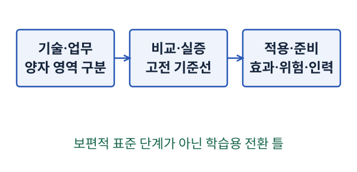

## 먼저 이해하기

양자 기술이 유망하다는 말만 듣고 기존 시스템을 전부 교체할 수는 없다. 분자 계산을 개선하려는 것인지, 통신 보호를 검토하는 것인지, 정밀 측정을 하려는 것인지 먼저 나눠야 한다. QX는 이런 양자 기술의 활용과 조직 준비를 전환 관점에서 묶어 설명할 때 사용하는 말이다.

## 답안에 남길 핵심

**정의:** 퀀텀 전환(Quantum Transformation, QX)은 양자 기술의 특성과 성숙도를 바탕으로 적용 가능한 업무·서비스를 탐색하고, 실증·인력·기반·위험 대응을 준비하는 전환 관점이다. 이 노트에서는 셀프테스트의 용어를 학습용으로 풀어 쓴다.

**회상 단서:** 양자 계산 · 양자 통신 · 양자 센싱 · 적용 적합성 · 고전·양자 결합 · 실증

## 개념도

<figure class="concept-diagram">

<figcaption><strong>QX의 적용 탐색과 검증</strong> 자료의 구조·설명을 바탕으로 직접 재구성한 학습용 SVG. <a href="/assets/subnotes/concepts/quantum-transformation.svg" target="_blank" rel="noopener">그림 크게 보기</a></figcaption>
</figure>

**읽는 법:** 양자 기술의 가능성과 개별 업무에서 검증된 효과를 구분한다.

**손으로 그리기:** 기술·업무 → 비교 실증 → 준비·적용 판단 세 칸으로 그린다.

개념도 참고: <a href="https://www.nist.gov/programs-projects/applications-quantum-information">NIST · Applications of Quantum Information</a> · <a href="https://quantum.cloud.ibm.com/learning/en/courses/quantum-computing-in-practice/introduction">IBM Quantum Learning · Quantum utility와 advantage</a> · <a href="https://www.ibm.com/think/topics/quantum-computing">IBM · What is quantum computing?</a>. 확인: 2026-11-22. 지식관리 QX 항목을 확인했으나 본문·도식이 없어 근거로 사용하지 않음. 공식 기술 설명을 참고해 적용 검증 관점의 학습용 도식을 직접 구성함.

## 핵심 구조와 비교

| 기술 영역 | 주로 다루는 문제 | 구분할 점 |
| --- | --- | --- |
| 양자 계산 | 양자 상태를 활용한 계산·시뮬레이션 | 모든 문제에서 고전 컴퓨터보다 빠른 것은 아님 |
| 양자 통신 | 양자 특성을 활용한 정보 전달·보호 | QKD와 양자내성암호(PQC)는 다른 방식 |
| 양자 센싱 | 물리량의 정밀 측정 | 계산 서비스와 같은 성숙도로 볼 수 없음 |
| 조직의 준비 | 사례 탐색·실험·인력·보안 전환 검토 | 준비 계획과 이미 검증된 사업 효과를 구분 |

답안에는 **기술 영역 구분 → 적합 업무 선정 → 고전 기준선과 실증 → 인력·기반·위험 준비**를 제시한다. 이는 문제를 이해하기 위한 제안 틀이다. IBM은 실제 활용에서 유용성(utility)과 의미 있는 문제의 비교 우위(advantage)를 구분해 설명한다. 실험·데모를 곧바로 보편적 우위로 확대하지 않는다.

## 가리고 설명하기

정답을 펼치기 전에 자료를 가리고, 정의와 그림을 내 말로 설명한다.

1. QX를 “AI보다 다음 단계이므로 모든 업무를 양자로 교체”라고 써도 될까?
2. 양자 계산의 실증에서 기존 방법과 비교해야 할 것은?

내 답과 비교할 기준

**1.** 아니다. 기술 영역·업무 적합성·성숙도가 다르고, QX가 보편적으로 합의된 표준 단계명도 아니다.

**2.** 정답 품질·시간·비용뿐 아니라 입력·출력 처리와 고전 계산 자원, 오류·검증 비용을 포함한 전체 효과다.

## 상황에 적용하기

최적화 데모의 계산 한 부분이 빨랐다는 이유로 전체 물류 시스템의 양자 전환 효과가 입증됐다고 주장한다. 무엇을 확인할까?

풀이와 판단 근거

문제 규모와 제약이 실제 업무와 같은지, 비교한 고전 알고리즘이 적절한지, 데이터 준비·입출력·검증을 포함한 전체 시간과 비용을 확인한다. 일부 계산의 성능과 전체 업무의 이득을 구분하고, 실증 결과·한계·다음 검증 조건을 기록한다.

## 헷갈리지 않기

QX는 현재 모든 조직에 동일하게 적용되는 표준 프로세스나 완성된 제품 등급이 아니다. 양자 컴퓨터가 암호를 곧바로 모두 해독한다거나 보안 전환이 이미 불필요하다는 식의 단정도 피한다. 양자내성암호는 양자 컴퓨터 자체를 쓰는 암호와 구분한다.

## 셀프테스트 범위와 출처

- **셀프테스트 추가 범위:** 심화 5번. 확정 숙제 32개와 별도로 문제지에 포함된 주제다. 문제지에 실렸다는 사실과 강사의 출제 예상·암기 강조는 구분한다.
- [ITPE 151기 1~2주차 셀프테스트 공지와 첨부 문제지](https://cafe.naver.com/81th/243521). 원문을 전재하지 않고 질문의 요구에 맞춰 개인 학습용으로 정리했다.
- [IBM Quantum Learning · Quantum utility와 advantage](https://quantum.cloud.ibm.com/learning/en/courses/quantum-computing-in-practice/introduction)
- [IBM · What is quantum computing?](https://www.ibm.com/think/topics/quantum-computing)
- [NIST · Applications of Quantum Information](https://www.nist.gov/programs-projects/applications-quantum-information)
- 확인일: 2026-11-22. 개념도는 출처의 구조·설명을 바탕으로 직접 구성한 학습용 그림이다.
