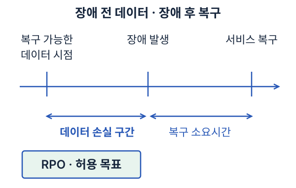

## 먼저 이해하기

14시 장애인데 13시 55분 데이터까지 복구할 수 있다면 거래 5분이 사라질 수 있다. RPO는 이 데이터 손실을 어디까지 허용할지 정하는 목표다.

## 답안에 남길 핵심

**정의:** RPO(Recovery Point Objective)는 사고 시 복구해야 할 데이터의 목표 시점으로, 허용 가능한 데이터 손실 범위를 시간으로 표현한 것이다.

**회상 단서:** 데이터 손실 · 복원 시점 · 백업 주기 · 복제 지연

## 개념도

<figure class="concept-diagram">

<figcaption><strong>RPO를 구분하는 공통 시간축</strong> 자료의 구조·설명을 바탕으로 직접 재구성한 학습용 SVG. <a href="/assets/subnotes/concepts/rpo.svg" target="_blank" rel="noopener">그림 크게 보기</a></figcaption>
</figure>

**읽는 법:** 그림의 구간은 실제 결과를 뜻하며 RPO·RTO는 허용 목표다. 실제 손실·복구시간이 목표 이내인지 비교한다.

**손으로 그리기:** 시간축 → 데이터 시점·장애·복구 세 점 → 장애 좌우에 두 구간.

개념도 참고: <a href="https://itpe.co.kr/main/portal/selectPortalContent.do?topicId=82">ITPE 지식관리 · RTO·RPO</a>. 확인: 2026-11-22. 원본의 시간축을 대조해 RPO는 장애 전 데이터 손실, RTO는 장애 후 복구 소요시간의 목표로 구분함.

## 백업과 실제 복구 가능 시점

| 방법 | RPO에 주는 영향 |
| --- | --- |
| 백업 주기 단축 | 손실 가능 구간 감소 |
| 로그·증분 보호 | 전체 백업 이후 변경 복원 |
| 데이터 복제 | 전송·적용 지연과 정합성 확인 |
| CDP | 세밀한 복원 시점 선택 지원 |

스케줄이 짧아도 백업 실패·누락·복제 지연이 있으면 목표를 지키지 못한다. 복구 가능한 데이터 시점을 시험한다.

## 가리고 설명하기

본문을 위로 올려 가린 뒤, 말하거나 빈 종이에 적는다. 정답을 읽기 전에 답한다.

1. RPO·RTO는 시간축에서 어느 방향을 보나?
2. 5분마다 백업하면 언제나 RPO 5분일까?

내 답과 비교할 기준

**1.** RPO는 과거의 데이터 시점, RTO는 중단 후 서비스 복구까지 미래 방향이다.

**2.** 성공·정합성·실제 복원 가능성과 처리 지연을 확인해야 한다.

## 상황에 적용하기

RPO 5분, 장애 14시. 복구 가능한 데이터는 13시 45분이다. 10분 만에 복구하면 RPO도 충족할까?

풀이와 판단 근거

아니다. 데이터 공백 15분으로 RPO 5분을 초과한다. 작업 속도는 RTO 평가와 관련되며 데이터 손실 목표를 대체하지 않는다.

## 헷갈리지 않기

교재 일부의 “중단부터 정상가동까지”라는 설명은 RTO와 혼동될 수 있어 바로잡았다. RPO는 데이터 공백이며 복구 작업 소요시간이 아니다.

## 수업 범위와 출처

- **최종 숙제 16/32:** RPO.
- **수업 메모의 강조 수준:** 출제·암기 강조. RTO와 함께 암기 강조.
- 출제 관련 표현은 2026.11.21 수업에서 기록한 강사의 의견이다. 실제 출제 확정이나 미출제 이력의 독립 검증을 뜻하지 않는다.
- ITPE 『IT경영전략 V10.13 Part I』, PDF 파일 기준 320, 326~327쪽을 참고하여 개인 학습용으로 재구성했다. 교재 원문·도표를 전재하지 않았다.

반드시 비교: [RTO](/subnotes/notes/rto/) · 구현: [DRS](/subnotes/notes/drs/)

읽은 뒤에는 [내 것으로 만드는 복습법](/subnotes/notes/mastery-method/)에 따라 다른 날 다시 설명해본다. 이 노트가 있다는 사실만으로 학습 완료·점수가 기록되지는 않는다.
