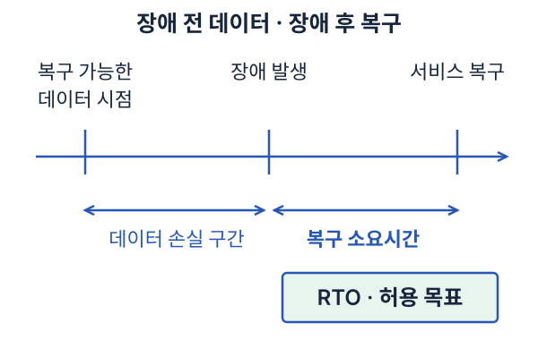

## 먼저 이해하기

14시에 장애가 났다. 주문 업무를 16시까지 재개해야 한다면 RTO는 2시간이다. 잃어도 되는 데이터 양이 아니라 서비스를 얼마나 빨리 되살릴지에 대한 목표다.

## 답안에 남길 핵심

**정의:** RTO(Recovery Time Objective)는 업무·서비스 중단 후 목표 수준으로 복구하기까지의 목표 시간이다.

**회상 단서:** 중단시간 · 업무 재개 · 전환·복구·검증 · 비용 균형

## 개념도

<figure class="concept-diagram">

<figcaption><strong>RTO를 구분하는 공통 시간축</strong> 자료의 구조·설명을 바탕으로 직접 재구성한 학습용 SVG. <a href="/assets/subnotes/concepts/rto.svg" target="_blank" rel="noopener">그림 크게 보기</a></figcaption>
</figure>

**읽는 법:** 그림의 구간은 실제 결과를 뜻하며 RPO·RTO는 허용 목표다. 실제 손실·복구시간이 목표 이내인지 비교한다.

**손으로 그리기:** 시간축 → 데이터 시점·장애·복구 세 점 → 장애 좌우에 두 구간.

개념도 참고: <a href="https://itpe.co.kr/main/portal/selectPortalContent.do?topicId=82">ITPE 지식관리 · RTO·RPO</a>. 확인: 2026-11-22. 원본의 시간축을 대조해 RPO는 장애 전 데이터 손실, RTO는 장애 후 복구 소요시간의 목표로 구분함.

## 시간축

| 개선 방법 | 효과·고려사항 |
| --- | --- |
| 대기 자원·이중화 | 준비 시간 감소·비용 증가 가능 |
| 전환 자동화 | 수작업 지연 감소·오작동 통제 |
| 의존성·절차 정리 | 로그인·연결 등 병목 감소 |
| 복구훈련 | 실제 시간과 목표의 차이 확인 |

BIA에 근거해 정하고 최대 허용 중단 한계를 넘기지 않도록 여유를 고려한다. 실제 복구시간을 측정해 비교한다.

## 가리고 설명하기

본문을 위로 올려 가린 뒤, 말하거나 빈 종이에 적는다. 정답을 읽기 전에 답한다.

1. RTO 2시간이면 데이터도 2시간 잃어도 될까?
2. 장비 기동과 업무 재개 중 무엇을 볼까?

내 답과 비교할 기준

**1.** 아니다. 데이터 손실 목표는 RPO다.

**2.** 합의한 서비스·업무 복구 기준이다. 장비가 켜져도 거래 불가면 미완료일 수 있다.

## 상황에 적용하기

14시 장애, RTO 2시간. 서버는 15시 기동, 주문은 16시 30분 가능했다. 목표 달성일까?

풀이와 판단 근거

업무 재개가 완료 기준이라면 실제 시간은 2시간 30분으로 초과했다. 로그인·외부 연계·검증의 지연을 개선한다.

## 헷갈리지 않기

RTO는 목표, 실제 복구시간은 결과다. 목표를 짧게 적는 것만으로 성능이 좋아지지 않는다. 짧은 목표에는 보통 더 많은 준비·비용이 필요하다.

## 수업 범위와 출처

- **최종 숙제 15/32:** RTO.
- **수업 메모의 강조 수준:** 출제·암기 강조. 반복 출제·암기 강조.
- 출제 관련 표현은 2026.11.21 수업에서 기록한 강사의 의견이다. 실제 출제 확정이나 미출제 이력의 독립 검증을 뜻하지 않는다.
- ITPE 『IT경영전략 V10.13 Part I』, PDF 파일 기준 315, 320, 323~325쪽을 참고하여 개인 학습용으로 재구성했다. 교재 원문·도표를 전재하지 않았다.

반드시 비교: [RPO](/subnotes/notes/rpo/) · 설정 근거: [BIA](/subnotes/notes/bia/)

읽은 뒤에는 [내 것으로 만드는 복습법](/subnotes/notes/mastery-method/)에 따라 다른 날 다시 설명해본다. 이 노트가 있다는 사실만으로 학습 완료·점수가 기록되지는 않는다.
