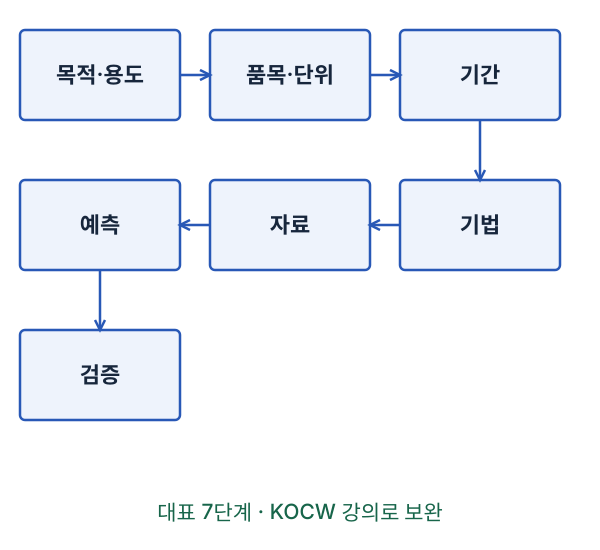

## 먼저 이해하기

편의점 빵 주문량을 정하려면 지난달 총매출만 보는 것으로 부족하다. 내일 아침 점포별 수량인지, 다음 분기 공장 생산능력인지에 따라 품목·단위·기간·기법이 달라진다. 수요예측은 점치는 숫자 하나가 아니라 조달·생산·재고 결정을 돕는 과정이다.

## 답안에 남길 핵심

**정의:** SCM 수요예측은 과거 수요·판매와 시장·가격·행사 등 관련 정보를 바탕으로 미래의 제품·서비스 수요를 추정해 공급망 계획을 지원하는 활동이다.

**회상 단서:** 목적 → 품목·단위 → 기간 → 기법 → 자료 → 예측 → 검증 · 정성·시계열·인과

## 개념도

<figure class="concept-diagram">

<figcaption><strong>수요예측의 목적에서 검증까지</strong> 자료의 구조·설명을 바탕으로 직접 재구성한 학습용 SVG. <a href="/assets/subnotes/concepts/scm-demand-forecast.svg" target="_blank" rel="noopener">그림 크게 보기</a></figcaption>
</figure>

**읽는 법:** 지식관리의 수요계획 위치와 기법 분류를 바탕으로, 상세 단계는 생산관리 강의의 7단계를 연결했다.

**손으로 그리기:** 목적·품목·기간 → 기법·자료·예측 → 검증의 일곱 칸을 지그재그로 잇는다.

개념도 참고: <a href="https://itpe.co.kr/main/portal/selectPortalContent.do?topicId=49">ITPE 지식관리 · 수요예측 기법</a> · <a href="http://contents2.kocw.or.kr/KOCW/document/2018/wonkwang/kimdogoan0412/9.pdf">원광대 KOCW · 생산정보시스템 9주차 13쪽</a>. 확인: 2026-11-22. SCM 수요계획·기법 도식을 참고하고, 원본에 상세 목록이 없는 7단계는 KOCW 강의로 보완해 직접 재구성함.

## 문제지 요구를 보완하는 생산관리의 대표 7단계

ITPE 문제지와 지식관리는 7단계·기법을 묻지만, 확인한 지식관리 본문에는 그 일곱 단계의 상세 목록이 없다. 아래는 **원광대 KOCW 생산정보시스템 강의 13쪽의 대표 7단계**를 보완 근거로 정리한 것이다. 이를 ITPE의 별도 고정 단계명을 확인한 것처럼 쓰지 않는다.

| 단계 | 결정할 것 | 빵 발주 예 |
| --- | --- | --- |
| 1 목적·용도 | 어느 의사결정을 지원하나? | 폐기·품절을 줄일 발주 |
| 2 품목·단위 | 무엇을 어떤 단위로 보나? | 점포·빵 종류별 개수 |
| 3 예측 기간 | 얼마나 앞을 어느 간격으로 보나? | 다음 주 일별 수요 |
| 4 기법 선정 | 데이터·패턴에 맞는 방법은? | 요일·행사 고려 모델 |
| 5 자료 수집 | 필요한 판매·외부 정보는? | 판매·재고·날씨·행사 |
| 6 예측 시행 | 미래 값을 어떻게 추정하나? | 품목별 예상 수량 산출 |
| 7 검증 | 오차·타당성은 어떤가? | 실제 수요와 비교·보완 |

## 수요예측 기법의 선택

| 구분 | 대표 기법 | 맞는 조건·주의 |
| --- | --- | --- |
| 정성적 | 델파이·시장조사·영업 의견 | 신제품·과거 자료 부족, 판단 편향 관리 |
| 시계열 | 이동평균·지수평활·추세·계절성 모델 | 과거 패턴 활용, 구조 변화 확인 |
| 인과·설명 | 회귀·계량모형 | 가격·행사·날씨 등 설명 변수, 인과 단정 주의 |

시간 순서를 지켜 학습·검증 자료를 나누고, 품목별 오차와 과대·과소 편향을 확인한다. **이동평균 예:** 최근 3일 수요가 90·100·110개이면 단순 예측은 100개다. 행사·요일 차이까지 저절로 반영된다는 뜻은 아니다.

## 가리고 설명하기

자료를 덮고 말하거나 빈 종이에 적는다. 정답을 열기 전에 두 질문에 먼저 답한다.

1. 자료를 수집하기 전에 목적·품목·기간을 정하는 이유는?
2. 신제품과 안정적인 주간 반복 품목에 같은 기법이 항상 적절할까?

내 답과 비교할 기준

**1.** 필요한 데이터의 범위·단위와 예측의 사용처가 달라지기 때문이다. 목적과 다른 숫자는 정확해도 실행에 쓰기 어렵다.

**2.** 아니다. 신제품은 시장조사·유사품·전문가 의견을, 반복 수요는 시계열을 활용할 수 있다. 충분한 데이터와 조건을 보고 비교 검증한다.

## 상황에 적용하기

재고가 모자라 하루 50개밖에 팔지 못한 상품의 판매 50개를 실제 수요로 그대로 학습했다. 어떤 문제가 생길까?

풀이와 판단 근거

품절 때문에 관측되지 않은 수요가 빠져 예측을 낮게 만들 수 있다. 판매와 수요를 구분하고 품절·재고 가용성·판매 중단·행사 기록을 함께 확인한다. 예측 오차를 모니터링하며 생산·발주·안전재고 결정과 연결한다.

## 헷갈리지 않기

7단계는 일을 진행하는 틀이고 기법은 수요 값을 추정하는 방법이다. 기법만 나열해 단계 질문을 대신하지 않는다. 판매·출하량을 언제나 수요와 같다고 보거나, 상관관계를 인과관계로 확정하지 않는다. [SCM](/subnotes/notes/scm/)은 전체 공급망 관리이며 이 노트는 그중 수요예측을 보완한다.

## 셀프테스트 범위와 출처

- **셀프테스트 추가 범위:** 기본 26번 · 수요예측 7단계 및 기법. 확정 숙제 32개에 새 숙제 번호를 붙이는 것이 아니라 문제지의 추가 주제를 별도로 보완한다.
- [ITPE 151기 셀프테스트 공지·문제지](https://cafe.naver.com/81th/243521). 문제 번호는 로컬 보관 PDF와 대조했다. 문제지의 출제 예상 표현은 실제 출제 확정을 뜻하지 않는다.
- [ITPE 지식관리 · SCM 수요계획](https://itpe.co.kr/main/portal/selectPortalContent.do?topicId=49).
- [ITPE 지식관리 · 수요예측 기법](https://itpe.co.kr/main/portal/selectPortalContent.do?topicId=49).
- [원광대 KOCW · 생산정보시스템 9주차 13쪽](http://contents2.kocw.or.kr/KOCW/document/2018/wonkwang/kimdogoan0412/9.pdf).

확인일: 2026-11-22. 원문 도표를 전재하지 않고 개인 학습용 설명과 그림으로 재구성했다. 학습 여부는 가리고 설명·비교·적용하는 답변으로 확인한다.
