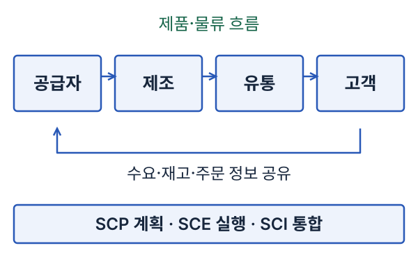

## 먼저 이해하기

판매점에서 수요가 조금 늘었는데 도매상·공장은 훨씬 크게 주문한다. 각자 안전재고를 쌓으면 공급망 전체가 흔들린다. SCM은 기업 사이의 수요·자재·생산·물류 정보를 연결해 전체 흐름을 관리한다.

## 답안에 남길 핵심

**정의:** SCM(Supply Chain Management)은 공급자에서 고객까지의 자재·제품·정보·자금 흐름을 통합적으로 계획·실행·관리하여 공급망 성과를 높이는 활동이다.

**회상 단서:** SCP 계획 · SCE 실행 · SCPM 과정 관리 / 채찍효과 · CPFR

## 개념도

<figure class="concept-diagram">

<figcaption><strong>SCM의 제품·정보 흐름과 계획·실행·통합</strong> 자료의 구조·설명을 바탕으로 직접 재구성한 학습용 SVG. <a href="/assets/subnotes/concepts/scm.svg" target="_blank" rel="noopener">그림 크게 보기</a></figcaption>
</figure>

**읽는 법:** 제품과 정보의 방향을 구분한다. 수요 정보를 함께 보지 못하면 상류로 주문 변동이 증폭될 수 있다.

**손으로 그리기:** 공급자 → 제조 → 유통 → 고객, 아래 반대 방향 정보 화살표와 세 기능.

개념도 참고: <a href="https://itpe.co.kr/main/portal/selectPortalContent.do?topicId=49">ITPE 지식관리 · 공급망 관리</a>. 확인: 2026-11-22. 핵심 관계만 남긴 학습용 재구성. 원본 이미지를 전재하지 않음.

## 세 기능과 정보 흐름

| 항목 | 의미 |
| --- | --- |
| SCP | 수요·재고·생산·운송 등의 계획 |
| SCE | 주문·생산·창고·물류 등의 실행 |
| SCPM | 계획과 실행 차이의 모니터링·성과·개선 |
| 채찍효과 | 수요 변동이 상류 주문으로 갈수록 증폭 |
| CPFR | Collaborative Planning, Forecasting and Replenishment. 협업 계획·예측·보충 |

판매 정보 공유·주문 묶음 완화·납기 단축·공동 예측은 왜곡을 줄이는 수단이다.

## 가리고 설명하기

본문을 위로 올려 가린 뒤, 말하거나 빈 종이에 적는다. 정답을 읽기 전에 답한다.

1. SCP와 SCE의 차이는?
2. CPFR가 채찍효과를 줄이는 이유는?

내 답과 비교할 기준

**1.** SCP는 계획·의사결정, SCE는 주문·물류·생산 등 실제 실행이다.

**2.** 각자 추정한 주문만 보지 않고 실제 수요와 계획·예측을 공유하여 중복 증폭을 줄이기 때문이다.

## 상황에 적용하기

소비자 수요는 10% 늘었는데 공장 발주가 80% 늘었다. 먼저 무엇을 확인할까?

풀이와 판단 근거

실제 판매·재고·주문 주기·납기·판촉을 함께 본다. 단계별 주문이 실제 수요를 과장했는지 확인하고 공동 예측·재고 가시성·보충 정책으로 개선한다.

## 헷갈리지 않기

SCM을 물류 운송만으로 축소하지 않는다. 여기서 SCM은 Supply Chain Management이며 소프트웨어 형상관리와 약어가 같다. 맥락을 밝혀 쓴다.

## 수업 범위와 출처

- **최종 숙제 25/32:** SCM.
- **수업 메모의 강조 수준:** 출제·암기 강조. SCP·SCE·SCPM, 채찍효과·CPFR 연계.
- 출제 관련 표현은 2026.11.21 수업에서 기록한 강사의 의견이다. 실제 출제 확정이나 미출제 이력의 독립 검증을 뜻하지 않는다.
- ITPE 『IT경영전략 V10.13 Part I』, PDF 파일 기준 172~178쪽을 참고하여 개인 학습용으로 재구성했다. 교재 원문·도표를 전재하지 않았다.

함께 보기: [MES](/subnotes/notes/mes/)

읽은 뒤에는 [내 것으로 만드는 복습법](/subnotes/notes/mastery-method/)에 따라 다른 날 다시 설명해본다. 이 노트가 있다는 사실만으로 학습 완료·점수가 기록되지는 않는다.
