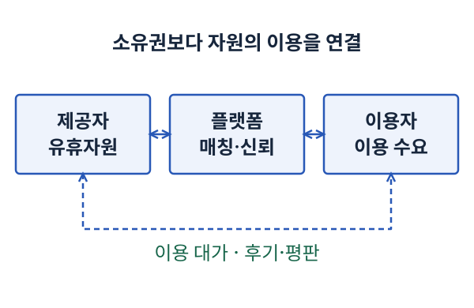

## 먼저 이해하기

집에 쓰지 않는 공구를 이웃이 잠깐 빌려 쓴다. 소유권을 새로 사는 대신 이미 있는 자원의 이용 기회를 나누는 것이다. 디지털 플랫폼은 이런 제공자와 이용자를 찾아 연결한다.

## 답안에 남길 핵심

**정의:** 공유경제는 활용되지 않는 자원·자산의 이용 기회를 다른 사람과 공유하거나 거래하여 자원 활용도를 높이는 경제 방식이다. 플랫폼은 탐색·매칭·결제·평판을 지원할 수 있다.

**회상 단서:** 유휴 자원 · 접근·이용 · 매칭 · 평판 · 책임

## 개념도

<figure class="concept-diagram">

<figcaption><strong>공유경제의 삼자 거래 구조</strong> 자료의 구조·설명을 바탕으로 직접 재구성한 학습용 SVG. <a href="/assets/subnotes/concepts/sharing-economy.svg" target="_blank" rel="noopener">그림 크게 보기</a></figcaption>
</figure>

**읽는 법:** 플랫폼이 반드시 자산을 소유하는 것은 아니다. 이용 조건·책임·신뢰 장치가 중요하다.

**손으로 그리기:** 제공자·플랫폼·이용자 세 칸 → 매칭 연결 → 아래 대가·후기 경로.

개념도 참고: <a href="https://itpe.co.kr/main/portal/selectPortalContent.do?topicId=111">ITPE 지식관리 · 공유경제</a>. 확인: 2026-11-22. 핵심 관계만 남긴 학습용 재구성. 원본 이미지를 전재하지 않음.

## 거래 구조

| 과제 | 대응 설계 |
| --- | --- |
| 상대를 신뢰하기 어려움 | 신원 확인·이용 이력·평판 검증 |
| 파손·사고·분쟁 | 책임 범위·보험·보증·분쟁 절차 |
| 품질 편차 | 자원 상태 검증·표준 안내 |
| 이용 정보의 과도한 수집 | 최소 수집·접근통제·보관 정책 |

앰비언트 기술이 가까운 자원의 위치·상태를 파악하면 매칭이 편해질 수 있다. 이 연결은 응용 설명이며 공유경제의 필수 조건은 아니다.

## 가리고 설명하기

본문을 위로 올려 가린 뒤, 말하거나 빈 종이에 적는다. 정답을 읽기 전에 답한다.

1. 플랫폼이 있으면 모두 공유경제일까?
2. 구독경제와 구분하는 기준은?

내 답과 비교할 기준

**1.** 아니다. 플랫폼은 거래를 연결하는 수단이다. 자원의 공유·이용 구조를 확인해야 한다.

**2.** 공유경제는 자원 이용·공유 방식, 구독경제는 반복 지불·지속 제공이라는 거래 관계에 초점이 있다.

## 상황에 적용하기

회사가 새 전동공구를 대량 구매해 월정액으로 빌려준다. 유휴 자산 공유와 완전히 같은가?

풀이와 판단 근거

월정액 제공은 구독·임대 모델로 설명할 수 있다. 기존 유휴 자산을 나누는 구조인지 별도로 확인해야 하며, 공유경제의 범위를 넓게 쓰는 자료와 좁게 쓰는 자료를 구분한다.

## 헷갈리지 않기

모든 대여·중개 서비스를 같은 범주로 단정하지 않는다. 편리함만 쓰지 말고 신뢰·책임·품질·데이터 문제를 함께 제시한다.

## 수업 범위와 출처

- **최종 숙제 08/32:** 공유경제.
- **수업 메모의 강조 수준:** 출제 예상. 미출제이나 밀고 있는 주제. 앰비언트 커머스와 연결 암기.
- 출제 관련 표현은 2026.11.21 수업에서 기록한 강사의 의견이다. 실제 출제 확정이나 미출제 이력의 독립 검증을 뜻하지 않는다.
- ITPE 『IT경영전략 V10.13 Part I』, PDF 파일 기준 412~416쪽을 참고하여 개인 학습용으로 재구성했다. 교재 원문·도표를 전재하지 않았다.

함께 보기: [구독경제](/subnotes/notes/subscription-economy/) · [앰비언트 커머스](/subnotes/notes/ambient-commerce-computing/)

읽은 뒤에는 [내 것으로 만드는 복습법](/subnotes/notes/mastery-method/)에 따라 다른 날 다시 설명해본다. 이 노트가 있다는 사실만으로 학습 완료·점수가 기록되지는 않는다.
