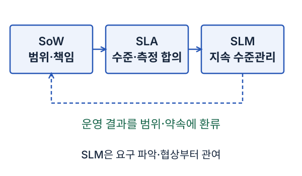

## 먼저 이해하기

운영 외주를 맡기며 “잘 운영해주세요”라고만 하면 서버 패치·백업·야간 대응이 포함되는지부터 다툴 수 있다. 범위는 합의했어도 품질 기준이 없으면 잘했는지 판단하기 어렵다. 품질 기준까지 정했어도 측정·검토가 없으면 약속은 문서에만 남는다. 세 용어는 이 빈틈을 각각 채운다.

## 답안에 남길 핵심

**정의:** SoW(Statement of Work)는 수행할 작업·서비스의 범위·산출물·책임·일정 등을 명시하는 작업기술서다. SLA(Service Level Agreement)는 서비스 수준·측정·책임·미달 조치의 합의다. SLM(Service Level Management)은 서비스 수준을 정하고 합의·측정·검토·개선하는 지속적인 관리 활동이다.

**회상 단서:** SoW 범위 · SLA 수준 약속 · SLM 측정·평가·개선 · 서비스 카탈로그·OLA·보고

## 개념도

<figure class="concept-diagram">

<figcaption><strong>범위를 약속으로, 약속을 실제 관리로</strong> 자료의 구조·설명을 바탕으로 직접 재구성한 학습용 SVG. <a href="/assets/subnotes/concepts/sow-sla-slm.svg" target="_blank" rel="noopener">그림 크게 보기</a></figcaption>
</figure>

**읽는 법:** 세 칸은 범위·합의·관리의 논리적 연결이다. SLM은 SLA 이전 요구 파악과 협상에도 관여한다.

**손으로 그리기:** 세 상자에 범위·약속·관리를 적고 아래 결과 환류를 표시한다.

개념도 참고: <a href="https://itpe.co.kr/main/portal/selectPortalContent.do?topicId=67">ITPE 지식관리 · SoW 구성항목</a>. 확인: 2026-11-22. 지식관리 관계도를 단순화하되 SLM이 최종 단계에서만 시작하는 것으로 오해하지 않도록 설명을 보완함.

## 세 개념을 같은 질문으로 비교하기

| 구분 | 핵심 질문 | 주된 내용·산출물 |
| --- | --- | --- |
| SoW | 무엇을 어디까지 누가 수행하나? | 업무·제외 범위, 산출물, 일정, 책임·수락 기준 |
| SLA | 어느 수준을 어떤 기준으로 지킬까? | 가용성·응답·복구 목표, 측정 기간·방법, 예외·미달 조치 |
| SLM | 약속이 현실에서 지켜지고 개선되나? | 요구·협상·합의, 모니터링·서비스 보고·검토·개선 |

**관계 예:** SoW에 주문 서비스 야간 장애 대응을 포함한다. SLA에는 장애 등급별 접수·응답·복구 목표와 측정 방법을 합의한다. SLM에서 실제 로그로 달성 여부를 보고하고 반복 미달의 원인을 제거한다.

SLM은 계획·계약·운영·평가로 묶어 설명할 수 있다. 서비스 카탈로그로 제공 항목을 명확히 하고, 필요하면 내부 조직의 OLA(Operational Level Agreement), 외부 공급자 계약과 SLA를 정렬한다. 내부 지원 목표가 고객 약속보다 느리면 고객 SLA를 지키기 어렵다.

세 문서를 한 번 작성하는 순서로만 고정하지 않는다. 서비스 요구와 범위가 달라지면 SoW·SLA를 함께 검토하고 운영 결과도 다음 합의에 반영한다. 비교 문제에서는 **문서·합의·관리 활동**의 차이를 먼저 드러내면 좋다.

## 가리고 설명하기

자료를 덮고 말하거나 빈 종이에 적는다. 정답을 열기 전에 두 질문에 먼저 답한다.

1. SoW에 업무 범위를 적었다면 SLA와 SLM이 불필요할까?
2. 외부 SLA와 내부 OLA가 서로 맞아야 하는 이유는?

내 답과 비교할 기준

**1.** 아니다. 수행 범위와 품질·측정 기준은 다르다. 약속을 합의한 뒤 실제 이행을 계속 확인·개선하는 활동도 필요하다.

**2.** 내부 지원 체계가 고객 약속을 뒷받침해야 하기 때문이다. 고객 복구 목표 1시간인데 내부 지원 착수가 2시간 뒤라면 구조적으로 충돌한다.

## 상황에 적용하기

야간 장애 대응은 SoW에 포함됐지만 공급자는 “원격 접속만 하면 이행”이라고 주장한다. 어떤 합의를 보완할까?

풀이와 판단 근거

SLA에서 장애 분류, 접수·응답·복구의 의미와 목표, 업무 시간, 측정 시작·종료, 예외, 보고·미달 조치를 구체화한다. SoW의 책임 경계와 모순이 없는지도 확인한다. 이후 SLM에서 동일한 측정 기준으로 결과를 검토한다.

## 헷갈리지 않기

SoW는 서비스 수준 숫자만 적은 SLA의 다른 이름이 아니며 SLM은 특정 솔루션 제품명에 한정되지 않는다. SLA 숫자만 높이고 측정 예외·기간·책임을 빼면 비교가 무의미하다. [SLA](/subnotes/notes/sla/)에서 구체적인 협약 항목을 복습한다.

## 셀프테스트 범위와 출처

- **셀프테스트 추가 범위:** 기본 41번 · SoW·SLA·SLM 관계. 확정 숙제 32개에 새 숙제 번호를 붙이는 것이 아니라 문제지의 추가 주제를 별도로 보완한다.
- [ITPE 151기 셀프테스트 공지·문제지](https://cafe.naver.com/81th/243521). 문제 번호는 로컬 보관 PDF와 대조했다. 문제지의 출제 예상 표현은 실제 출제 확정을 뜻하지 않는다.
- [ITPE 지식관리 · SoW·SLA·SLM 관계](https://itpe.co.kr/main/portal/selectPortalContent.do?topicId=67).
- [ITPE 지식관리 · SoW 구성항목](https://itpe.co.kr/main/portal/selectPortalContent.do?topicId=67).

확인일: 2026-11-22. 원문 도표를 전재하지 않고 개인 학습용 설명과 그림으로 재구성했다. 학습 여부는 가리고 설명·비교·적용하는 답변으로 확인한다.
