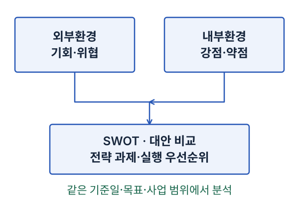

## 먼저 이해하기

AI 보안 서비스를 출시하려는 회사가 “AI가 유행한다”는 이유만으로 투자하려 한다. 시장이 커져도 고객이 원하는 문제를 해결하지 못하거나 데이터·인력이 부족하면 성공하기 어렵다. 외부 분석은 기회와 제약을, 내부 분석은 실제로 할 수 있는 일과 빈틈을 확인한다.

## 답안에 남길 핵심

**정의:** 환경분석은 조직의 전략 수립을 위해 외부의 시장·경쟁·거시적 변화와 내부의 자원·역량·조직 조건을 분석하여 전략적 기회·위협·강점·약점과 대응 방향을 도출하는 활동이다.

**회상 단서:** 외부 기회·위협 · 내부 강점·약점 · 증거 · 분석 축 · 전략적 연결

## 개념도

<figure class="concept-diagram">

<figcaption><strong>외부 조건과 내부 역량을 전략으로 연결</strong> 자료의 구조·설명을 바탕으로 직접 재구성한 학습용 SVG. <a href="/assets/subnotes/concepts/strategy-environment.svg" target="_blank" rel="noopener">그림 크게 보기</a></figcaption>
</figure>

**읽는 법:** 외부·내부는 서로 다른 분석 축이며 선후관계가 있는 두 단계가 아니다. 한 상자 안에 병렬 입력으로 묶었다.

**손으로 그리기:** 두 입력을 떠올리고 증거 → 통합 → 선택의 세 칸으로 이어간다.

개념도 참고: <a href="https://itpe.co.kr/main/portal/selectPortalContent.do?topicId=23">ITPE 지식관리 · SWOT의 내부·외부 교차</a> · <a href="https://itpe.co.kr/main/portal/selectPortalContent.do?topicId=27">ITPE 지식관리 · PEST 거시환경 설명</a> · <a href="https://itpe.co.kr/main/portal/selectPortalContent.do?topicId=22">ITPE 지식관리 · 7S 내부 조직 분석</a>. 확인: 2026-11-22. 원문 구조·설명을 검토하여 핵심 관계만 직접 재구성한 학습용 도식. 원본 이미지는 전재하지 않음.

## 핵심 구조와 답안 포인트

| 구분 | 주요 질문 | 도구·결과 예 |
| --- | --- | --- |
| 외부 거시환경 | 법·정책·경제·사회·기술이 무엇을 바꾸는가? | PEST 관점의 변화·제약·시나리오 |
| 외부 산업·시장 | 고객·경쟁자·공급자·대체재의 힘은? | 3C·경쟁구조 분석, 기회·위협 |
| 내부 자원·역량 | 기술·데이터·인력·자금·채널을 갖췄나? | 자원·역량·가치활동 분석 |
| 내부 조직 정합성 | 전략·구조·시스템·구성원 등이 맞물리는가? | 7S 등의 관점, 실행 장애 |
| 통합·선택 | 외부 조건과 내부 역량을 어떻게 연결할까? | SWOT 조합·대안·우선순위·가정 |

**2교시 답안 목차:** 가항은 외부 분석의 목적·범위·도구·산출물, 나항은 내부 분석의 목적·범위·도구·산출물로 같은 축을 맞춘다. 마지막에 두 분석을 전략 대안으로 통합하는 연결을 한 줄 적는다. 도구 이름을 많이 쓰는 것보다 해당 도구가 밝히는 질문과 판단 근거를 설명한다.

## 가리고 설명하기

본문을 덮고 먼저 내 말로 답한다.

1. “경쟁사가 좋은 데이터를 확보했다”는 내부 약점일까 외부 위협일까?
2. SWOT 네 칸을 채웠다면 전략 수립이 끝났을까?

내 답과 비교할 기준

**1.** 경쟁사의 행동은 외부 조건이다. 자사의 데이터 부족은 내부 약점으로 별도 적을 수 있다. 같은 사실을 중복 나열하지 않고 관찰 대상과 분석 축을 명시한다.

**2.** 아니다. 조합을 통해 실행 가능한 대안을 만들고 적합성·효과·자원·위험을 비교하여 선택해야 한다.

## 상황에 적용하기

법규 강화로 보안 수요가 늘지만, 회사의 전문 인력과 고객 지원 체계가 부족하다. 기회가 있으니 전면 출시를 바로 선택할까?

풀이와 판단 근거

기회와 실행 역량을 분리해 판단한다. 고객군을 좁힌 시범 서비스, 전문업체 제휴, 인력·지원 체계 보강 같은 대안을 비교한다. 각 대안이 어떤 고객 문제를 해결하고 법규·비용·시간 제약을 만족하는지 근거를 붙인다. “기회가 큼”이라는 문장 하나로 투자 결론을 정당화하지 않는다.

## 헷갈리지 않기

PEST는 외부 거시환경의 관점이지 자사 조직 역량 분석표가 아니다. 7S의 전략·구조·시스템·공유가치·스타일·인력·역량은 내부 정합성을 보는 관점이다. 이번 노트는 2교시 비교·전략 문항 보완이며, PEST·STP·ERP·CRM을 확정 숙제 목록에 다시 넣는 것이 아니다.

## 셀프테스트 범위와 출처

- **2교시 2번.** 확정 숙제 32개와 구분하여 추가한 셀프테스트 보완 노트다.
- [151기 셀프테스트 공지와 첨부 문제지](https://cafe.naver.com/81th/243521). 문제지의 출제 예상 표현은 강사의 의견이며 실제 출제를 확정하지 않는다.
- [ITPE 지식관리 · SWOT의 내부·외부 교차](https://itpe.co.kr/main/portal/selectPortalContent.do?topicId=23)
- [ITPE 지식관리 · PEST 거시환경 설명](https://itpe.co.kr/main/portal/selectPortalContent.do?topicId=27)
- [ITPE 지식관리 · 7S 내부 조직 분석](https://itpe.co.kr/main/portal/selectPortalContent.do?topicId=22)
- 확인일: 2026-11-22. 아래 설명과 사례는 개인 학습용으로 재구성했으며 원문 도표를 전재하지 않았다.
