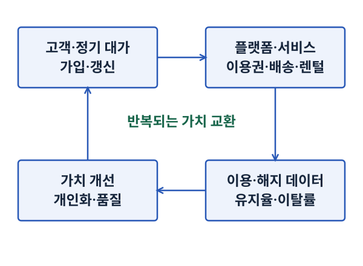

## 먼저 이해하기

일회성 구매와 달리 구독은 다음 달에도 고객이 돈을 낼 이유를 만들어야 한다. 그래서 판매 이후의 품질·추천·지원·해지 경험이 사업의 중심이 된다.

## 답안에 남길 핵심

**정의:** 구독경제는 고객이 약정한 주기로 이용료를 지불하고 상품·서비스에 지속적으로 접근하거나 정기적으로 제공받는 경제 모델이다.

**회상 단서:** 반복 수익 · 지속 가치 · 개인화 · 유지·이탈 관리

## 개념도

<figure class="concept-diagram">

<figcaption><strong>구독경제의 반복 가치 교환</strong> 자료의 구조·설명을 바탕으로 직접 재구성한 학습용 SVG. <a href="/assets/subnotes/concepts/subscription-economy.svg" target="_blank" rel="noopener">그림 크게 보기</a></figcaption>
</figure>

**읽는 법:** 정기 결제만으로 성공하지 않는다. 이용 가치가 유지돼야 갱신과 반복매출로 이어진다.

**손으로 그리기:** 고객 → 서비스 → 데이터 → 개선을 순환으로 그린다.

개념도 참고: <a href="https://itpe.co.kr/main/portal/selectPortalContent.do?topicId=118">ITPE 지식관리 · 구독경제</a>. 확인: 2026-11-22. 핵심 관계만 남긴 학습용 재구성. 원본 이미지를 전재하지 않음.

## 흐름과 관리 지표

| 관리 요소 | 확인할 것 |
| --- | --- |
| 제공·과금 | 이용 범위·주기·요금제·결제 실패 처리 |
| 고객 경험 | 온보딩·개인화·품질·지원 |
| 반복 매출 | MRR: 월간 반복 매출. 모든 매출을 뜻하지 않음 |
| 경제성 | 이탈률·고객생애가치(LTV)·고객획득비용(CAC) |

콘텐츠 이용·정기배송·서비스 접근 등 형태가 다양하다. 무엇을 어떤 주기로 제공하고 왜 유지하는지 설명한다.

## 가리고 설명하기

본문을 위로 올려 가린 뒤, 말하거나 빈 종이에 적는다. 정답을 읽기 전에 답한다.

1. 할부와 구독은 어떻게 다를까?
2. 신규 가입이 많은데 적자가 커질 수 있을까?

내 답과 비교할 기준

**1.** 할부는 구매대금을 나누어 내는 방식, 구독은 약정 기간의 지속 제공·접근 관계에 초점이 있다.

**2.** 획득·지원 비용이 크거나 고객이 빨리 이탈하면 지속 편익이 비용을 회수하지 못한다.

## 상황에 적용하기

무료 체험 후 자동 결제로 전환하고 해지는 전화로만 받는다. 좋은 유지 전략일까?

풀이와 판단 근거

고객을 가두는 설계는 불만·신뢰 저하를 키울 수 있다. 전환 조건·요금·해지를 명확히 알리고 품질·맞춤 가치로 유지 이유를 만들어야 한다. 구체적인 적법성은 별도 법규 검토 대상이다.

## 헷갈리지 않기

구독이 언제나 무소유를 뜻하지 않는다. 정기배송 상품은 인도 후 소유할 수 있다. 제공 형태와 반복 결제를 구분한다.

## 수업 범위와 출처

- **최종 숙제 09/32:** 구독경제.
- **수업 메모의 강조 수준:** 출제 예상. 미출제이므로 출제 예상이라고 명시.
- 출제 관련 표현은 2026.11.21 수업에서 기록한 강사의 의견이다. 실제 출제 확정이나 미출제 이력의 독립 검증을 뜻하지 않는다.
- ITPE 『IT경영전략 V10.13 Part I』, PDF 파일 기준 425 및 멘토 구독경제 서브노트쪽을 참고하여 개인 학습용으로 재구성했다. 교재 원문·도표를 전재하지 않았다.
- [ITPE 구독경제 지식관리](https://itpe.co.kr/main/portal/selectPortalContent.do?topicId=118). 기존 대조 결과 참고. 최신 기출 여부는 단정하지 않는다.

함께 보기: [공유경제](/subnotes/notes/sharing-economy/) · [다크패턴](/subnotes/notes/dark-patterns/)

읽은 뒤에는 [내 것으로 만드는 복습법](/subnotes/notes/mastery-method/)에 따라 다른 날 다시 설명해본다. 이 노트가 있다는 사실만으로 학습 완료·점수가 기록되지는 않는다.
