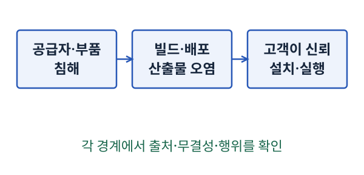

## 먼저 이해하기

회사 서버를 직접 뚫는 대신, 회사가 믿고 설치하는 프로그램의 제작사나 업데이트 경로를 먼저 침해하는 경우를 떠올려보자. 고객이 정상 업데이트라고 생각해 설치하면 공격자가 오염시킨 코드도 함께 들어온다. 보안 경계가 자사 서버에서 끝나지 않는 이유다.

## 답안에 남길 핵심

**정의:** 공급망 공격(Supply Chain Attack)은 제품·서비스의 공급자, 구성요소, 개발·빌드·배포 등 공급 경로를 침해하여 이를 신뢰하는 최종 조직이나 이용자에 영향을 주는 공격이다.

**회상 단서:** 의존성 · 신뢰 경로 · 공급자 · 빌드·배포 · 무결성 · 확산

## 개념도

<figure class="concept-diagram">

<figcaption><strong>공급망 공격이 신뢰 경로를 따라 전달되는 구조</strong> 자료의 구조·설명을 바탕으로 직접 재구성한 학습용 SVG. <a href="/assets/subnotes/concepts/supply-chain-attack.svg" target="_blank" rel="noopener">그림 크게 보기</a></figcaption>
</figure>

**읽는 법:** 화살표는 공급 경로를 통한 전달이다. 모든 공격이 같은 세 단계를 그대로 거치는 것은 아니다.

**손으로 그리기:** 공급자 → 배포 경로 → 고객 세 칸, 아래에 경계별 검증을 적는다.

개념도 참고: <a href="https://itpe.co.kr/main/portal/selectPortalContent.do?topicId=322">ITPE 지식관리 · SBOM 의존관계·개발주기</a> · <a href="https://csrc.nist.gov/pubs/sp/800/161/r1/upd1/final">NIST SP 800-161 Rev.1 · 공급망 위험관리</a> · <a href="https://www.nist.gov/itl/executive-order-14028-improving-nations-cybersecurity/software-supply-chain-security-guidance-20">NIST · SBOM과 소프트웨어 공급망</a>. 확인: 2026-11-22. ITPE의 SBOM 의존관계·개발주기 도식을 참고하고 NIST의 공급망 위험 설명으로 보완하여 공격 전달 경로를 직접 재구성했다. 공급망 공격 항목 자체는 본문이 비어 있었으며, 이 SVG를 해당 항목의 원본 그림으로 표기하지 않음.

## 핵심 구조와 답안 포인트

| 공격 지점 | 위험 | 방어와 증거 |
| --- | --- | --- |
| 외부 구성요소 | 변조·악성 패키지, 알려진 취약점 포함 | 구성요소 목록·버전 관리, 출처·취약점 확인 |
| 개발·빌드 환경 | 계정·저장소·파이프라인 탈취 | 최소권한·강한 인증·변경 승인·빌드 이력 |
| 배포·업데이트 | 정상 배포 경로로 오염된 산출물 전달 | 서명·해시·출처 검증, 단계적 배포·격리 시험 |
| 협력사 접근 | 위탁 계정·연동 경로를 통한 침투 | 공급자 평가, 접근 분리, 계약·통보 의무 |
| 고객 운영환경 | 여러 조직에 동시에 피해 확산 | 관측·이상행위 탐지·격리·안전한 복구 |

**답안 연결:** 예방은 공급자·개발·배포 통제를, 탐지는 구성요소·행위 관측을, 대응은 영향 범위와 복구를 써서 균형을 맞춘다. “백신 설치” 하나로 전 과정을 설명하지 않는다.

## 가리고 설명하기

본문을 덮고 먼저 내 말로 답한다.

1. 일반적인 직접 침투와 공급망 공격의 차이는?
2. SBOM을 받았으면 악성코드가 없다고 보증된 것일까?

내 답과 비교할 기준

**1.** 최종 대상만 공격하는 것이 아니라 최종 대상이 의존하고 신뢰하는 공급자·부품·배포 경로 등을 공격해 피해를 전달한다.

**2.** 아니다. SBOM은 구성요소와 관계를 알기 위한 자료다. 출처·정확성·취약점·무결성·행위를 함께 확인해야 한다.

## 상황에 적용하기

정상 서명이 붙은 업데이트를 설치한 뒤 비정상 외부 통신이 시작됐다. 서명이 유효하므로 그대로 운영해도 될까?

풀이와 판단 근거

서명 검증은 특정 키로 서명된 산출물이 바뀌지 않았는지를 확인하는 수단이지 내용이 안전하다는 보증은 아니다. 빌드 환경이나 서명 키 자체가 침해될 수 있다. 배포 중단·영향 버전 식별·격리·로그 보존·공급자 확인을 수행하고, 안전성이 확인된 버전으로 복구한다. 공급자와 최종 이용자 각각의 책임을 정해 대응한다.

## 헷갈리지 않기

이 노트의 SCM Attack은 공급망 보안 공격이다. 기존 SCM 노트의 공급망 계획·실행·통합 관리와 문제의 초점이 다르다. 모든 공급망 위험이 의도적인 공격인 것도 아니다. 취약하거나 품질이 낮은 부품의 위험과, 공격자가 경로를 침해한 경우를 구분한다.

## 셀프테스트 범위와 출처

- **기본 27번.** 확정 숙제 32개와 구분하여 추가한 셀프테스트 보완 노트다.
- [151기 셀프테스트 공지와 첨부 문제지](https://cafe.naver.com/81th/243521). 문제지의 출제 예상 표현은 강사의 의견이며 실제 출제를 확정하지 않는다.
- [ITPE 지식관리 · SBOM의 의존관계·개발주기 도식](https://itpe.co.kr/main/portal/selectPortalContent.do?topicId=322)
- [NIST SP 800-161 Rev.1 · 공급망 위험관리](https://csrc.nist.gov/pubs/sp/800/161/r1/upd1/final)
- [NIST · SBOM과 소프트웨어 공급망](https://www.nist.gov/itl/executive-order-14028-improving-nations-cybersecurity/software-supply-chain-security-guidance-20)
- 확인일: 2026-11-22. 아래 설명과 사례는 개인 학습용으로 재구성했으며 원문 도표를 전재하지 않았다.
