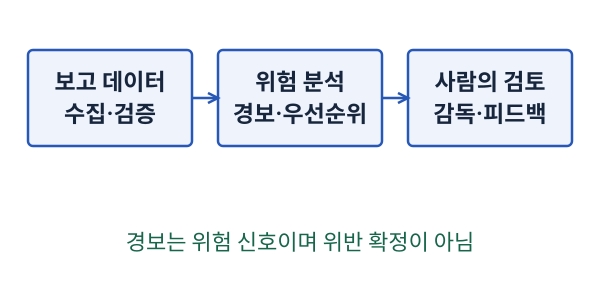

## 먼저 이해하기

감독기관이 수많은 금융회사의 보고서를 사람이 한 장씩 읽으면 위험 발견이 늦어질 수 있다. 보고 데이터를 표준화하고 이상 징후를 분석해 어느 회사를 우선 검토할지 정하는 것이 섭테크의 예다. 단속 결론을 AI가 자동으로 확정한다는 뜻은 아니다.

## 답안에 남길 핵심

**정의:** 섭테크(SupTech, Supervisory Technology)는 감독기관 등 금융당국이 데이터·AI 등의 기술을 활용해 정보 수집·위험 분석·시장 감시·감독 업무를 지원하고 개선하는 접근이다.

**회상 단서:** 감독기관 · 보고 데이터 · 위험 탐지 · 시장 감시 · 사람의 판단

## 개념도

<figure class="concept-diagram">

<figcaption><strong>섭테크의 데이터에서 감독 판단까지</strong> 자료의 구조·설명을 바탕으로 직접 재구성한 학습용 SVG. <a href="/assets/subnotes/concepts/suptech.svg" target="_blank" rel="noopener">그림 크게 보기</a></figcaption>
</figure>

**읽는 법:** 감독 업무를 기술이 지원하며 최종 판단과 책임을 지우는 구조가 아니다.

**손으로 그리기:** 데이터 → 위험 분석 → 사람의 감독 판단 세 칸을 잇는다.

개념도 참고: <a href="https://www.bis.org/fsi/publ/insights19.pdf">BIS FSI · The suptech generations</a> · <a href="https://www.oecd.org/en/publications/oecd-business-and-finance-outlook-2021_ba682899-en/full-report/component-9.html">OECD · SupTech and market supervision</a>. 확인: 2026-11-22. 지식관리 레그테크·섭테크 항목을 확인했으나 본문·도식이 없어 근거로 사용하지 않음. BIS·OECD의 설명을 바탕으로 직접 구성함.

## 핵심 구조와 비교

| 구분 | 섭테크 | 레그테크 |
| --- | --- | --- |
| 주된 사용자 | 감독기관·금융당국 | 규제를 준수해야 하는 금융회사 등 |
| 중심 목적 | 감독·감시의 효과와 효율 개선 | 준수 의무 이행과 비용·오류 감소 |
| 활용 예 | 위험 징후 탐지, 보고 자동 수집, 검사 대상 선별 | 고객확인, 규정 매핑, 보고서 작성 지원 |
| 공통 기반 | 데이터 품질·표준·보안·분석·추적 가능성 | 같은 기반을 다른 책임과 업무에 적용 |

운영할 때는 **수집할 데이터와 감독 목적을 먼저 연결**한다. 많이 모으는 것보다 보고 표준, 품질 검증, 접근권한, 모델 설명과 변경 이력이 중요하다. 기관 간 정보를 결합할 경우에도 목적·권한·보호 조건을 검토하고, 경보의 근거를 사람이 추적할 수 있도록 한다.

## 가리고 설명하기

정답을 펼치기 전에 자료를 가리고, 정의와 그림을 내 말로 설명한다.

1. 섭테크와 레그테크를 구분하는 가장 빠른 질문은?
2. 감독 모델의 경보를 곧바로 위반 판정으로 보면 안 되는 이유는?

내 답과 비교할 기준

**1.** 누가 어떤 업무를 위해 쓰는가다. 감독기관이 감독에 쓰면 섭테크, 피감독 회사가 규제 준수에 쓰면 레그테크의 전형적인 예다.

**2.** 경보는 위험 신호다. 자료 오류·오탐·편향 가능성이 있어 증거 확인과 담당자의 판단을 거쳐야 한다.

## 상황에 적용하기

감독기관 모델이 소규모 금융회사에만 경보를 많이 낸다. 경보 수가 많으니 검사 대상을 모두 그 회사들로 정할까?

풀이와 판단 근거

학습 자료의 대표성, 회사 규모에 따른 보고 방식 차이, 누락·정정 이력, 경보의 정확도를 확인한다. 필요하면 사람의 검토로 표본을 비교하고 임계값·특징을 조정한다. 감독 자원을 배분할 때 모델 한계와 판단 근거를 기록한다.

## 헷갈리지 않기

핀테크·레그테크·섭테크를 기술 종류만으로 구분하지 않는다. 같은 자연어 처리도 금융회사의 규정 점검에 쓰이면 레그테크, 감독기관의 공시 감시에 쓰이면 섭테크로 설명할 수 있다.

## 셀프테스트 범위와 출처

- **셀프테스트 추가 범위:** 기본 11·24번. 확정 숙제 32개와 별도로 문제지에 포함된 주제다. 문제지에 실렸다는 사실과 강사의 출제 예상·암기 강조는 구분한다.
- [ITPE 151기 1~2주차 셀프테스트 공지와 첨부 문제지](https://cafe.naver.com/81th/243521). 원문을 전재하지 않고 질문의 요구에 맞춰 개인 학습용으로 정리했다.
- [BIS FSI · The suptech generations](https://www.bis.org/fsi/publ/insights19.pdf)
- [OECD · SupTech and market supervision](https://www.oecd.org/en/publications/oecd-business-and-finance-outlook-2021_ba682899-en/full-report/component-9.html)
- 확인일: 2026-11-22. 개념도는 출처의 구조·설명을 바탕으로 직접 구성한 학습용 그림이다.
