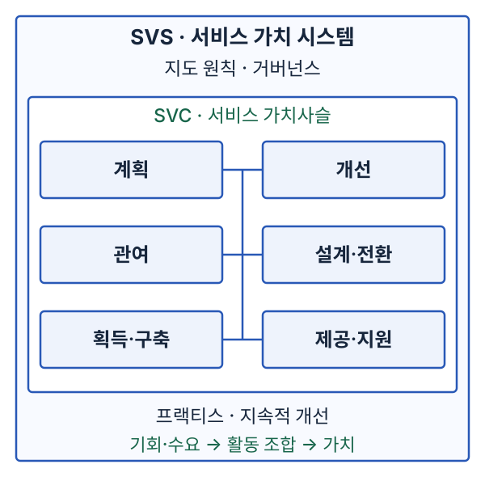

## 먼저 이해하기

식당의 운영 체계에는 경영 방향, 일하는 원칙, 조리·서빙 활동, 직원 역량, 개선이 모두 들어간다. 그중 주문을 음식과 식사 경험으로 연결하는 활동 묶음이 있다. 서비스관리에서도 **SVS는 전체 체계**, **SVC는 그 안의 운영 활동 모델**로 구분하면 된다.

## 답안에 남길 핵심

**정의:** SVS(Service Value System)는 조직의 구성요소와 활동이 함께 작동해 서비스 가치를 공동 창출하는 전체 체계다. SVC(Service Value Chain)는 수요에 대응하고 가치 실현을 돕는 상호 연결된 6활동의 운영 모델이며 SVS의 한 구성요소다.

**회상 단서:** SVS ⊃ SVC · 지도 원칙·거버넌스·프랙티스·지속 개선 · SVC 6활동 · 가치흐름

## 개념도

<figure class="concept-diagram">

<figcaption><strong>SVS 안의 SVC와 가치흐름</strong> 자료의 구조·설명을 바탕으로 직접 재구성한 학습용 SVG. <a href="/assets/subnotes/concepts/svs-svc.svg" target="_blank" rel="noopener">그림 크게 보기</a></figcaption>
</figure>

**읽는 법:** 큰 상자는 전체 체계, 안의 여섯 칸은 조합할 수 있는 활동이다. 직렬 순서가 아니라 상호 연결을 나타낸다.

**손으로 그리기:** 큰 SVS 상자 → 안에 SVC와 여섯 활동 → 위 지도 원칙·거버넌스, 아래 프랙티스·지속적 개선. 고정 순서 화살표를 넣지 않는다.

개념도 참고: <a href="https://itpe.co.kr/main/portal/selectPortalContent.do?topicId=72">ITPE 지식관리 · SVC</a> · <a href="https://www.youtube.com/watch?v=qF2Ccw5tiZg">공식 ITIL · SVC 6활동</a>. 확인: 2026-11-22. SVS·SVC 원본 포함관계를 유지하고 Products/Services를 활동에서 제외해 공식 6활동으로 정정함.

## 포함관계와 활동의 역할

| SVS 구성요소 | 역할 |
| --- | --- |
| 지도 원칙 | 판단·행동의 공통 권고 |
| 거버넌스 | 조직 활동의 평가·지시·감독 |
| 서비스 가치사슬(SVC) | 기회·수요를 제품·서비스와 가치로 연결 |
| 프랙티스 | 수행에 필요한 사람·정보·기술·업무 자원의 묶음 |
| 지속적 개선 | 서비스와 관리 방식 전반의 개선 |

| SVC 6활동 | 짧은 질문 |
| --- | --- |
| Plan · 계획 | 방향·현재 상태·개선 방향을 공유했나? |
| Improve · 개선 | 모든 활동의 효과·효율을 어떻게 높일까? |
| Engage · 관여 | 이해관계자의 요구와 관계를 이해했나? |
| Design and Transition · 설계 및 전환 | 요구에 맞는 서비스와 전환을 설계했나? |
| Obtain/Build · 획득/구축 | 필요한 구성요소를 확보했나? |
| Deliver and Support · 제공 및 지원 | 합의한 수준으로 제공·지원하나? |

이 여섯 개를 항상 한 번씩 거치는 일렬 절차로 외우지 않는다. 신규 서비스, 변경, 장애 해결 등 시나리오마다 활동을 조합한 **가치흐름(Value Stream)**이 달라진다. 예를 들어 새 요구의 관여에서 설계로 갔다가 추가 확인을 위해 다시 관여할 수 있다.

## 가리고 설명하기

자료를 덮고 말하거나 빈 종이에 적는다. 정답을 열기 전에 두 질문에 먼저 답한다.

1. SVS와 SVC를 같은 뜻으로 써도 될까?
2. Products/Services를 SVC의 일곱 번째 활동으로 적으면 왜 틀릴까?

내 답과 비교할 기준

**1.** 아니다. SVS는 다섯 구성요소의 전체 체계이고 SVC는 그 구성요소 중 하나다.

**2.** 제품·서비스는 가치사슬 활동으로 만들어지는 산출물이다. 공식 6활동은 계획·개선·관여·설계 및 전환·획득/구축·제공 및 지원이다.

## 상황에 적용하기

신규 서비스 출시를 설명하면서 “관여→설계→구축→제공”만 적었다. SVS·SVC 설명을 어떻게 보완할까?

풀이와 판단 근거

그 흐름이 한 시나리오의 예임을 밝히고 계획·개선 활동과의 연결을 보완한다. SVS 질문에는 지도 원칙·거버넌스·프랙티스·지속적 개선까지 적어 전체 체계를 설명한다. SVC의 일부 실행 흐름만으로 SVS 전체를 대체하지 않는다.

## 헷갈리지 않기

지식관리 서브노트 8~10번 이미지는 제품·서비스를 활동에 포함해 SVC를 7개로 표시한다. 이 노트는 공식 ITIL 채널의 6활동 설명으로 정정했다. **7 지도 원칙·5 SVS 요소·6 SVC 활동**의 숫자와 범위를 각각 붙여 기억한다.

## 셀프테스트 범위와 출처

- **셀프테스트 추가 범위:** 기본 20번 · SVS와 SVC. 확정 숙제 32개에 새 숙제 번호를 붙이는 것이 아니라 문제지의 추가 주제를 별도로 보완한다.
- [ITPE 151기 셀프테스트 공지·문제지](https://cafe.naver.com/81th/243521). 문제 번호는 로컬 보관 PDF와 대조했다. 문제지의 출제 예상 표현은 실제 출제 확정을 뜻하지 않는다.
- [ITPE 지식관리 · SVS·SVC](https://itpe.co.kr/main/portal/selectPortalContent.do?topicId=72).
- [ITPE 지식관리 · SVC](https://itpe.co.kr/main/portal/selectPortalContent.do?topicId=72).
- [공식 ITIL · SVC 6활동](https://www.youtube.com/watch?v=qF2Ccw5tiZg).

확인일: 2026-11-22. 원문 도표를 전재하지 않고 개인 학습용 설명과 그림으로 재구성했다. 학습 여부는 가리고 설명·비교·적용하는 답변으로 확인한다.
