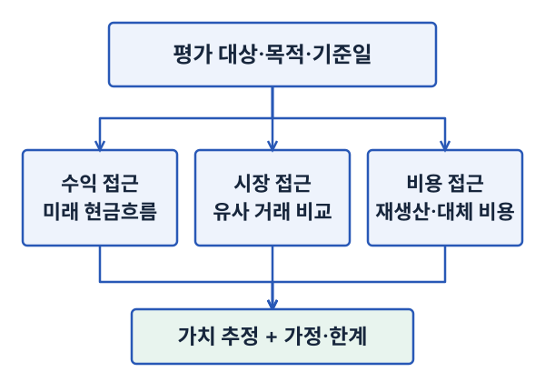

## 먼저 이해하기

좋은 기술이라고 해서 곧바로 높은 가격이 정해지지는 않는다. 앞으로 벌 돈, 다시 만드는 비용, 비슷한 거래 가격 중 어떤 근거로 값을 정할지 선택해야 한다.

## 답안에 남길 핵심

**정의:** 기술 가치 평가는 기술의 사업화·이전 등 특정 목적을 위해 기술의 경제적 가치를 화폐금액으로 추정하는 활동이다.

**회상 단서:** 수원시: 수익 접근 · 원가 접근 · 시장 접근

## 개념도

<figure class="concept-diagram">

<figcaption><strong>기술 가치 평가의 세 접근법</strong> 자료의 구조·설명을 바탕으로 직접 재구성한 학습용 SVG. <a href="/assets/subnotes/concepts/technology-valuation.svg" target="_blank" rel="noopener">그림 크게 보기</a></figcaption>
</figure>

**읽는 법:** 세 접근법은 자료와 목적에 맞게 선택·교차 검토한다. 세 결과를 무조건 단순 평균하지 않는다.

**손으로 그리기:** 위에 평가 대상, 가운데 세 방법, 아래 가치 추정 → 가지를 합친다.

개념도 참고: <a href="https://itpe.co.kr/main/portal/selectPortalContent.do?topicId=131">ITPE 지식관리 · 기술 가치 평가</a>. 확인: 2026-11-22. 핵심 관계만 남긴 학습용 재구성. 원본 이미지를 전재하지 않음.

## 세 접근법 비교

| 접근법 | 중심 질문 | 확인할 것 | 한계 |
| --- | --- | --- | --- |
| 수익 | 이 기술로 앞으로 얼마나 벌까? | 미래 현금흐름, 기술 기여, 할인율 | 예측·가정에 민감 |
| 원가 | 같은 효용을 다시 확보하려면 얼마일까? | 재생산·대체 비용, 진부화 | 비용이 수익 가치를 보장하지 않음 |
| 시장 | 비슷한 기술은 얼마에 거래됐을까? | 유사 거래와 차이 조정 | 비교 가능한 거래가 부족할 수 있음 |

**수업의 우선 암기 범위는 수원시 세 가지다.** 세부 평가 절차는 이해·응용용으로 읽는다.

## 가리고 설명하기

본문을 위로 올려 가린 뒤, 말하거나 빈 종이에 적는다. 정답을 읽기 전에 답한다.

1. 수원시를 풀고 각 접근법의 질문을 말해보자.
2. 개발비가 10억이면 기술 가치도 반드시 10억일까?

내 답과 비교할 기준

**1.** 수익=미래 편익, 원가=동등 효용 확보 비용, 시장=유사 거래 가격이다.

**2.** 아니다. 수익성·권리성·대체기술·진부화에 따라 가치가 달라진다.

## 상황에 적용하기

매출이 아직 없고 유사 기술 거래도 드물다. 왜 단일 가격을 확정적으로 제시하기 어려울까?

풀이와 판단 근거

수익 접근은 매출 가정의 불확실성이 크고 시장 접근은 비교 자료가 부족하다. 대체 비용을 참고하더라도 사업화 가능성·진부화를 함께 검토하고 가정별 범위를 설명해야 한다.

## 헷갈리지 않기

기술 가치 평가는 “얼마인가”, 사업타당성 평가는 “이 사업을 할 만한가”에 초점이 있다. 비용을 많이 썼다는 사실을 경쟁력이나 미래 편익과 동일시하지 않는다.

## 수업 범위와 출처

- **최종 숙제 05/32:** 기술 가치 평가.
- **수업 메모의 강조 수준:** 핵심만 제한 암기. 수익·원가·시장 접근법(수원시)만 암기.
- 출제 관련 표현은 2026.11.21 수업에서 기록한 강사의 의견이다. 실제 출제 확정이나 미출제 이력의 독립 검증을 뜻하지 않는다.
- ITPE 『IT경영전략 V10.13 Part I』, PDF 파일 기준 451~454쪽을 참고하여 개인 학습용으로 재구성했다. 교재 원문·도표를 전재하지 않았다.

함께 보기: [경제성 평가·IT-ROI](/subnotes/notes/it-investment/) · [지식재산권](/subnotes/notes/intellectual-property/)

읽은 뒤에는 [내 것으로 만드는 복습법](/subnotes/notes/mastery-method/)에 따라 다른 날 다시 설명해본다. 이 노트가 있다는 사실만으로 학습 완료·점수가 기록되지는 않는다.
