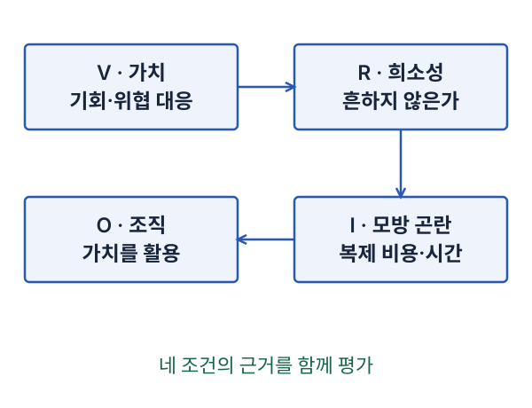

## 먼저 이해하기

우리 회사만 가진 데이터가 있어도 고객 문제 해결에 쓸 수 없거나, 법적 사용 권한과 이를 활용할 인력이 없다면 경쟁우위가 되기 어렵다. VRIO는 자원이 있다는 사실에서 멈추지 않고 그 자원이 경쟁에 어떤 의미가 있는지 단계적으로 묻는 틀이다.

## 답안에 남길 핵심

**정의:** VRIO Framework는 기업의 자원·역량이 가치(Value), 희소성(Rarity), 모방 곤란성(Imitability), 조직적 활용(Organization) 조건을 갖추는지 평가하는 내부 역량 분석 틀이다.

**회상 단서:** 가치 · 희소성 · 모방 비용 · 조직적 활용 · 지속적 경쟁우위

## 개념도

<figure class="concept-diagram">

<figcaption><strong>VRIO가 묻는 네 가지 조건</strong> 자료의 구조·설명을 바탕으로 직접 재구성한 학습용 SVG. <a href="/assets/subnotes/concepts/vrio.svg" target="_blank" rel="noopener">그림 크게 보기</a></figcaption>
</figure>

**읽는 법:** 네 질문을 모두 검토하되, 어느 조건이 충족되지 않는지에 따라 경쟁상 의미가 달라진다.

**손으로 그리기:** V·R·I·O 네 상자에 질문 하나씩 쓰고 자원 사례를 대입한다.

개념도 참고: <a href="https://itpe.co.kr/main/portal/selectPortalContent.do?topicId=19">ITPE 지식관리 · VRIO 개념도</a>. 확인: 2026-11-22. 지식관리의 VRIO 도식·내부 분석 표를 재구성. I는 모방 곤란성을 뜻하도록 질문을 풀어 썼으며 고정 단계별 성공 보증으로 표현하지 않음.

## 핵심 구조와 비교

| 질문 | 판단할 내용 | 예시 |
| --- | --- | --- |
| V · 가치 | 기회를 활용하거나 위협에 대응하는가? | 이탈 예측이 실제 고객 유지에 기여 |
| R · 희소성 | 경쟁사가 널리 보유하지 않았는가? | 쉽게 확보하기 어려운 고유 데이터 |
| I · 모방 곤란성 | 복제·대체에 비용·시간의 불리함이 있는가? | 축적된 관계·경험·복잡한 운영 역량 |
| O · 조직 | 가치 실현을 지원하는 체계가 있는가? | 권한·인력·보상·프로세스·통제 |

네 조건의 결여를 구분하면 답안이 분명해진다. 가치가 없으면 경쟁상 불리할 수 있고, 가치만 있고 흔하면 경쟁 균등에 가깝다. 가치·희소성이 있으나 쉽게 모방되면 일시적 우위일 수 있다. 유용한 자원을 보유해도 O가 부족하면 잠재력을 충분히 실현하지 못한다. 자원별 근거를 써야 한다.

## 가리고 설명하기

정답을 펼치기 전에 자료를 가리고, 정의와 그림을 내 말로 설명한다.

1. 가치 있고 희소한 자원만 있으면 지속적 경쟁우위가 완성될까?
2. O가 묻는 것은 조직도 존재 여부일까?

내 답과 비교할 기준

**1.** 아니다. 경쟁사의 모방·대체 가능성과 실제 활용을 지원하는 조직 체계를 함께 봐야 한다.

**2.** 아니다. 자원의 가치를 실현하도록 의사결정·프로세스·인력·보상·통제가 갖춰졌는지를 본다.

## 상황에 적용하기

경쟁사도 같은 상용 AI 모델을 쓴다. 우리 회사가 그 모델을 구매했으니 독점적 경쟁우위라고 설명해도 될까?

풀이와 판단 근거

모델 구매 자체의 희소성과 모방 곤란성은 낮을 수 있다. 독자 데이터·현장 지식·통합 운영·고객 관계가 어떤 가치와 차별성을 만드는지 분석한다. 그것을 반복적으로 활용할 권한·업무·인력 체계가 있는지도 확인한다.

## 헷갈리지 않기

I는 영어가 Imitability 계열로 표기돼도 “모방하기 쉬우면 우위가 높다”는 뜻이 아니다. 모방에 따른 비용 불리함, 즉 모방 곤란성을 판단한다. 경쟁우위는 환경 변화에 따라 달라지므로 영구적인 보증으로 쓰지 않는다.

## 셀프테스트 범위와 출처

- **셀프테스트 추가 범위:** 심화 1번. 확정 숙제 32개와 별도로 문제지에 포함된 주제다. 문제지에 실렸다는 사실과 강사의 출제 예상·암기 강조는 구분한다.
- [ITPE 151기 1~2주차 셀프테스트 공지와 첨부 문제지](https://cafe.naver.com/81th/243521). 원문을 전재하지 않고 질문의 요구에 맞춰 개인 학습용으로 정리했다.
- [ITPE 지식관리 · 전략수립 도구·VRIO](https://itpe.co.kr/main/portal/selectPortalContent.do?topicId=19)
- [ITPE 지식관리 · VRIO 개념도](https://itpe.co.kr/main/portal/selectPortalContent.do?topicId=19)
- 확인일: 2026-11-22. 개념도는 출처의 구조·설명을 바탕으로 직접 구성한 학습용 그림이다.
