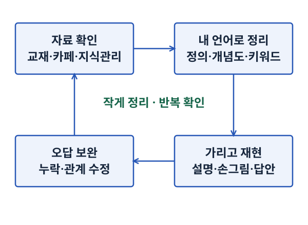

## 기록 원칙

**기존 교재·멘토 자료를 바탕으로, 내가 이해한 설명과 직접 그릴 수 있는 개념도를 보완한다.**

서브노트의 목적은 시험에 대응할 수 있도록 내용을 이해하고 정리하는 것이다. 기존 자료가 충분하다면 내용을 억지로 추가하기보다, 설명하기 어려운 부분을 찾아 보완한다.

## 카페에서 확인한 작성 팁

| 항목 | 적용할 원칙 |
| --- | --- |
| 기존 자료 활용 | 잘된 서브노트를 참고하고 자신에게 맞게 수정한다. |
| 이해와 암기 구분 | 설명에 필요한 내용은 서브노트에, 꼭 외울 키워드는 별도 암기장에 정리한다. |
| 개념도 연습 | 자료 속 그림을 확인한 뒤, 보지 않고 손으로 그려본다. |
| 분량 관리 | 반복해서 읽기 편한 양식과 분량을 유지한다. |
| 꾸준한 보완 | 정리 방식을 계속 바꾸거나 기존 자료를 버리고 새로 시작하는 낭비를 줄인다. |

멘토는 시험 전 짧은 기간에 여러 차례 회독할 수 있는 정리 체계를 강조했다. 한승건 기술사는 한 페이지를 네 칸으로 나누고 토픽당 두 칸 이내로 작성한 개인 사례를 공유했다. 이는 참고할 방식이며, 모든 토픽에 적용해야 하는 고정 규칙은 아니다.

최근 140회 최O하 필기 합격수기에서는 **정확한 정의·키워드·그림을 연결하는 연습**을 강조했다. 토픽이 2,213개까지 늘어나 중요도를 판단하기 어려웠던 점은 본인의 시행착오로 설명했다. 토픽 수를 늘리는 것만을 목표로 삼지 않는다.

## 개념도

<figure class="concept-diagram">

<figcaption><strong>서브노트를 만드는 학습 순환</strong> 자료의 구조·설명을 바탕으로 직접 재구성한 학습용 SVG. <a href="/assets/subnotes/concepts/writing-guide.svg" target="_blank" rel="noopener">그림 크게 보기</a></figcaption>
</figure>

**읽는 법:** 카페 작성 원칙을 이 노트의 운영 방식으로 재구성한 그림이며 카페 원본 도식은 아니다.

**손으로 그리기:** 자료 → 정리 → 재현 → 보완의 네 칸을 반복으로 연결한다.

개념도 참고: <a href="https://cafe.naver.com/81th/78220">ITPE 카페 · 서브노트 작성방법론</a> · <a href="https://cafe.naver.com/81th/106133">ITPE 카페 · 서브노트 작성 기본 사항</a>. 확인: 2026-11-22. 핵심 관계만 남긴 학습용 재구성. 원본 이미지를 전재하지 않음.

## 토픽별 기본 틀

아래는 카페 조언을 바탕으로 정한 개인 기록용 틀이다. 토픽의 성격에 따라 항목을 조정한다.

### 정의

핵심 용어가 포함된 1~2문장. 자료를 덮고 내 말로 설명할 수 있는지 확인한다.

### 개념도

핵심 구성요소와 관계를 표현한다. 이미지가 있더라도 별도로 손그림을 연습한다.

### 핵심 내용

구성요소·절차·특징 중 문제에 필요한 내용을 표나 목록으로 정리한다. 암기할 키워드를 분명하게 표시한다.

### 비교와 사례

혼동하기 쉬운 개념과의 차이 또는 대표 사례를 기록한다.

### 셀프테스트 보완

빠뜨린 키워드, 틀린 설명, 그리지 못한 그림과 수정 이유를 남긴다.

### 출처

교재의 페이지, 카페 글 링크, 확인 날짜를 기록한다. 인용한 내용과 내 해석을 구분한다.

## 주간 운영

| 시점 | 할 일 |
| --- | --- |
| 토요일 수업 후 | 강사가 강조한 부분과 이해하지 못한 부분 표시 |
| 일요일~월요일 | 숙제 자료를 읽고, 내 말로 설명하기 어려운 부분 보완 |
| 화요일 | 정의와 키워드 회상, 빈 종이에 개념도 그리기 |
| 수요일~금요일 | 셀프테스트 답안 작성·업로드 후 오답을 해당 노트에 반영 |

첫 수업 숙제 범위는 2026년 11월 22일 확정한 **최종 32개**를 기준으로 한다. PEST·STP·ERP·CRM은 이번 수업의 제외 항목이며, 숙제 포함 여부와 강사의 출제 예상·암기 범위는 구분한다.

## 참고한 카페 글

- [멘토 · 서브노트 작성방법론](https://cafe.naver.com/81th/78220) — 2015.04.10. 기존 자료 활용과 반복 회독, 암기장 관리.
- [멘토 · 촉진반 질문 답변](https://cafe.naver.com/81th/142995) — 2019.09.30. 자료 추가보다 이해와 시험 대응을 위한 정리.
- [멘토 · 서브노트 작성방법 4가지 기본 사항](https://cafe.naver.com/81th/106133) — 2016.11.13. 개념도 손그림에 대한 작성자 댓글 참고.
- [한승건PE · 서브노트 공개](https://cafe.naver.com/81th/100383) — 2016.06.14. 분량 제한, 양식 통일, 가독성에 관한 개인 사례.
- [최O하 · 140회 정보관리기술사 필기 합격 후기](https://cafe.naver.com/81th/243462) — 2026.11.16. 정의·키워드·그림 연결과 토픽 증가의 시행착오.

카페 확인일: 2026.11.22. 오래된 작성 지침은 학습 원칙으로 참고하고, 현재 수업의 지시와 범위를 우선한다.

셀프테스트 문제에만 있는 주제는 별도의 **셀테 추가** 노트로 관리한다. [문항 연결표](/subnotes/selftest/)에서 실제 문제 번호와 노트의 대응을 확인한다. 추가 노트가 생겨도 확정 숙제 32개 자체는 바꾸지 않는다.
